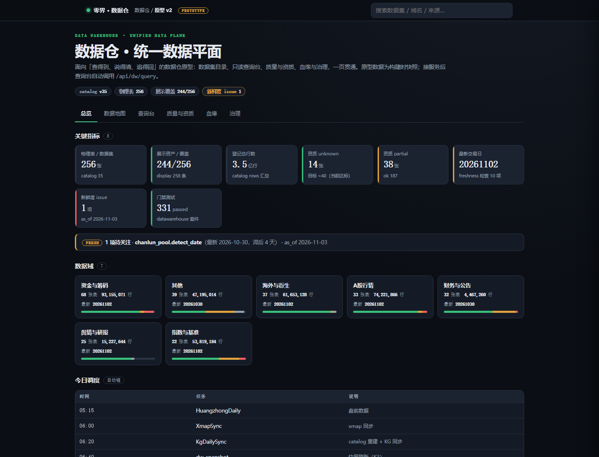

# 数据仓原型重设计 v2（2026-11-03）

> 版本：v1.2（2026-11-03 增补「手动数据入口」「军团 × Hermes」）｜定位：**产品原型（可交互）**，独立于生产页；不改动 `/dw.html`，待评审后再走 11-05/后续窗口切换。
> 产物：设计文档 + 可交互原型 + 构建器 + 校验器（全部入库）。
> 预览：`http://127.0.0.1:8734/static/dw_v2.html`（8734 登录态内；本机也可直接打开文件）



## 一、为什么重设计

旧 `/dw.html` 是「驾驶舱视角」：KPI + 来源清单 + 主题堆叠，解决「看总量」；但数据仓真实工作流是四件事：
**找得到数据 → 查得动数据 → 说得清质量 → 追得回血缘/治理**。旧页没有查询台、没有数据集下钻、质量与资质混在统计里、血缘/治理只有静态列表，导致：
- 研究员拿不到「这个表最新到哪天、能不能信、怎么查」；
- 运维看到数字但无法一键定位到表/证据；
- Agent 缺少稳定的「机器可读契约 + 人类可读入口」对应关系。

## 二、设计目标（验收口径）

1. **一页贯通**：总览→地图→查询→手动录入→质量→军团×Hermes→治理与血缘，7 个视图，两层导航（顶栏 + 页内 tab），不超 7 入口；
2. **数据可信可见**：每张表展示 行数 / 最新业务日 / 资质（ok/partial/unknown/deprecated）/ display 覆盖 / 证据摘要；
3. **查询零门槛**：数据地图点表 → 自动带入查询台；查询台支持 since/where/limit/count/order，带 API URL 一键复制；
4. **质量 fail-visible**：新鲜度 issue、KPI、验收状态直接进总览与质量页；
5. **可离线预览**：原型内嵌构建时快照，无后端也能完整演示；接服务后自动切换真实 `/api/dw/query`；
6. **合规**：只读、无外部 URL 依赖、无密钥、不写生产数据。

## 三、信息架构

```
顶栏：品牌 · 面包屑(数据仓/原型 v2) · PROTOTYPE · 全局搜索
Hero：标题/说明/状态 chips（catalog 版本、物理表、display 覆盖、新鲜度 issue）
Tabs（6）：
 ① 总览       KPI 卡（8）+ 新鲜度横幅 + 数据域卡（7）+ 今日调度链
 ② 数据地图   搜索/数据域/资质/频率筛选 + 可排序表（256 表）+ 行下钻抽屉
 ③ 查询台     参数表单（dataset/since/where/limit/count/order）+ 结果信封 + 示例
 ④ 手动录入   文件导入 / 手工行录入 / 新建数据集登记 / staging 队列（详见 §十一）
 ⑤ 质量与资质 资质分布条 + 查询覆盖 + 新鲜度 issue 表 + 验收状态
 ⑥ 军团×Hermes 组织架构/在线/在办/进度/数据仓分工/Hermes MCP（详见 §十二）
 ⑦ 治理与血缘  治理原则/待办/L2 + 端到端血缘链路 + 节点边统计
```

## 四、数据契约（原型读取，只读）

| 来源 | 用途 | 关键字段 |
|---|---|---|
| `quant_backtest/data/catalog.json` | 物理表目录/行数/最新日/频率/日期列/store | `tables[asset_id]` |
| `quant_backtest/data/warehouse_registry.json` | 资质/证据/display 资产/channel | `physical_tables`、`display_assets` |
| `portal/static/dw_snapshot.json` | 在办任务/治理/驾驶舱 | `tasks.doing`、`governance` |
| `tools/datawarehouse/freshness_report.py` | 新鲜度 issue | `checks[]` |
| `research/reports/kpi_baseline_*.json` | KPI 快照 | `kpis` |
| 实时（P1） | `GET/POST /api/dw/query` | `id/since/where/order/limit/offset/count/columns`，三态信封 `state/query_state/as_of` |

**口径纪律**：
- 「最新交易日」= `trade_date` 且 ≤ 最近已收盘日（<15:30 不计当日）；不把 `cal_date`/未来 `end_date` 混入；
- 资质 unknown ≠ 通过；display 覆盖 = display_assets 关联物理表去重 / catalog 表数；
- 查询台不构成投资建议。

## 五、原型实现

| 文件 | 说明 |
|---|---|
| `portal/static/dw_v2.template.html` | 原型模板（HTML/CSS/JS，设计系统变量 + 离线兜底） |
| `tools/build_dw_prototype.py` | 构建器：聚合 catalog/registry/snapshot/freshness → 生成页面与数据 |
| `portal/static/dw_v2.html` | 生成物（自包含，内嵌 `DW_DATA`，200KB） |
| `portal/static/dw_v2_data.json` | 同源数据快照（184KB，供复用/审计） |
| `tools/check_dw_prototype.py` | 校验器：必需元素/6 视图/设计系统依赖/无外部 URL/数据下限 |

构建命令：
```powershell
cd C:\项目\老田的AI助手
& 'C:\项目\py312\python.exe' -X utf8 tools/build_dw_prototype.py --check
```
输出：`OK pages=256 domains=7 ... check PASS`。

## 六、交互规格（关键）

1. **全局搜索**：回车 → 跳到数据地图并按关键词过滤；
2. **数据地图**：筛选联动（域/资质/频率/搜索）；表头排序（行数/最新日等）；行点击打开右侧抽屉，展示证据、store、display 覆盖，并提供「在查询台打开 / 复制查询 URL」；
3. **查询台**：dataset 自动补全（datalist）；示例胶囊一键填充；提交时构造 `/api/dw/query`；离线时显示本地快照信封并提示；支持复制 API URL；
4. **质量页**：资质分布堆叠条 + 图例；新鲜度 issue 表；验收状态（pass/pending）；
5. **键盘/可用性**：tab 支持 ←/→ 切换；抽屉 Esc 关闭；`aria-selected/aria-controls`；`focus-visible` 描边；移动端断点 720/820px；
6. **状态色**：ok=绿 / partial=黄 / unknown=红 / deprecated=灰；与 tokens.css 一致。

## 七、与生产/11-05 的关系

- **原型独立**：`/static/dw_v2.html` 已通过 nginx 静态访问（200），不影响 `/dw.html`；
- **不替换生产**：11-05 窗口仍按原计划替换旧 `/dw.html`（当前新页），原型待评审后再决定是否升级为 v2；
- **升级路径**：
  - P1：把查询台切到真实 `/api/dw/query`（已具备，无需改页面结构）；补充 `/api/dw/lineage`、`/api/dw/qualification` 下钻；
  - P2：权限/审计/导出/告警订阅；表格虚拟滚动（>400 行）；
- **回滚**：删除 `portal/static/dw_v2.*` + 两个 tools 即可，零生产影响。

## 八、验收清单

| # | 项 | 判据 |
|---|---|---|
| 1 | 结构 | 6 tab / 必需元素齐全（checker PASS） |
| 2 | 数据 | 256 物理表、7 数据域、KPI 8 卡、查询示例 4 个 |
| 3 | 可信 | 每表展示资质/最新日/行数；unknown 样本可见 |
| 4 | 查询 | 表单→URL→（离线）信封；接服务后真实返回 |
| 5 | 依赖 | tokens.css + nav.js；无外部 http 资源 |
| 6 | 合规 | 只读；无密钥；不改 catalog/数据 |
| 7 | 可维护 | 构建器一条命令重建；校验器进 CI 可选 |

## 九、风险与后续

| 风险 | 缓解 |
|---|---|
| 内嵌数据体积随表增长（>400KB） | 超出时切 `dw_v2_data.json` + fetch（同目录，无跨域） |
| 查询台依赖登录态 | 8734 同源 cookie；开发期可直连 8091 |
| 血缘/治理仍为静态汇总 | P1 接入 lineage/qualification API 后下钻 |
| 与生产新页并存 | 原型独立文件，不链入主导航，评审后再决定切换 |

## 十、证据

- 构建/校验：`python tools/build_dw_prototype.py --check` → PASS（256 表 / 7 域 / 6 视图 / 0 外部 URL）
- 截图：`deliverables/2026-11-03_dw_v2_原型截图.png`（总览 1440×1100）
- 访问：`http://127.0.0.1:8734/static/dw_v2.html`（200，205KB）

## 十一、手动数据入口（v1.1 增补）

### 11.1 为什么需要
自动同步覆盖接口/爬虫/文件导入，但以下数据天然需要人工介入：外部行业数据（PDF/Excel）、渠道专员数据、临时补数、手工标注/映射、新建测试数据集。没有手动入口就会退化成「脚本+口头+网盘」，无法审计、无法追溯、无法保证口径。

### 11.2 四个入口（原型已实现交互）
| # | 入口 | 能力 | 校验 |
|---|---|---|---|
| ① | **文件导入** | CSV/TSV/JSON/JSONL 本地解析预览；xlsx/parquet 交服务端解析；指定目标数据集、append/staging_replace、落层 raw/clean/mart | 文件大小、扩展名白名单、schema 列匹配、主键/日期列、重复行、编码 |
| ② | **手工行录入** | 选数据集 → 按 registry `business_columns` 生成表格 → 增删行 → 提交 | 目标必填、≥1 行、主键/日期非空、类型/枚举 |
| ③ | **新建数据集登记** | dataset_id、名称、来源、频率、主键、日期列、说明/血缘 | id 命名规则、必填、重复 id、与 catalog 冲突 |
| ④ | **staging 队列** | 本次会话提交记录（类型/目标/行数/状态），撤销、导出 JSON；审计字段随附 | 未审核前不写主仓 |

### 11.3 治理链路（硬约束）
```
上传/录入 → 暂存 data/staging/manual/<yyyymmdd>/<entry_id>/
        → 校验（schema/类型/主键/日期/去重/大小/编码）→ quarantine 或通过
        → 审核（DATA1 + DSH-Lead；涉及生产写回走 L2 五要素）
        → 写回（raw/clean/mart 指定层，append/覆盖，仅追加审计日志）
        → 取证（行数/最新日/manifest/证据）→ 资质 unknown→ok/partial
        → 血缘登记（来源文件 sha256 + 提交人 + 审核人）
```
- **不直接写主仓**：手动入口只落 staging；写回动作必须有审核记录与回滚点；
- **审计字段**：`submitted_by / submitted_at / source(filename,size,sha256) / rows / target_dataset / mode / layer / review{reviewer,reviewed_at,decision}`；
- **安全**：扩展名白名单、≤5MB 前端预览上限、服务端大小/行数上限、禁止可执行/脚本、文件哈希去重、内容不打印敏感字段。

### 11.4 staging 目录与数据模型
```
data/staging/manual/
└── 20261103/
    └── MAN-20261103061200-123/
        ├── payload.csv|tsv|json
        ├── manifest.json      # 提交元数据 + sha256 + rows + audit
        └── validation.json    # 校验结果/错误列表/样本
```
`manual_entries`（建议 sqlite/表）：`entry_id, kind, target_dataset, mode, layer, rows, columns, status(staged/validated/approved/rejected), submitted_by, submitted_at, source_json, manifest_sha256, reviewer, reviewed_at, write_result`。

### 11.5 API 契约（P1 实现，不在本次原型后端）
| 方法 | 路径 | 说明 |
|---|---|---|
| POST | `/api/dw/manual/ingest` | 上传/登记 → staging；返回 `entry_id,status`；只写 staging |
| GET | `/api/dw/manual/entries?status=&limit=` | 队列查询（分页） |
| GET | `/api/dw/manual/entries/{entry_id}` | 详情 + 校验结果 + 审计 |
| POST | `/api/dw/manual/validate` | 重新校验（幂等） |
| POST | `/api/dw/manual/approve` | 审核通过 → 触发写回任务（L2） |
| POST | `/api/dw/manual/reject` | 驳回 + 原因 |
| GET | `/api/dw/manual/template?dataset=` | 下载录入模板（列名/示例） |

请求示例：
```json
POST /api/dw/manual/ingest
{
  "kind": "file_import",
  "target_dataset": "ts_daily",
  "mode": "append",
  "layer": "raw",
  "source": {"filename": "industry_202611.csv", "sha256": "…"},
  "payload_path": "data/staging/manual/20261103/MAN-…/payload.csv"
}
```
响应统一三态信封：`{"ok":true,"state":"staged","entry_id":"MAN-…","as_of":"2026-11-03","audit":{…}}`；错误 `bad_param/too_large/unsupported_type/conflict` 4xx，不吞错。

### 11.6 原型现状与升级
- **已实现（前端原型）**：四入口交互、本地文件解析预览、行编辑、登记校验、staging 队列（localStorage）、导出 JSON、API 契约展示；**不落库**；
- **P1（评审通过后）**：后端 staging/审核/写回 + 队列页 + 审计；依赖 11-05 后 portal 重启窗口；写回动作按 L2 审批；
- **P2**：模板下载、Excel 解析、大文件分片、审核通知（飞书卡片）、批量导入、字段映射器；
- **回滚**：原型仅前端文件；后端未上线前零生产影响。

### 11.7 手动入口验收清单
| # | 判据 |
|---|---|
| 1 | 四入口可交互，未提交时无副作用 |
| 2 | 文件解析预览行数/列数与本地一致（CSV/JSON 抽样） |
| 3 | 缺目标/空行/非法 dataset_id 有明确提示 |
| 4 | 提交进入 staging 队列，带 entry_id/提交人/时间/状态 |
| 5 | 队列可撤销、可导出 staging JSON（含 API 契约） |
| 6 | 页面明确「不直接写主仓、需审核」 |

## 十二、军团 × Hermes 组织视图（v1.2 增补）

### 12.1 目标
老田要求「结合 Hermes 以及军团组织架构，看分工、是否在线、正在干什么、进度」。数据仓不只是数据目录，还要回答**谁负责、在不在、忙什么、到哪了**。

### 12.2 数据源（构建时实时拉取，失败降级）
| 来源 | 端点/文件 | 用途 |
|---|---|---|
| 军团指挥台 | `http://127.0.0.1:8796/api/snapshot` | 17 部门、77 agents、主官、activity、schedules |
| 军团意图卡 | `http://127.0.0.1:8796/api/intent` | seats 69、doing/review/done/aborted、lead 签署、L2 在办 |
| 作战大屏 API | `http://127.0.0.1:8096/api/legion/ops` | roster 78（state 在线态）、feed 活动、tasks |
| 席位心跳 | `agent_platform/data/seat_heartbeat/history.jsonl` | 最近心跳时间/在岗席位数（当前 12/12，但快照 20.6h 前） |
| Hermes MCP | `http://127.0.0.1:8787/api/mcp/servers`、`/api/mcp/tools` | 13 servers、tools 数、`reload_required`、unavailable_servers |

### 12.3 页面内容
1. **组织总览**：部门 17 / 席位 69、在线席位（roster state）、在办/评审、累计完成、Hermes servers/tools、心跳在岗；
2. **部门分工**：17 部门卡片（名称/主官/编制/在办/status），点击过滤席位表；
3. **席位状态表**：席位/姓名/部门/角色/是否在线/正在干什么（最近 feed 动作），支持搜索+部门+状态筛选；
4. **在办任务 + 最近活动**：intent/tasks（doing/review）+ 40 条 activity feed（谁在催办/派单）；
5. **数据仓分工映射**：6 条数据域 ↔ 责任席位 ↔ 状态/进度（接口数据→DATA2、质量→DATA3、治理→DATA1、API/前端→DEV1、学习→ACAD1、调度→A0A）；
6. **进度总览**：完成/在办/评审/中止堆叠条 + lead 签署率 + 数据仓 KPI 9/10、S3 83.3%；
7. **Hermes MCP**：13 servers 明细（transport/active/tools）、tools=0 且 `reload_required=true` 的告警提示（期望约 98 tools，需 `/reload-mcp`）；
8. **军团排程**：3 条 cron（盘前 weak 池、每日复盘三问、每周军团周报）。

### 12.4 实测状态（2026-11-03 06:00 构建时）
| 项 | 值 |
|---|---|
| 部门 / 编制 | 17 / 78（含 chief A0） |
| roster 在线 | **0**（全部 idle） |
| 在办 / 评审 | **2 / 1**（K-STOCK-ANALYSIS-P2-8/P2-9） |
| 累计完成 / 中止 | 1,902 / 134 |
| lead 签署 | 16 / 17 |
| 心跳快照 | 2026-11-02 09:20:22（20.6h 前，12/12 在岗） |
| Hermes | 13 servers / **0 tools**（`reload_required=true`，13 servers unavailable） |

> 观察：当前**无 active 席位**、大量 agent 无任务（feed 中多部门被 A0/QA1 催办「无任务活动、0 单超期」）；数据仓在办集中在 **DSH-Lead**；Hermes 工具清单为空，需要在 11-05 窗口 `/reload-mcp` 恢复 98 工具。

### 12.5 口径与升级
- 「在线」= roster `state != idle`；心跳快照仅表示最近一次探测在岗（有滞后，不替代实时状态）；
- 「正在干什么」= 最近一条 feed 动作；`L2_doing` 为意图卡在办项（当前 cards 在办=0，与 tasks 的 doing 有口径差，页面并列展示不合并）；
- P1：接入 `/api/legion/agent/<id>` 明细、席位心跳实时化、点击工单跳军团指挥台；
- P2：把 Hermes 工具数/失败率纳入质量页；在线异常告警。
