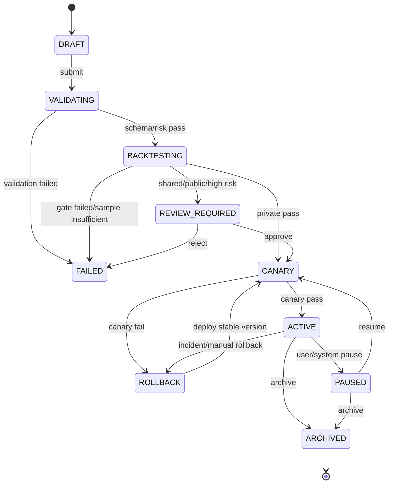

# 个性化盯盘 Agent 商业化规格 v1.0

- **状态**：定盘设计，进入 P0 实施拆分
- **适用市场**：首发中国 A 股（CN）；其他市场通过 market policy 扩展
- **核心能力**：在统一、不可绕过的量化盯盘底座上，为每位客户生成可验证、可审计、可回放的个人化盯盘 Agent
- **默认执行模式**：`recommendation_only`，只生成事实、候选信号、风险计划和告警，不自动下单

> 本规格定义的是产品与工程边界，不构成收益承诺或个性化投资建议。所有性能指标必须以指定数据快照、评价 horizon、标签定义和回测报告为准。

## 1. 定盘结论

未来商业化不应让客户从零编写策略，也不应让 LLM 直接改变交易底层规则。正确形态是：

```text
统一确定性底座
  + 客户画像与风险边界
  + 声明式参数配置
  + 对话式生成配置草案
  + 时间前向回测与门禁
  + 用户确认后发布个人 Agent
```

个人 Agent 的职责是选择和组合底座能力：

- 选择投资周期：日内、短线、波段、中线/长线；
- 选择策略能力：趋势、回踩、突破、事件、情绪等；
- 设置风险预算、确认方式、告警节奏和关注股票池；
- 按底座的真实成交制度输出可执行性判断。

个人 Agent **不能**修改数据时间语义、未来函数防护、A 股交易制度、平台风险硬上限、审计链和安全策略。

## 2. 三层产品架构

```text
┌──────────────────────────────────────────────┐
│  平台确定性底座 Platform Foundation           │
│  数据/as-of · 市场状态 · 方法插件 · 撮合约束 │
│  T+1 · 涨跌停 · 停牌 · 费用 · 审计 · 回放     │
└──────────────────────────────────────────────┘
                     ▲
┌──────────────────────────────────────────────┐
│  租户/套餐策略域 Tenant Policy                │
│  数据源开关 · 成员权限 · 配额 · 共享范围       │
│  仅可收紧平台约束                             │
└──────────────────────────────────────────────┘
                     ▲
┌──────────────────────────────────────────────┐
│  客户个人 Agent 域 Agent Configuration         │
│  周期 · 方法 · 标的 · 风险 · 确认 · 告警       │
│  只能声明式配置，禁止任意代码/SQL              │
└──────────────────────────────────────────────┘
```

冲突优先级固定为：

```text
平台硬约束 > 租户策略 > Agent 配置 > 单次请求
```

任何被裁剪或拒绝的参数必须返回机器可读的 `reason_code`，并写入审计记录；不得静默改变用户意图。

## 3. 不可修改边界矩阵

| 领域 | 平台底座：不可修改 | 租户管理员：可配置但只能收紧 | Agent 作者：可配置 | 运行时：只读 |
|---|---|---|---|---|
| 数据 | source_id、event_time、ingest_time、UTC、质量标记、快照和 as-of 规则 | 授权数据源开关 | 关注市场、股票池、周期 | 输入快照与质量状态 |
| 计算 | 指标公式、窗口边界、去重、幂等、反未来函数 | 可禁用某能力 | 指标参数、组合逻辑 | 指标中间值和结果 |
| 交易制度 | T+1、涨跌停、停牌、复牌、滑点、费用、部分成交 | 可收紧可成交范围 | 风险预算和执行偏好 | 成交可行性判定 |
| 风险 | 单票/总仓/行业/相关组硬上限、熔断 | 可进一步降低上限 | 止损止盈、确认方式、仓位偏好 | EffectiveRiskProfile |
| 安全 | 工具 allowlist、密钥隔离、沙箱、模型安全 | 成员权限、共享域 | 不可上传脚本、SQL、提示词覆盖 | 只读调用 |
| 告警 | 全局频率上限、关键告警不可静默 | 租户配额和渠道 | 冷却、摘要、渠道、文案偏好 | 事实、解释、投递状态 |
| 审计 | append-only、hash-chain/WORM、留存底线 | 查询权限、导出权限 | 不可删除或修改 | lineage 和审计事件 |
| 回测 | 最低样本、时间前向、反泄漏、覆盖率 | 可提高门槛 | 时间窗、标的、评价 horizon | 报告与回放 |

LLM 仅可做三件事：

1. 将自然语言解析为声明式配置草案；
2. 对已经确定的事实进行归纳和解释；
3. 在冲突或数据不完整时进行排序和说明。

LLM 不得改变触发事实、补造缺失数据、绕过门禁，或输出未被输入支持的事实。

## 4. 客户画像与 EffectiveRiskProfile

心理承受能力不能直接等同为“止损百分比”。系统应将其转换为可验证的约束：单笔亏损、日亏损、组合回撤、连续亏损、隔夜跳空风险、持仓周期和告警负担。

### 4.1 请求画像

```yaml
profile_version: 1
risk_tolerance: conservative | balanced | aggressive
horizon: intraday | swing | position | long_term
capital_base:
  currency: CNY
  amount: 100000
loss_budget:
  max_loss_per_trade_pct: 0.005
  max_daily_loss_pct: 0.015
  max_portfolio_drawdown_pct: 0.08
exit:
  stop:
    mode: fixed_pct | atr | thesis
    pct: 0.03
    atr_multiple: 1.5
  take_profit:
    mode: fixed_pct | rr | atr
    pct: null
    rr: 2.0
  trailing:
    enabled: true
    activate_profit_pct: 0.04
    trail_pct: 0.02
  time_stop:
    max_hold_trading_days: 20
position:
  max_single_pct: 0.10
  max_total_pct: 0.50
  max_sector_pct: 0.25
  max_correlated_pct: 0.25
alerts:
  critical: immediate
  warning_interval_min: 30
  digest_interval_min: 240
  cooldown_min: 30
  max_per_day: 30
confirmation:
  mode: confirm_entry | confirm_all | recommendation_only
  timeout_sec: 900
  protective_exit_auto: true
execution:
  mode: alert_only | candidate | paper_trade
market_overrides:
  CN:
    t_plus_one: true
    price_limit_policy: platform
```

所有比例内部使用 `Decimal` 存储为 `[0, 1]`，API 展示为百分比。多头 fixed stop 的语义为 `stop = entry * (1 - pct)`，take profit 为 `entry * (1 + pct)`。

### 4.2 默认风险基线

| 风险档位 | 单笔最大亏损 | 日损失上限 | 组合回撤上限 | 单票上限 | 最低 RR | 默认确认 |
|---|---:|---:|---:|---:|---:|---|
| conservative | 0.5% | 1.5% | 8% | 5%（受平台上限） | 2.0 | confirm_all |
| balanced | 1.0% | 3% | 15% | 10%（受平台上限） | 1.8 | confirm_entry |
| aggressive | 1.5% | 5% | 25% | 20%（仍受平台上限） | 1.5 | auto* |

`auto*` 在 v1.0 只表示自动生成候选/模拟动作，不代表开放实盘自动下单。平台默认执行模式仍为 `recommendation_only`。

周期基线：

| 周期 | 持有期 | 止损参考 | 告警节奏 |
|---|---|---|---|
| intraday | 最多 1 个交易日 | 0.8%–2% 或波动率下限 | 触发即时 |
| swing | 2–20 个交易日 | 3%–7% 或结构/ATR | 15–30 分钟 |
| position | 21–120 个交易日 | 6%–12% 或 thesis | 日内关键变化 |
| long_term | 120 日以上 | thesis/time-stop + trailing | 日终/重大事件 |

ATR 导致止损距离变宽时，优先缩小仓位，不得突破单笔亏损预算。

## 5. 风险计算与冲突校验

核心计算：

```text
stop_pct = abs(entry - stop) / entry
position_pct <= min(
  max_single_pct,
  max_loss_per_trade_pct / stop_pct,
  remaining_total_headroom,
  sector_headroom,
  correlation_headroom
)
risk_amount = capital * position_pct * stop_pct
```

必须实现的 `reason_code`：

| code | 规则 |
|---|---|
| RISK_001 | 仓位 × 止损超过单笔风险预算：降仓或拒绝 |
| RISK_002 | take profit 小于 stop × min RR：拒绝 |
| RISK_003 | 多头价格顺序错误：必须 `stop < entry < tp` |
| RISK_004 | 单票、总仓、行业或相关组超过上限：拒绝 |
| RISK_005 | horizon 与 max_hold 不一致：警告/需确认 |
| RISK_006 | 止损小于市场噪声或 ATR 下限：缩仓并警告 |
| RISK_007 | 线上禁用保护性退出：拒绝 |
| RISK_008 | cooldown 小于渠道最低间隔：返回渠道下限并告警 |
| RISK_009 | recommendation_only 模式禁止实际下单 |
| RISK_010 | confirm_all 超时：取消入场，保护性退出仍有效 |
| RISK_011 | 组合风险达到预算 80%：新仓位乘 0.5；达到 100%：暂停开仓 |
| RISK_012 | CN T+1/涨跌停导致退出不可即时成交：提示计划退出，不得伪报已成交 |

输出必须保留：

```json
{
  "requested_profile": {},
  "effective_profile": {},
  "violations": [],
  "warnings": [],
  "decision_trace": [],
  "config_version": "..."
}
```

## 6. 四类默认 Agent 模板

### 6.1 `cn_intraday_reactive`

- 关注：15m/60m 盘中结构、量价突变、突破后确认；
- 适合：短持仓、能频繁接收告警的客户；
- 默认确认：两根 15m K 线或人工确认；
- 默认执行：候选信号，不自动下单；
- 强制风险：T+1 和涨跌停可行性提示，禁止把盘中信号描述成已成交。

### 6.2 `cn_swing_pullback`

- 关注：日线趋势 + 60m MACD/结构回踩；
- 底座能力：`dual_tf_pullback` / `pullback_resonance_cn`；
- 默认持有：2–20 个交易日；
- 默认确认：入场两根 60m K 线；
- 默认退出：结构低点、MA20/EMA20、1.8–2.0R 分段止盈；
- 这是首发商业化模板，直接复用当前标准化能力。

### 6.3 `cn_position_trend`

- 关注：日线/周线趋势、MA20/MA60、市场状态；
- 适合：不希望高频盯盘的客户；
- 默认告警：日终摘要 + 趋势破坏即时告警；
- 默认退出：趋势状态转坏、连续收盘跌破、时间止损；
- 不使用短周期噪声作为强制入场条件。

### 6.4 `cn_long_term_thesis`

- 关注：长期趋势、基本面/公告事件（若数据授权）、组合集中度；
- 适合：低频查看、接受较长持有期的客户；
- 默认止损：thesis/time-stop + trailing，不用短周期固定百分比误杀；
- 重大事件、数据失真和置信度下降仍为 critical 告警。

模板本质是配置预设，不是四套独立交易系统。所有模板必须经过同一数据、撮合、风险和审计底座。

## 7. 对话生成 Agent 流程

```text
用户自然语言
  → 意图/画像解析
  → 声明式配置草案
  → JSON Schema 校验
  → 风险冲突检查
  → 固定数据快照回测
  → 生成解释卡片和门禁报告
  → 用户确认
  → 创建不可变版本
  → CANARY 灰度
  → ACTIVE
  → 线上监控与 T+5/T+10/T+20 复盘
```

示例：

> “我偏中线，不能接受单笔亏损超过账户 1%，可以接受两周持仓，不想频繁提醒。”

系统应生成草案：

```yaml
horizon: swing
risk_tolerance: balanced
loss_budget:
  max_loss_per_trade_pct: 0.01
exit:
  time_stop:
    max_hold_trading_days: 14
alerts:
  mode: daily_plus_trigger
  warning_interval_min: 240
confirmation:
  mode: confirm_entry
execution:
  mode: recommendation_only
```

生成后必须明确展示：原始诉求、解析结果、被平台约束裁剪的字段、回测样本、风险结果、不可宣称项和待确认项。

## 8. Agent 生命周期与版本化

### 8.1 状态机



允许的核心状态：`DRAFT`、`VALIDATING`、`BACKTESTING`、`REVIEW_REQUIRED`、`CANARY`、`ACTIVE`、`PAUSED`、`ROLLBACK`、`ARCHIVED`、`FAILED`。

### 8.2 不可变版本

- `Agent`：稳定业务身份、租户、所有者、当前发布版本和配额；
- `AgentVersion`：规范化配置、配置哈希、父版本、schema/engine/model/data snapshot 版本、门禁报告；
- 草稿可编辑；进入校验后冻结；发布版不可原地修改；
- 任意改动创建新 patch/minor/major 版本；回滚也是新发布事件，不修改旧版本；
- 使用规范化 JSON 后 SHA-256 哈希，忽略字段顺序；并发更新使用 optimistic locking。

核心实体：

```text
Agent 1──N AgentVersion
AgentVersion 1──N ValidationRun
AgentVersion 1──N BacktestReport
AgentVersion 1──N Release
Release 1──N CanaryMetric
AgentVersion 1──N AlertEvent
AlertEvent 1──N NotificationAttempt
AlertEvent 1──1 LineageRecord
所有实体 1──N AuditEvent
```

## 9. 回测与发布门禁

门槛是 platform policy，按市场和周期配置；用户只能提高，不能降低。若没有可靠标签或 horizon，报告必须标记“样本不足/不可宣称预测能力”。

### A. 数据与反泄漏（必须通过）

- 时间前向切分；泄漏检测为 0；
- 默认评估窗口至少 90 个自然日或 1,000 个有效 bar，取更严格者；
- 至少 30 个正例/候选事件，否则为样本不足；
- 有效数据覆盖率 ≥99%；
- 时间戳、复权、停牌、休市、涨跌停、T+1 和费用异常必须有解释。

### B. 触发质量（建议基线，不是跨市场承诺）

- precision ≥60%、recall ≥50%，或相对朴素基线 lift ≥1.5；
- 误报默认不超过 3 条/标的/日；
- 至少 2/3 子区间通过；最差子区间相对总体下降不超过 30%；
- 与父版本使用相同快照对比，报告增益和回归。

### C. 线上与解释

- p95 告警延迟目标 ≤60 秒，按供应商 SLA 调整；
- 通知成功率目标 ≥99%；
- 解释不得新增输入未支持的事实；抽样来源/数值一致性 ≥95%；重大合规错误为 0；
- 解释失败时保留触发事实，降级为模板化摘要。

### D. 灰度

- 至少 24 小时或 100 条候选事件；
- 数据完整性低于 99%、来源失效、误报较基线增加 50%、延迟超过 SLA 两倍、合规违规或超预算时自动暂停并回滚。

## 10. 审计与告警血缘

每条告警必须能回答：哪个 Agent、哪个版本、何时、使用何源数据、哪个公式、哪些中间值、为何触发、解释由哪个模型生成、发到哪里、是否成功。

`AlertEvent` 至少记录：

```json
{
  "agent_id": "...",
  "version_id": "...",
  "config_hash": "...",
  "input_snapshot_id": "...",
  "signal_ts": "...",
  "facts": {},
  "gates": {},
  "intermediate_values": {},
  "formula_version": "...",
  "model_version": "...",
  "source_refs": [],
  "explanation": {},
  "lineage_hash": "..."
}
```

审计事件覆盖：创建、编辑、校验、回测、审批、发布、暂停、恢复、回滚、归档、触发、解释、发送、失败、重试、配额变更。审计为 append-only，用户暂停/删除 Agent 不得删除证据。

## 11. 商业化套餐

套餐只改变配额、渠道和模型成本，不改变安全、数据、交易制度、审计和最低门禁。

| 套餐 | 定位 | 典型能力 |
|---|---|---|
| Basic | 规则型引流 | 1–2 个 Agent、日线/基础告警、有限股票池、模板化解释 |
| Pro | 个性化盯盘 | 多周期、`dual_tf_pullback`、对话生成、回测报告、更多渠道和复盘 |
| Institutional | 团队/机构 | 多成员权限、共享 Agent、数据源策略、灰度审批、审计导出、独立配额 |

建议计量：活跃 Agent 数、监控标的数、行情/事件点、回测计算量、通知次数、解释模型 token 成本。所有 usage event 追加记录。

## 12. P0/P1 实施拆分

### P0-T01：基础设施与契约

- 配置 JSON Schema、枚举、API 响应和权限中间件；
- 建立数据库迁移基线；
- 固化平台 policy、market policy 和 reason_code。

### P0-T02：配置与不可变版本

- Agent/AgentVersion/Quota；
- 声明式 CRUD、规范化哈希、diff、optimistic locking；
- 生命周期状态机和 requested/effective profile。

### P0-T03：校验、回测与门禁

- 固定数据快照和时间前向回放；
- 接入现有 `dual_tf_pullback`、真实 CN 日线+60m 数据；
- 接入涨跌停、停牌、T+1、跳空止损、动态费用和不可成交统计；
- 输出 backtest report 与 replay API。

### P0-T04：发布、运行、通知与 lineage

- Release/Canary、发布/暂停/恢复/回滚；
- `AlertEvent`、`NotificationAttempt`、事实型解释、渠道适配；
- 全局限频、熔断和降级。

### P1-T05：审计、计量与管理 UI

- AuditEvent/LineageRecord hash-chain；
- 版本历史、diff、门禁报告、审计导出；
- 套餐配额、usage event、个人/团队/公开发布域。

## 13. 与现有 zhice-os-v2 的兼容约束

1. `default_registry()` 永远保持旧 7 方法；
2. `create_cn_registry()` 承载 `dual_tf_pullback` 和后续 CN 能力；
3. `pullback_resonance_cn` 继续作为首发个人 Agent 的底座能力；
4. `MethodVote` 保持兼容，候选信号继续使用 `direction="HOLD"` + `params_snapshot.action="BUY_CANDIDATE"`；
5. 所有线上和回测调用继续使用 `signal_ts`、`as_of_ts` 和已闭合 K 线；
6. 个性化层只传入经过校验的声明式参数，不改变方法插件的时间边界和交易制度；
7. 每个个人 Agent 的回测、告警和复盘必须可关联到能力版本、配置哈希和数据快照。

## 14. 首发验收标准

- 能通过问卷或自然语言生成 `cn_swing_pullback` 草案；
- 能生成 requested/effective 风险画像，并对冲突返回 reason_code；
- 能在固定 CN 数据快照上完成时间前向回测；
- 能真实统计涨跌停、停牌、T+1、跳空止损、费用和不可成交率；
- 能通过用户确认发布不可变版本；
- 能在 CANARY 期间自动检测数据质量、误报、延迟和成本异常；
- 任一告警可回放到输入快照、指标公式、方法票、解释和投递状态；
- 默认旧 registry 和旧回测全部不回归；
- 在无可靠标签/样本不足时明确输出“不可宣称预测能力”，不得包装为收益承诺。

## 15. 最终产品口号

> **统一底座保证真实与安全，个人 Agent 负责适配每个人的盯盘方式。**
