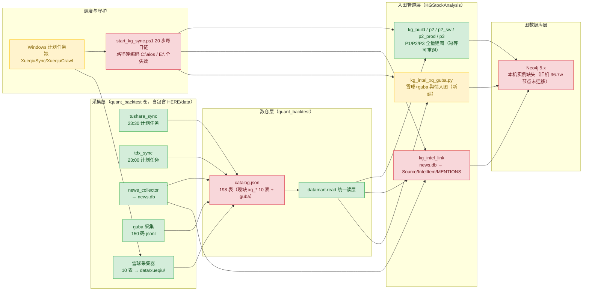
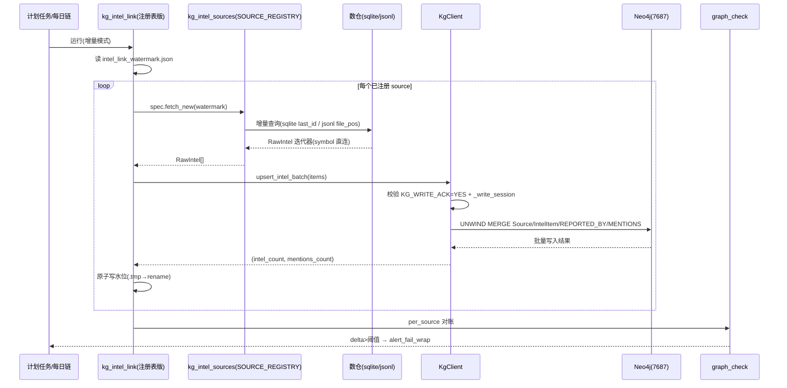

# 采集数据 → 数仓 → Neo4j 图数据库 存储方案设计

> 版本：v1.0 ｜ 日期：2026-10-16 ｜ 作者：Gao（架构师）
> 状态：待主理人裁决"待明确事项"后定稿
> 上游输入：Explore 侦察结论（已核验）+ 主理人裁决 D1~D4

---

## 0. 背景与范围

用户需求（原话）："这些数据回来都要进数仓，然后需要按图谱的方式去存，图数据库的方式去存。"

**范围**：
- 采集端数据（tushare/tdx/news/guba/雪球采集器）接入 catalog 数仓
- 舆情类数据（雪球 xq_status/xq_hot_post/xq_comment + guba）按既有 news.db 范本入图
- 每日链在本机换机中间态下修复，做到"本机能跑"（P0）
- 旧机 Neo4j 资产（36.7 万节点/128.3 万边）恢复路径（P1）

**非范围**：行情类雪球表建节点（D3 裁决不入图）；新增本体大扩展（D4 裁决走三件套，本文仅给立项材料）。

---

## 1. 总体架构

### 1.1 数据流总图（绿=现有可用 / 黄=需新建 / 红=需修复）



### 1.2 架构要点

1. **单一数据根原则（D1 落地）**：雪球数据物理落在 `quant_backtest/data/xueqiu/`，catalog 注册后，KGStockAnalysis 侧一律经 `datamart.read` 只读消费，不复制数据、不做第二套采集。
2. **入图只是数仓的一个"物化视图"**：沿既有决策（BENCHMARK_OF 先例）——证据节点只存 `data_source + data_version` 指针，正文留在数仓/原文库，图里不复制。
3. **双根中间态**：KGStockAnalysis 的 KGDataRoot 新根（`C:/项目/KGDataRoot`）是空壳，本机中间态引入环境变量 `KG_DATA_ROOT_FALLBACK` 指向 `C:/项目/老田的AI助手/quant_backtest/data`，`kg_launcher_common.build_env` 在 `KG_DATA_ROOT` 目录缺 `catalog.json` 时降级到 fallback（fail-closed 逻辑保留：两处都无 catalog 才报错）。
4. **舆情入图是本期唯一图 schema 扩展**：仅扩展既有 `Source` 的 `data_source` 取值枚举 + 既有 `IntelItem/REPORTED_BY/MENTIONS` 复用，**不新增实体/关系类型**，规避 KG_CLOSEOUT 冻结条款（无需新 Phase 立项即可实施；xq_earningforecast 的图映射作为三件套候补另立项）。

---

## 2. Neo4j 实例重建方案

### 2.1 两选项对比

| 维度 | 选项 A：旧机卷拷回 | 选项 B：catalog 全量重跑 P1/P2/P3 |
|---|---|---|
| 资产保全 | ✅ 367,256 节点 / 1,283,086 边原样保留 | ⚠️ P1/P2/P3 实体+关系可重建；**IntelItem 11,925 / Hypothesis 1720 active / Assessment 等推理层资产不可重建**（依赖 LLM 产物与人工输入） |
| 数据新鲜度 | 需补 2026-09-30 之后每日增量（每日链修复后自动追平） | 基线即最新 |
| 可行性 | 依赖旧机可访问（待用户确认） | catalog 本机今日仍更新、管道幂等可重跑，**本机立即可行** |
| 工期 | 卷拷回+启动 ≈ 半天（不含增量追平） | 全量重跑 ≈ 数小时（UNWIND 批量） |
| 风险 | 卷版本与 neo4j:5 兼容性；传输中断 | 推理层永久丢失（若旧机最终不可用） |

### 2.2 推荐：两阶段融合（B 起步 + A 择机并入）

- **阶段 0（本机，P0）**：立即 `docker run` 一个 neo4j:5 实例，从 catalog 全量重跑 P1/P2/P3 建基线，随后雪球/guba 舆情增量入图 → 本机链路当天跑通。
- **阶段 1（P1，待用户）**：若旧机卷可拷回 → 用拷回实例做**主库**（保推理层资产），在其上重放阶段 0 的增量（MERGE 幂等保证可安全重放）；本机阶段 0 实例降级为验证环境。若旧机不可用 → 阶段 0 实例转正，推理层资产接受重建损失并记录。
- **合并安全性**：所有写入均为 MERGE 幂等 + 边五元组（validStart/validEnd），两库 replay 同一份 ETL 输出可收敛到一致状态，无双写冲突。

### 2.3 端口选型

**推荐沿用 7687/7474**，理由：
- `kg_schema.py` 硬编码 `bolt://localhost:7687`，10 个增量写入器生态默认 7687，改端口的连带改动远大于收益；
- zerobound 栈的 17687/17474 自注"尚未经真实部署验证"，且 zerobound 是独立商业栈，与本线（quant_backtest + KGStockAnalysis）无关；
- 若将来 zerobound 栈启用，它占 17687 不冲突，可共存。

行动项：`kg_schema.py` 硬编码改为 **env 优先（KG_NEO4J_URI）→ 7687 兜底**，与 KGStockAnalysis 的凭据约定对齐。

### 2.4 凭据 env 方案

```powershell
# 统一凭据约定（写入 docs/planning，launcher 与所有 ETL 共用）
KG_NEO4J_URI=bolt://localhost:7687
KG_NEO4J_USER=neo4j
KG_NEO4J_PASSWORD=<本机新设，首轮启动强制修改>
KG_WRITE_ACK=YES           # 写门，kg_client 既有约定
KG_DATA_ROOT=C:/项目/KGDataRoot
KG_DATA_ROOT_FALLBACK=C:/项目/老田的AI助手/quant_backtest/data
```

- 本机新实例**不复用**旧机密码（旧凭据已泄露风险不可控），新建后经 launcher `build_env` 注入。
- shell 级不设永久 env，全部经 launcher 注入，保持 fail-closed。

### 2.5 驱动版本对齐

**统一钉 neo4j Python driver 5.28.6**：
- 生产 20 步链全部在 5.x 下验证，6.x 存在 breaking change（API 收紧），跨大版本混跑风险不可接受；
- 行动：Py311 环境降级 `pip install neo4j==5.28.6`；`C:/项目/py312` 补装 5.28.6；`deploy/requirements.txt` 保持 5.28.6 不动；
- 6.3.1 仅留个人实验环境，禁止进入每日链依赖。

---

## 3. catalog 注册方案

### 3.1 注册对象与元数据

| 逻辑表 | 物理形态 | 路径 | 注册要点 |
|---|---|---|---|
| xq_quote_snap | parquet | data/xueqiu/xq_quote_snap/*.parquet | 行情快照，**catalog only（D3）** |
| xq_kline_d | parquet | data/xueqiu/xq_kline_d/*.parquet | 日线，catalog only（D3） |
| xq_capital_flow | parquet | data/xueqiu/xq_capital_flow/*.parquet | 资金流，catalog only（D3） |
| xq_northbound | parquet | data/xueqiu/xq_northbound/*.parquet | 北向，catalog only（D3） |
| xq_earningforecast | parquet | data/xueqiu/xq_earningforecast/*.parquet | 盈利预测，catalog only；图映射待三件套 |
| xq_hot_deal | parquet | data/xueqiu/xq_hot_deal/*.parquet | 热门交易，catalog only |
| xq_inner_trade | parquet | data/xueqiu/xq_inner_trade/*.parquet | 高管交易，catalog only |
| xq_status | sqlite | data/xueqiu/xueqiu_info.db::xq_status | 舆情，**入图**（kg_intel_xq_guba 消费） |
| xq_hot_post | sqlite | data/xueqiu/xueqiu_info.db::xq_hot_post | 舆情，**入图** |
| xq_comment | sqlite | data/xueqiu/xueqiu_info.db::xq_comment | 舆情，**入图** |
| guba_posts | jsonl | data/guba/*.jsonl（150 码） | 舆情，**入图**；按"目录=逻辑表"归并注册 |

### 3.2 build_catalog.py 扫描分支扩展（3 个新分支）

```python
# build_catalog.py 新增扫描分支（伪代码，签名）
def scan_parquet_dir(root: Path, logical_name: str) -> CatalogEntry:
    """读首个 parquet 的 schema 推断字段/行数，注册 data_format='parquet'。"""

def scan_sqlite_tables(db_path: Path, table_pattern: str) -> list[CatalogEntry]:
    """枚举 sqlite_master，按前缀过滤（xq_），每表一条 entry，
    path 记 'db文件::表名'，data_format='sqlite'。"""

def scan_jsonl_glob(root: Path, logical_name: str) -> CatalogEntry:
    """glob *.jsonl 聚合为一逻辑表，按首行 schema 推断，data_format='jsonl'，
    额外记录 file_count / total_lines。"""
```

- 推断失败（空文件/空库）→ 注册占位 entry（status='empty'），**不 fail**（与雪球采集器"首次运行才产数据"兼容）。
- 注册后跑一次 `datamart.read('xq_status')` 冒烟验证读层可达。
- catalog 版本号 +1，写入 catalog_changelog。

---

## 4. 雪球/guba → 图谱映射设计

### 4.1 逐表映射总表

| 表 | 图映射 | 实体/关系 | 说明 |
|---|---|---|---|
| xq_status | ✅ 入图 | Source(新 data_source='xueqiu') ←REPORTED_BY← IntelItem —MENTIONS→ Security | 舆情正文留在 sqlite，图存指针 |
| xq_hot_post | ✅ 入图 | 同上，Source.tier 按热度分档 | 同上 |
| xq_comment | ✅ 入图 | 同上，低 tier | 同上；量大时可只取热门评论 |
| guba_posts | ✅ 入图 | Source(data_source='guba') ←REPORTED_BY← IntelItem —MENTIONS→ Security | 东方财富股吧，symbol 从 guba 代码直接可得 |
| xq_quote_snap / xq_kline_d | ❌ 不入图（D3，沿 BENCHMARK_OF 先例） | — | catalog only |
| xq_capital_flow / xq_northbound | ❌ 不入图 | — | 时序行情类，入图不经济 |
| xq_earningforecast | ⏸ 暂不入图 | 候补：Security —[HAS_EARNFCST]→ ForecastDoc（新实体） | 需三件套立项，见 §4.4 |
| xq_hot_deal / xq_inner_trade | ⏸ 暂不入图 | 候补：Seat/Person 关联扩展 | 高管/大交易属另一 Phase 议题 |

### 4.2 舆情链映射细则（复用 news.db 范本）

**Source 节点**（证据源，一源一节点，MERGE key = source_url）：

| 属性 | xq_status | xq_hot_post | xq_comment | guba_posts |
|---|---|---|---|---|
| data_source | 'xueqiu_status' | 'xueqiu_hot' | 'xueqiu_comment' | 'guba' |
| tier | 2（社媒） | 1（热门精选，热度加权） | 3（评论） | 2（股吧，可按吧龄/粉丝加权） |
| source_url | 帖子 permalink | 帖子 permalink | 评论 permalink | 帖子 url |
| publisher | 用户昵称（哈希化可选） | 同左 | 同左 | 吧内昵称 |

**IntelItem 节点**（情报项，MERGE key = `data_source + 原文主键`）：
- 只存：`title`（或截断摘要）、`data_source`、`data_version`（采集批次日期）、`published_at`、`pointer`（sqlite 表::主键 / jsonl 文件+行号）——**正文永不落图**。
- 与 Source 建 `REPORTED_BY` 边；与 Security 建 `MENTIONS` 边（五元组带 validStart=发帖日，validEnd=9999-12-31）。

**MENTIONS 消歧（沿 news_link 既有三级，雪球更简单）**：
1. **直连**：雪球/guba 数据自带 `symbol` 字段（如 SH600519）→ 直接建边，不进模糊匹配（D2 裁决的核心红利）；
2. symbol 缺失时 → 回退精确名匹配 → cnspell 词边界匹配（复用 `kg_intel_link` 现有函数，不重写）。

**置信度**：舆情不进置信度字段（铁律：置信度只进推理层）。

### 4.3 kg_intel_link 的 data_source 分支化改造

现脚本与 news.db 强耦合。改造为**源注册表模式**（不改图 schema，只改管道代码）：

```python
@dataclass
class IntelSourceSpec:
    """一个舆情源的注册描述。"""
    name: str                      # 'news' / 'xueqiu_status' / 'guba' ...
    fetch_new: Callable[[dict], Iterator[RawIntel]]
    #   入参：watermark 字典；产出：原始情报迭代器
    disambiguate: str              # 'symbol_direct' | 'fuzzy_3level'
    watermark_key: str             # intel_link_watermark.json 里的键名

SOURCE_REGISTRY: dict[str, IntelSourceSpec] = {
    'news':           ...existing news.db 逻辑搬入...,
    'xueqiu_status':  IntelSourceSpec(...disambiguate='symbol_direct'...),
    'xueqiu_hot':     ...,
    'xueqiu_comment': ...,
    'guba':           ...,
}
```

- 水位文件：`news_link_watermark.json` → 扩展为 `intel_link_watermark.json`（结构：`{"news": {...}, "xueqiu_status": {"last_id": ...}, "guba": {"last_ts": ..., "file_pos": {...}}}`），旧文件首轮迁移读取。
- `graph_check` 增加 per-source 计数断言（每源入图条数 vs 数仓新增条数）。

### 4.4 xq_earningforecast 三件套候补材料（D4 口径，只立项不实施）

- **设计文档**：新实体 `ForecastDoc`（证据层，机构研报/盈利预测文档），新关系 `Security —[HAS_FORECAST validStart/validEnd]→ ForecastDoc`；属性：机构、预测 EPS/净利、报告期、指针。
- **口径基线**：MERGE key = `data_source + report_id`；一预测一节点；同机构同股同报告期 MERGE 覆盖。
- **验证清单**：①注册 `schema_registry.yaml` 元数据一条；②影子写入 EXP_ 前缀隔离层验证；③graph_check 对账；④抽检 20 条指针回数仓可追溯。

---

## 5. 入图管道设计

### 5.1 新建/修改脚本清单

| 脚本 | 动作 | 依赖复用 | 预估行数 |
|---|---|---|---|
| `kg_intel_sources.py` | 新建：IntelSourceSpec 注册表 + 雪球/guba fetcher + symbol 直连消歧 | kg_etl_common | ~260 |
| `kg_intel_link.py` | 修改：主流程接 SOURCE_REGISTRY，news 逻辑收编为注册项之一，水位文件迁移 | kg_client | ~150 改动 |
| `kg_intel_xq_guba.py` | 新建：雪球三表+guba 的一次性回填入口（存量 150 码 jsonl + sqlite 全量首次入图），复用注册表 | kg_client | ~120 |
| `kg_schema.py` | 修改：bolt URI 改 env 优先 | — | ~10 改动 |
| `kg_launcher_common.py` | 修改：build_env 增加 KG_DATA_ROOT_FALLBACK 降级 | — | ~25 改动 |
| `build_catalog.py` | 修改：3 个扫描分支（§3.2） | datamart | ~120 改动 |
| `graph_check.py` | 修改：per-source 对账计数 | — | ~40 改动 |
| `start_kg_sync.ps1` | 修改：路径重指（§6） | — | ~30 改动 |

### 5.2 核心 ETL 函数签名

```python
def fetch_xueqiu_status(wm: dict) -> Iterator[RawIntel]:
    """按 last_id 水位读 sqlite xq_status 新增帖，产出 RawIntel(
        src_key='xueqiu_status', ext_id=str(rowid), symbol=row.symbol,
        title=row.title[:200], published_at=row.created_at, pointer='xq_status::'+rowid)"""

def fetch_guba(wm: dict) -> Iterator[RawIntel]:
    """按 last_ts + 文件偏移读 jsonl 增量；symbol 取自文件名对应股码。"""

def upsert_intel_batch(client: KgClient, items: list[RawIntel]) -> tuple[int, int]:
    """UNWIND 批量 MERGE Source/IntelItem/REPORTED_BY/MENTIONS；
    返回 (intel_items_written, mentions_written)；沿用 _write_session+KG_WRITE_ACK 门。"""

def backfill(source_names: list[str], batch_size: int = 500) -> dict:
    """存量回填：逐源拉全量→分批 upsert→逐批提交水位→断点续跑。"""
```

### 5.3 幂等与水位方案

1. **幂等**：全部写入 MERGE（Source key=source_url，IntelItem key=data_source+ext_id，MENTIONS 五元组含 validStart）；禁先删后建、禁无键 SET（graph-write-convention 既约）。
2. **水位三段式**：fetch → upsert batch → 成功后写水位（原子：先写 .tmp 再 rename）；任一批失败水位停在上一成功点，重跑自动续。
3. **对账**：`graph_check` 输出 `per_source = {source: {dw_count, graph_count, delta}}`，delta 超阈值（如 >5%）→ 每日链 alert_fail_wrap 报警。
4. **写窗口报备**：雪球/guba 舆情写入挂入每日链既有写窗口（20 步链内 intel 环节之后），不新增独立窗口。

---

## 6. 每日链修复方案

### 6.1 路径重指（最小改动优先）

| 硬编码位置 | 现值 | 修复方式 |
|---|---|---|
| start_kg_sync.ps1 | `C:\aios\quant_backtest` | 首选：`New-Item -ItemType Junction C:\aios → C:\项目\老田的AI助手\quant_backtest`（脚本零改动）；同时在脚本头部加路径存在性 fail-fast 提示 |
| start_kg_sync.ps1 | `E:\KGStockAnalysis\...` | 同法建 Junction `E:\KGStockAnalysis → C:\项目\KGStockAnalysis`（若 E: 盘符不存在则改为脚本内 `$KG_ROOT` 变量重指，二选一，junction 优先） |
| kg_schema.py | bolt://localhost:7687 | env 优先（§2.3） |
| kg_launcher_common.ensure_new_root | 拒旧根 | 加 KG_DATA_ROOT_FALLBACK 降级（§1.2） |
| alert_fail_wrap | E:\ 路径 | 同 junction 方案覆盖 |

### 6.2 链内新增环节

20 步链在 `intel_link` 之后插入一步：

```
... mentions_rebuild → cl1 → m2 → candle → bclass → seat_winrate → dt_gap
  → sim_k → tradedate → kg_features → sector_flow → distill → check
  → intel_link(扩展版) → [新] intel_xq_guba(增量) → ontology_snap → brief
```

### 6.3 计划任务重建清单

| 任务名 | 触发时间 | 命令 | 优先级 |
|---|---|---|---|
| TdxSync | 23:00 | tdx_sync 主入口 | P0 |
| TushareSync | 23:30 | tushare_sync 主入口 | P0 |
| NewsCollect | 每日 17:00 | news_collector | P0 |
| **XueqiuSync** | **17:40** | xueqiu 采集器（sqlite 增量+parquet 拉取） | P0 |
| **XueqiuCrawl** | **18:00** | xueqiu 深度爬取（热帖/评论） | P0 |
| GubaCollect | 17:20 | guba 采集（150 码轮转） | P1（原采集未挂调度） |
| KgDailySync | 23:59 | start_kg_sync.ps1（20+1 步链） | P0 |

> 时序约束：采集全部先于 23:59 图链；雪球 17:40/18:00 按主理人指定；图链前置条件检查（Neo4j 可达 + catalog 当日 mtime 新鲜），不满足则 fail-fast 落 alert 日志。

---

## 7. 任务分解（P0 = 本机立即可做；P1 = 需旧机资产或用户决策）

| # | 任务 | 内容 | 依赖 | 预估行数 | 优先级 |
|---|---|---|---|---|---|
| 1 | Neo4j 本机实例启动 + 驱动对齐 | docker 起 neo4j:5（7687）；Py311 装钉 5.28.6、py312 补装；设置 env 凭据；kg_schema.py env 化 | — | ~10 | P0 |
| 2 | 基线重建：catalog 全量重跑 P1/P2/P3 | 修 launcher fallback；跑 kg_build/p2/p2_sw/p2_prod/p3；graph_check 基线对账 | 1 | ~25 | P0 |
| 3 | catalog 注册 xq_* 10 表 + guba | build_catalog 三扫描分支；冒烟 datamart.read；changelog | 2 | ~120 | P0 |
| 4 | 舆情入图管道 | kg_intel_sources.py（注册表+fetcher）、kg_intel_link 改造、kg_intel_xq_guba 回填、graph_check per-source | 3 | ~530 | P0 |
| 5 | 每日链修复 + 调度重建 | junction/路径重指、start_kg_sync 插步、alert_fail_wrap、7 个计划任务含 XueqiuSync 17:40/XueqiuCrawl 18:00 | 4 | ~30+脚本 | P0 |
| 6 | 旧机卷迁移评估与执行（选项 A） | 用户确认旧机可访问 → 卷拷回 → docker 挂载 → 重放 P0 增量 → 主库切换 | 4, 用户决策 | 脚本 ~80 | P1 |
| 7 | zerobound 栈验证（可选） | 若用户要启用：compose 实测 + 门户联通验证 | 6 | — | P1 |
| 8 | ForecastDoc 三件套立项 | xq_earningforecast 图映射（§4.4 材料）评审 + 新 Phase 实施 | 4, 用户决策 | ~200 | P1 |

**实现顺序**：1 → 2 → 3 → 4 → 5（P0 串行，约 2~3 个工作日）；6/7/8 并行等待用户输入。

---

## 8. 风险与对策

| 风险 | 等级 | 对策 |
|---|---|---|
| 旧机卷最终不可用 → 推理层（Hypothesis 1720/Assessment）永久丢失 | 高 | 阶段 0 起每日 `neo4j-admin dump` 快照；尽早向用户确认旧机状态（待明确 #1） |
| 雪球采集器从未在本机跑过，数据结构可能与设计假设偏差 | 中 | catalog 扫描分支对空数据容错（占位注册）；ETL 首跑前人工抽检 3 个 parquet + sqlite schema |
| guba jsonl 无统一 schema（150 码文件各自写） | 中 | jsonl 分支按首行推断 + 脏行跳过计数；回填脚本 dry-run 模式先跑 |
| junction 方案在无 E: 盘符机器上失效 | 低 | fallback：脚本内变量重指（§6.1 二选一） |
| 驱动 6.3.1 已被 Py311 其他项目引用 → 降级冲突 | 低 | 用 venv 隔离每日链环境，requirements 钉死 |
| 舆情存量回填量大（guba 150 码 + 雪球全量）首跑超时 | 低 | backfill 分批+断点续跑（§5.3），每日链只做增量 |
| catalog 注册后 datamart 读层不支持 parquet/jsonl 格式 | 中 | 任务 3 内含 read 冒烟；若 datamart 缺格式支持则补 read 适配器（+~60 行） |

---

## 9. 待明确事项（需用户/主理人决策）

1. **旧机 Neo4j 卷是否可拷回？** ~~决定选项 A 能否执行~~ **【主理人核验补充 2026-10-16 07:00：已解决】**——本机迁移包内有两份未加密图资产备份可直接恢复，无需旧机：
   - `C:/项目/_restore/老田的AI助手_迁移包_20261015/外部依赖/E_KGStockAnalysis/backups/neo4j-20261010.dump`（287MB，neo4j-admin 标准转储，2026-10-10，**恢复首选**）
   - 同目录 `neo4j-kg-data-20261008-prebind.tar.gz`（284MB，原始数据目录 tar，2026-10-08，备用）
   - **【路径作废更正 2026-10-18 16:20】上面两条路径均已不存在。** 迁移包 zip（43.94GB）及 `_restore` 解包副本已由老田于 2026-10-18 彻底删除（回收站 0GB，非暂存）。**但本节"已解决"的结论仍然成立**：上述 dump 已于 2026-10-16 成功 load 进 `neo4j-kg` 容器，图资产活在命名卷 `neo4j_kg_data`（2.6GB）中；2026-10-18 16:12 活体校验 `nodes=1,569,799 / Hypothesis=1,720`（恢复时基线为 1,489,853 / 1,720，节点增长约 8 万来自每日链增量写入）。**新增风险：图资产现为单点副本，仅存在于该命名卷，无离卷转储。**
   - 影响：P0 任务 1 改为"docker 起 neo4j:5 → neo4j-admin database load 恢复 dump → 验证节点/边计数（对照 367,256/1,283,086 基线）→ 重放增量"；全量重跑 P1/P2/P3 降级为恢复失败的 fallback。注意事项：dump 携带旧库凭据体系，恢复后需走密码重置流程（不沿用旧密码）；dump 制作时的 Neo4j 版本需与恢复容器版本兼容（5.x 内向下兼容，实施时核实）。
2. **端口**：默认按 7687 沿用执行；若用户坚持 zerobound 17687 独立栈，任务 7 启用并改造 launcher env（改动小，可随时切）。
3. **zerobound 栈是否启用**：默认不启用（未经验证、与本线无关）；启用需补真实部署验证。
4. **xq_earningforecast 是否值得立项 ForecastDoc**：等用户确认盈利预测数据的使用场景（是否服务于 Hypothesis 推理）后再启动任务 8。
5. **xq_comment 全量 vs 热门子集入图**：评论量大，建议只入 tier≥某阈值的评论；需用户给量级容忍度（暂按全量入、量大后再裁）。
6. **雪球 publisher 用户昵称是否哈希化**（合规考量）：默认原样存图指针不落正文，昵称属 Source 属性，默认明文，待用户确认。

---

## 附：舆情入图关键调用流


