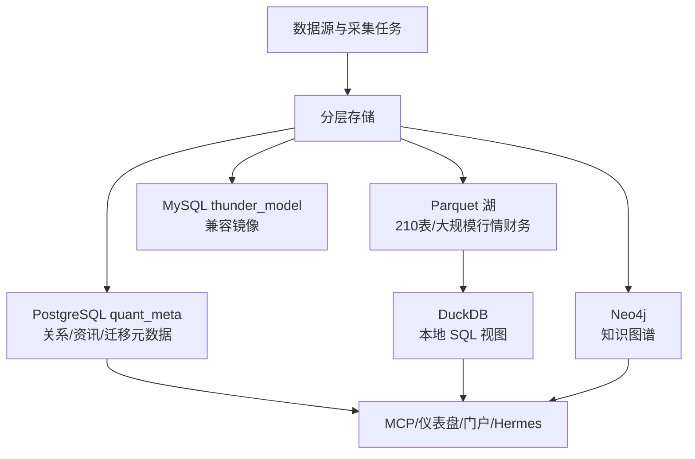

# 股票数据系统分层入库研发计划书

> 版本：v1.0
> 日期：2026-10-17
> 项目：zerobound-kg / quant_ingestion
> 状态：T01-T05 基础工程已完成，进入运行期收口

## 一、项目目标

把现有股票数据系统收敛为“分层数据平面”，不是把所有数据粗暴塞进一个数据库：

- **PostgreSQL 15**：关系型元数据、资讯缓存、迁移后的 SQLite 数据，主库为 `quant-pg:5442/quant_meta`。
- **Parquet 湖**：行情、财务、分钟线等大规模分析数据继续作为主存储，不做全量物理搬迁。
- **DuckDB**：Parquet 湖的本地 SQL 查询层，提供统一分析入口。
- **Neo4j**：知识图谱继续保留，不迁移到 MongoDB 或 PostgreSQL。
- **MySQL**：`thunder_model` 只读兼容镜像，独立运行于 `quant-mysql:3308`。

目标是：可恢复、可审计、可回滚、消费端不断供。

## 二、总体架构



## 三、已完成基线（Day 0）

| 阶段 | 结果 | 验收状态 |
|---|---|---|
| T01 环境准备 | 容器健康、磁盘布局、离线镜像/快照脚本 | 完成 |
| T02 MySQL 恢复 | `quant-mysql:3308`，233 表；`stock_basic=5480`、`trade_order=238` | 条件 PASS |
| T03 SQLite 入 PG | `quant.db` 6 表 + `tdx_info.db` 3 表，共 9 表进入 `quant_meta` | PASS |
| T04 双跑与对账 | 9/9 行数一致，抽样 MD5 100%，回滚 dry-run | PASS |
| T05 DuckDB 能力 | catalog 210 表，192 个 Parquet store 可注册，18 个空/逻辑源跳过 | PASS |

已知条件阻塞：xmap 需要 VPN/内网；news.db 当前会话 E: 不可达；雪球 token/watermark 缺失。

## 四、后续研发路线

### 阶段 A：持久化分析入口（当前优先）

**目标**：从“能生成视图”升级为“本地可复用 DuckDB 查询库”。

工作项：
1. 在 `C:/aios/quant_backtest/data/` 创建受控 `quant_lake.duckdb`。
2. 从 catalog v2 注册 192 个有效 Parquet 视图。
3. 18 个空/逻辑条目写入跳过清单，不伪造数据。
4. 对 `ts_daily`、`ts_index_daily` 执行代表性查询。
5. 将数据库文件、catalog 版本、视图数量和查询结果写入报告。

验收：视图数与有效 store 一致；路径安全检查通过；查询成功；不写回 Parquet、PG、Neo4j。

### 阶段 B：30 天双跑观测

**目标**：证明 PG 可稳定替代三份 SQLite 的读取路径，而不是只证明一次迁移成功。

每日任务：
- SQLite 以 `mode=ro + query_only` 读取。
- PG 只读读取 `quant_meta`。
- 9 表执行 COUNT 对账。
- 每表执行主键/行签名抽样校验。
- 生成 `double_run_YYYYMMDD.md/.json`。

通过标准：
- 每表行数一致率 100%。
- 抽样 MD5 一致率 ≥99.9%。
- 任一失败则保持 SQLite 指针，不切换生产消费端。
- 30 天内保留 SQLite 原件和回滚开关。

### 阶段 C：外部链路解阻

按依赖顺序处理：

1. **xmap**：恢复 `192.168.203.x` VPN/内网，重跑 `xmap_sync.py init`，核验 `entity_map` 与 lineage。
2. **news**：在用户会话可访问 E: SUBST 的环境运行 `news_pg_sync.py`，确认表结构和 watermark，再处理图内 37,810 与数仓 46,859 的差异。只读对账报告先行，禁止自动改图。
3. **雪球**：浏览器登录后配置 `xq_a_token`，复核三表 watermark，解除 degraded 状态。

### 阶段 D：灰度切换

前置条件：阶段 B 连续通过，阶段 C 的 news 结构与增量游标确认。

切换策略：
1. 先切一项读取路径到 PG。
2. 保留采集端写 SQLite。
3. 观察一段时间的接口、仪表盘和 MCP 结果。
4. 无异常再扩展到其他消费端。
5. 异常时只需将 `KG_QUANT_DB/KG_TDX_DB/KG_NEWS_DB` 切回 SQLite，并按手册重启仪表盘任务。

禁止事项：不直接删除 SQLite；不自动重启生产消费端；不在未通过双跑时切换。

### 阶段 E：30 天后收口

满足连续 30 天双跑通过后：

- 采集写端再评估是否迁 PG。
- SQLite 进入只读归档，至少保留一个备份周期。
- 更新 catalog、README、数据血缘和恢复手册。
- 暂不做 Parquet 全量物理迁移、MongoDB 图谱迁移、Neo4j 下线。

## 五、代码与目录规划

```text
ingestion/
├── common/       配置、PG连接、报告
├── migrate/      SQLite→PG、双跑、回滚
├── sync/         news、图谱对账、雪球检查
├── duck/         catalog→DuckDB 视图
├── ops/          环境、恢复、快照、健康检查
├── conf/         数据源与容器清单
└── reports/      每次迁移/校验/对账报告
```

关键配置：

- `PG_DSN`：只允许指向 `quant_meta`。
- `KG_QUANT_DB/KG_TDX_DB/KG_NEWS_DB`：统一切换/回滚开关。
- 真实密码只进 `.env.local`，不进 Git。
- SQLite 一律只读；Neo4j 对账阶段只读；Docker 清理默认 dry-run。

## 六、风险与应对

| 风险 | 等级 | 应对 |
|---|---|---|
| xmap VPN/内网不可达 | P1 | 保留现有 entity_map，网络恢复后重跑，不伪造 PASS |
| E: SUBST 在非用户会话不可见 | P1 | 在用户会话运行 news 同步，或显式设置 `KG_NEWS_DB` |
| news 图数差 9,049 | P1 | 先产出集合差和 watermark，再人工审核补齐 |
| 双跑期间数据继续写入 SQLite | P1 | 增量同步按 watermark；失败保持旧指针 |
| Parquet 小文件/路径变动 | P2 | catalog 路径约束；后续再做 compaction |
| Docker 清理误删 | P0 | 当前只允许 dry-run，删除需单独确认 |
| MongoDB 迁移引入回归 | P2 | Neo4j 保留；MongoDB 仅在正文在线化时作为文档库复评 |

## 七、最终验收标准

- [ ] `quant_lake.duckdb` 建立，视图与 catalog 有效 store 一致。
- [ ] 双跑连续 30 天通过，报告可审计。
- [ ] xmap init 在 VPN 恢复后成功。
- [ ] news 增量游标正常，图数差异完成解释或补齐。
- [ ] 雪球 token 与 watermark 恢复。
- [ ] 至少一次完整回滚演练成功。
- [ ] 所有生产消费端持续可用。
- [ ] SQLite、PG、Parquet、Neo4j 恢复手册齐全。

## 八、当前结论

本项目不采用“全量入 PostgreSQL”或“全量入 MongoDB”的粗放方案。正确路线是：

> **关系数据进 PG，大数据留 Parquet，分析用 DuckDB，图谱留 Neo4j，兼容源保留 MySQL。**

现在最应做的是完成 DuckDB 持久化、启动 30 天双跑和解掉三个外部阻塞，而不是继续增加数据库种类。
