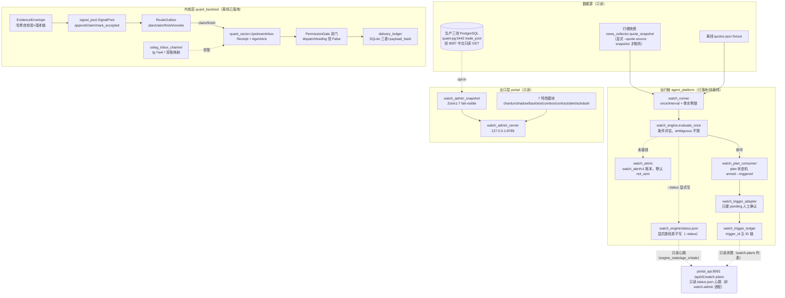

# 盯盘子系统总文档 v1.0

> **口径日期**：2026-11-04（全文所有行号、状态、计数均以该日只读盘点为准）
> **文档性质**：研发团队整合开发文档（非汇报稿）；本文档为 6 份来源文档的**合并总览入口**，各源文档保留原位不删不改
> **三态标注约定**：✅ 已落地（代码已提交/入库）｜🧊 已冻结（契约/红线冻结，不擅自改）｜🔌 待接线（代码就绪但未接生产）
> **安全边界**：本文档基于 2026-11-04 只读盘点；盯盘全链路 paper-only/只读/offline，研究推演不构成投资建议

## 合并来源（6 份）

| # | 来源文档 | 工单 | 内容定位 |
|---|---|---|---|
| S1 | `deliverables/盯盘整合开发文档_v1.0_2026-11-04.md` | —（整合视角骨架） | 四层边界、核心契约十项、数据流、出口层、测试矩阵、缺口/红线/路线图 |
| S2 | `docs/plans/2026-11-04_盯盘完整系统_引擎_v1.md` | WO-WATCH-ENGINE-20261104 | watch_engine 条件评估引擎 MVP（→第 5.1 节） |
| S3 | `docs/plans/2026-11-04_盯盘完整系统_API_v1.md` | WO-WATCH-API-20261104 | `/api/d1/watch-plans` 引擎状态/过滤/armed 时效（→第 5.5 节） |
| S4 | `docs/plans/2026-11-04_盯盘完整系统_告警_v1.md` | WO-WATCH-ALERT-20261104 | watch_alerts 告警事件账本骨架（→第 5.3 节） |
| S5 | `docs/plans/2026-11-04_盯盘完整系统_接线_v1.md` | WO-WATCH-WIRE-20261104 | watch_runner + engine status 兼容别名（→第 5.2 节） |
| S6 | `docs/plans/2026-11-04_F3c_trigger_ledger_v1.md` | WO-IFS-TRIGGER-LEDGER-20261104 | watch trigger 独立账本 trigger_id（→第 5.4 节） |

---

# 第 1 篇 总览与边界

## 1.1 子系统四层构成

盯盘子系统由四层构成，任何一层都不单独构成"盯盘系统"：

| 层 | 名称 | 代码域 | 职责 | 状态 |
|---|---|---|---|---|
| 出口层 | watch-admin 只读服务 | `portal/watch_admin_server.py` + `portal/watch_admin_snapshot.py` + 7 个 `portal/watch_admin_route_*.py` | 只读管理页/快照/特性看板，独立进程绑 127.0.0.1 | ✅ 已落地 |
| 内核层 | WQ 信号上行域 | `quant_backtest/watch_dispatch/` + `quant_backtest/quant_sector/` + `quant_backtest/agent_bridge/` | 证据信封、路由 outbox、上游受理、双门、投递账本 | ✅ 已落地（离线） |
| 运行链 | agent_platform watch_* | `agent_platform/watch_engine.py`、`watch_runner.py`、`watch_alerts.py`、`watch_plan_consumer.py`、`watch_trigger_adapter.py`、`watch_trigger_ledger.py` | 条件评估引擎、quote provider、告警账本、plan 状态机、trigger 账本 | ✅ 已落地；🔌 真实行情源/调度待接线 |
| 组织契约 | org.json 席位 | `agent_platform/registry/org.json` | WA1/WA2/WA3/QS1 席位、上报路、ACK 语义 | ✅ 已落地 |

边界声明：

1. **盯盘永不直连飞书/投研/交易室**——`quant_backtest/watch_dispatch/contracts.py:171-179`（RouteIntent docstring）：watch 是量化交易子模块，异动只上报量化板块（唯一路由 `QUANT_UPSTREAM_REPORT`，`contracts.py:16`），三路分发由量化层拥有。
2. **出口层不碰生产**——`portal/watch_admin_server.py:5-14`：独立进程、仅绑 127.0.0.1、不 import/modify `portal_api.py`、不碰 8091；`portal/watch_admin_route_ackdash.py:9-13`：数据源严格本地只读文件，无飞书/交易/通知/10.205.0.118/8091。
3. **全链路恒三类权限 False**——`contracts.py:77-87`（EvidenceEnvelope）、`contracts.py:199-209`（RouteIntent）、`quant_backtest/quant_sector/dual_gate.py:243-249`（PermissionGate）：production/notification/trading 均恒 `False`。

## 1.2 系统架构总览

分层数据流：**数据源 → 信号产生 → 内核上行链 → 双门 → 出口层只读投影**。



模块调用关系要点：

- **上游链**：`signal_pool`（营级账本）→ `RouteOutbox`（单事件上行）→ `UpstreamInbox`（司马懿侧受理出 Receipt+Ack）→ 回写 `mark_accepted`（`quant_backtest/watch_dispatch/signal_pool.py:447`）。
- **运行链**：`watch_runner → watch_engine → watch_plan_consumer.trigger_plan → watch_trigger_adapter → watch_trigger_ledger`（实施规格见第 5.1/5.2/5.4 节；`agent_platform/watch_plan_consumer.py:346`）。
- **可观测面**：engine/runner 显式写 `watch_engine/status.json` → `portal/api_d1_handoff.py` 的 `/api/d1/watch-plans` 只读消费（第 5.5 节；`docs/plans/2026-11-04_盯盘完整系统_API_v1.md:12-19`）。
- **出口层**：`watch_admin_server` 主两路由 + 动态加载 7 特性模块（`portal/watch_admin_server.py:49-57,118-166`）。

---

# 第 2 篇 核心契约十项

## 2.1 证据信封 EvidenceEnvelope：哈希自校验 + 版本链

| 契约点 | 证据 |
|---|---|
| 字段闭集（41 字段，含五时点） | `quant_backtest/watch_dispatch/contracts.py:39-75` |
| 三类权限恒 False | `contracts.py:77-87` |
| payload 序列化（排除 envelope_hash 自身） | `contracts.py:89-100` |
| 版本链：v1 禁 previous；v>1 须 previous_hash 逐字段咬合 + 前件哈希重算 | `contracts.py:116-126` |
| freeze_at 须严格递增（版本时间） | `contracts.py:125-126` |
| 信封时窗 `source<=visible<=detected<=freeze<until` | `contracts.py:142-147` |
| 现时性 `freeze_at<=now<valid_until` | `contracts.py:148-151` |
| 哈希自校验 `digest(payload())==envelope_hash` | `contracts.py:152-154` |
| `source_qualification` 只接受 SOURCE_UNVERIFIED | `contracts.py:140-141` |
| 唯一路由集 `_ROUTES={"QUANT_UPSTREAM_REPORT"}` | `contracts.py:16` |

## 2.2 RouteIntent：唯一路由 + observation_only

| 契约点 | 证据 |
|---|---|
| docstring：watch 只上报父层，永不直投三路 | `contracts.py:171-179` |
| 默认值 READY_OFFLINE / observation_only=True / executable=False / no_order_permission=True | `contracts.py:194-197` |
| route ∉ _ROUTES → ROUTE_INVALID | `contracts.py:213-214` |
| 执行语义禁入（EXECUTION_FORBIDDEN） | `contracts.py:222-223` |
| 信封身份一致性（event_id/version/hash 全对齐） | `contracts.py:217-218` |
| 路由时窗嵌套于信封时窗 | `contracts.py:226-227` |
| 幂等键 = 六要素 digest（非 provider 回执） | `contracts.py:233-237` |

## 2.3 RouteOutbox：三时间线 + generation + revoke

| 契约点 | 证据 |
|---|---|
| 状态机 READY_OFFLINE/CLAIMED/ACCEPTED_VERIFIED/DEFINITELY_REJECTED/UNKNOWN/CANCELLED | `quant_backtest/watch_dispatch/route_outbox.py:19-24` |
| plan（幂等建 intent） | `route_outbox.py:164` |
| claim（租约；LEASE_WINDOW/INTENT_NOT_CLAIMABLE/ATTEMPTS_EXHAUSTED；_MAX_ATTEMPTS=3 :25） | `route_outbox.py:274,25` |
| finish（attempt 结算；attempt/intent/generation/revoked 六重 current 校验） | `route_outbox.py:309,400-421` |
| **ACCEPTED_VERIFIED 须 ActiveAckPort 独立权威 + R1 复查** | `route_outbox.py:424-439`（D2 裁定 2026-10-23：ACK 回调与落账之间落地撤销时，发布前对同 fingerprint 只读复查 inbox 活性，堵住"撤销后仍发 verified 收据"竞态） |
| cancel（仅未投递 intent 可取消） | `route_outbox.py:457-469` |
| revoke_envelope（epoch 只进不退；EPOCH_NOT_ADVANCED） | `route_outbox.py:471-503` |

## 2.4 inbox 幂等键与双通道

| 契约点 | 证据 |
|---|---|
| 幂等键 = digest(channel,kind,payload,source,report_id,trace_id) | `quant_backtest/agent_bridge/osleg_contract.py:167-170`（`_digest` :69） |
| trace_id 缺失 = 契约违例，禁回填默认值 | `osleg_contract.py:164-166` |
| 同键重放回放同一单（duplicates+1）；被拒旧单重投须新 msg_id 不复活 | `osleg_contract.py:171-183` |
| 双账命名空间：gateway `lg-*`、契约层 `w4-*`，共享 report_id/trace_id | `quant_backtest/agent_bridge/osleg_inbox_channel.py:11-12` |
| kind 词表白名单 KIND_TO_GATEWAY；未登记失败关闭 | `osleg_inbox_channel.py:62-68`（gateway 侧 `agent_platform/gateway/inbox_gateway.py:60` INBOX_KINDS=("task_request","question","feedback")） |
| 隔离红线：store 不得指向真实 bridge_inbox | `osleg_inbox_channel.py:86-96,169-175` |
| HTTP 通道②契约：X-OSLEG-Auth + 来源白名单 ("qs1","a0")；占位 token 拒收 | `quant_backtest/agent_bridge/osleg_http_contract.py:62-70,87-91` |

## 2.5 ledger 追加式哈希链

| 账本 | 契约点 | 证据 |
|---|---|---|
| EvidenceEnvelope 版本链 | previous_version_hash 链 + 重算校验 | `contracts.py:116-126` |
| RuleEvent 链 | event_digest 规范化 sha256（previous_hash/sequence/issued_at 全入哈希） | `quant_backtest/watch_owner_rules.py:210-238,268-295` |
| delivery_ledger | SQLite 三表 delivery_events/targets/attempts + subscription_control；payload_hash 列；BEGIN IMMEDIATE 原子事务 | `quant_backtest/delivery_ledger.py:176-214,346-348` |
| SENT 语义 | CLAIMED 可能已触达 provider → 过期只产 UNKNOWN；SENT 须 provider 回执 + 独立 verifier | `delivery_ledger.py:1-8` |

## 2.6 revoke 原子性

| 契约点 | 证据 |
|---|---|
| outbox epoch 前进校验 + claimed intent 转 UNKNOWN 并清 receipt | `route_outbox.py:471-503` |
| inbox revoke：epoch 只进不退；撤销时间不得早于 ACK | `quant_backtest/quant_sector/upstream_inbox.py:257-270` |
| is_active/is_revoked 只读查询 | `upstream_inbox.py:272-278` |
| 双门 revoke：identity 入 blocked 集不可逆 | `quant_backtest/quant_sector/dual_gate.py:301-310` |
| R1 复查防撤销竞态（见 2.3） | `route_outbox.py:424-439` |

## 2.7 时间一致性

| 契约点 | 证据 |
|---|---|
| canonical.utc_text：tzinfo 缺失或非零 offset → UTC_REQUIRED | `quant_backtest/watch_dispatch/canonical.py:58-61` |
| 行情源时区 Asia/Shanghai（market A） | `quant_backtest/watch_source_authority.py:25` |
| 盘前完成凭证时区 Asia/Shanghai | `quant_backtest/premarket_run_receipt.py:20` |
| 信封五时点单调链 | `contracts.py:142-147` |
| delivery ledger 强制 aware 时间戳 | `quant_backtest/delivery_ledger.py:31-39` |

## 2.8 双门 stronggate（quant_sector）

| 契约点 | 证据 |
|---|---|
| PermissionGate：每次 consume 双门实时重验 | `quant_backtest/quant_sector/dual_gate.py:225-241` |
| **上游受理前置**：无 lookup/未知 ref/已撤销 → BLOCKED/UPSTREAM_NOT_ACCEPTED | `dual_gate.py:334-337` |
| 人工授权门：resolve_and_verify + binds + 时窗 + scope（sim_only 必 True） | `dual_gate.py:338-346` |
| RiskGuard 门：独立评估 + binds + decision==PASS + 时窗 | `dual_gate.py:347-355` |
| dispatch_permitted / trading_permitted 恒 False | `dual_gate.py:243-249` |
| 终态上限 SIM_DISPATCH_ELIGIBLE（仍不含交易许可） | `dual_gate.py:356-357` |

## 2.9 白名单/词表

| 契约点 | 证据 |
|---|---|
| HTTP 通道来源白名单 ("qs1","a0") | `quant_backtest/agent_bridge/osleg_http_contract.py:68-70` |
| gateway kind 词表（3 种） | `agent_platform/gateway/inbox_gateway.py:60` |
| W4 kind→gateway 映射；未登记失败关闭 | `quant_backtest/agent_bridge/osleg_inbox_channel.py:62-68,414-419` |
| API engine 状态白名单标量（token/凭据不透出） | `docs/plans/2026-11-04_盯盘完整系统_API_v1.md:49` |

## 2.10 来源资格四证据（WATCH1）

| 证据类 | 字段要点 | 证据 |
|---|---|---|
| StrategyMembershipProof | 权威签发的单条 A 池策略成员资格（approved/revoked/valid_from/until） | `quant_backtest/watch_source_authority.py:29-41` |
| OwnerInputProof | 服务端签发的 B 池持久化输入版本授权 | `watch_source_authority.py:44-59` |
| RawHttpResponseProof | 受信原始 HTTP 字节 + 独立留存锚（content_sha256/字段位） | `watch_source_authority.py:63-76` |
| TradingSessionProof | 独立交易所日历会话 + 策略版本 | `watch_source_authority.py:80-88` |

> 补充：`ProviderLicenseProof`（provider 授权）见 `watch_source_authority.py:92-100`；解析器协议 `WatchSourceAuthority` 为注入式只读端口，任何查找/解析/外部策略失败一律 fail-closed（`watch_source_authority.py:1-7,103-109`）。快照的 canonical digest **不构成**原始行情凭证（`watch_source_authority.py:5-6`）。

---

# 第 3 篇 数据流全链路

## 3.1 信号产生（影子触发器）

- 监控集：`portal/data/todays_picks.json`，tier∈{T1,T2} 且含买入类 tag（`quant_backtest/pool_watch.py:4-5`）。
- 触发线：`PULL_FACTOR=0.99`（回踩 -1%）/ `BREAK_FACTOR=1.03`（突破 +3%），`quant_backtest/pool_watch.py:52-53`。
- 择势门：reg=="down" 时突破降级 reg_flag_only（留痕不推）（`pool_watch.py:14-15`）。
- 落点：`signal_pool.append_event`；14 天影子期铁律，绝不调 signal_consumer/engine（`pool_watch.py:21-25`）。

## 3.2 内核上行链

`signal_pool`（append→claim→mark_accepted，`quant_backtest/watch_dispatch/signal_pool.py:370,424,447`）→ `EvidenceEnvelope` 冻结 → `RouteOutbox.plan/claim/finish` → `UpstreamInbox.accept` 出 Receipt+AgentAck（`quant_backtest/quant_sector/upstream_inbox.py:236-255`；ACK 不得早于受理 `:244-246`）→ 跨层翻译：`osleg_inbox_channel` lg-*/w4-* 双账共享 report_id/trace_id（`quant_backtest/agent_bridge/osleg_inbox_channel.py:11-12`）→ 回写 `mark_accepted`。

## 3.3 组织链落点

| 席位 | 组织事实 | 证据 |
|---|---|---|
| WA1 许褚 | watch_monitor / watch_lead；上行路 QUANT_UPSTREAM_REPORT；report_kinds ANOMALY/HEALTH；"不直连飞书/投研/交易所；三类动作权限恒 False" | `agent_platform/registry/org.json:155-208`（watch_lead :206-207；constraints :186-190） |
| WA2 张郃 | reports_to WA1；盘口/量能盯盘 | `org.json:485-538`（reports_to :508） |
| WA3 太史慈 | reports_to WA1；事件/情绪盯盘 | `org.json:540-593`（reports_to :563） |
| QS1 司马懿 | quant_sector_upstream_receiver；accepted_routes 仅 QUANT_UPSTREAM_REPORT；"受理回执=agent 级 ACK（AgentAck），受理不等于授权，不等于研判确认" | `org.json:210-262`（ack_semantics :230） |
| 部门职责 | QS1 签收 WA1 上行并出具 agent 级 ACK（K-ORG-191）；盯盘组 WA1 统管 WA2/WA3 | `org.json:93`（lead_duty） |
| 门户路由 | watch_setup → 许褚营 G1 触发器 | `portal/comm_router.py:105-112` |

## 3.4 运行链总述（详见第 5 篇）

运行链 = `watch_runner`（provider 三选一：quotes-json/snapshot/none，默认 none 不联网）→ `watch_engine.evaluate_once`（读 armed plan、判条件、命中调 `consumer.trigger_plan`；ambiguous/quote_unavailable/quote_stale 一律不触发）→ `watch_plan_consumer.trigger_plan`（plan→triggered）→ `watch_trigger_adapter.trigger_watch_plan`（只建 pending 确认）→ `watch_trigger_ledger`（trigger_id 五 ID 链）。**人工门**：approve/reject 走既有 `/api/sim/confirm`（接口登记 `docs/standards/INTERFACE_REGISTRY_v1.yaml:587`）；引擎/runner 绝不 decide/execute。引擎状态经显式 `--status` 写 `watch_engine/status.json`，由 `/api/d1/watch-plans` 只读消费。

> 各模块完整实施规格（条件语义、CLI、JSON 契约、退出码、实测证据）见第 5 篇 5.1-5.5。

## 3.5 告警上行边界

告警事件 `watch_alert/v1` 为运行时轻量账本（闭集字段、UTC、十进制、paper_only/not_a_trade 必 true、执行字段拒收），默认 dry-run 零写、dispatch 默认 not_sent，不 import 任何网络库（`docs/plans/2026-11-04_盯盘完整系统_告警_v1.md:18-40,66-77`）。**不授予任何生产资格**（同文 :41-42,168）。与 watch 上行边界一致：告警 sink 接线前，盯盘侧无任何真实通知出口。完整契约见第 5.3 节。

---

# 第 4 篇 出口层 watch-admin 服务

## 4.1 server 结构

| 项 | 事实 | 证据 |
|---|---|---|
| 进程隔离 | 独立进程，仅绑 127.0.0.1:8789，不 import/modify portal_api，不碰 8091 | `portal/watch_admin_server.py:5-14` |
| HOST | `"127.0.0.1"` | `watch_admin_server.py:43` |
| 端口 | 默认 8789（env WATCH_ADMIN_PORT 可覆盖）；2026-10-30 起 8796 让给军团指挥台后换 8789 | `watch_admin_server.py:44-45` |
| 端口史 | OSLINK 通道②契约占 8795（`quant_backtest/agent_bridge/osleg_http_contract.py:2`）；watch_admin 曾绑 8796（`outputs/盯盘子项目_单B_optin_验证报告_20261021.md:16`）→ 现 8789 | 见左列证据 |
| 鉴权 | **无 HTTP 鉴权**（仅靠 127.0.0.1 绑定 + 特性模块内部门控） | `watch_admin_server.py:89-184`（无任何 auth 分支） |
| static 穿越防护 | `/static/` resolve 后 relative_to(base)，越界 403 | `watch_admin_server.py:102-116` |
| 快照路由 | `GET /api/watch-admin/snapshot`，异常仍返 200 fail-visible 信封 | `watch_admin_server.py:118-133` |
| 特性模块动态加载 | ImportError 跳过；路由命中即 200；模块异常 feature_failed | `watch_admin_server.py:136-166` |
| 每请求新建 Aggregator | L121 `WatchAdminAggregator().build(replay_at=replay)` | `watch_admin_server.py:121` |

## 4.2 Zone3 门控（生产三池）

| 态 | 行为 | 证据 |
|---|---|---|
| 默认 opted_out | 不出网、不持 key、不发任何请求；error_code=opted_out，verified=False | `portal/watch_admin_snapshot.py:534-546` |
| opt-in | 须 `WATCH_ADMIN_ALLOW_PROD_POOL=1` + 只读 key 才 GET 8097（X-Push-Hub-Key；仅 SELECT 不写回） | `watch_admin_snapshot.py:547-574` |
| key 优先级 | env PUSH_HUB_KEY/push_hub_key/QUANT_MID_KEY/quant_mid_key → push_secrets.json（push_hub_key/quant_mid_key）→ None | `watch_admin_snapshot.py:295-319` |
| 无 key | error_code=no_key，SOURCE_UNVERIFIED，不伪造 | `watch_admin_snapshot.py:575-582` |
| fail-visible | 单源缺失只标该源 unknown，build() 整体不抛 | `watch_admin_snapshot.py:10-14` |

## 4.3 七个特性模块一览

| 模块 | API/HTML 路由 | 职责 | 缺源处理 |
|---|---|---|---|
| chanlun | `/api/watch-admin/chanlun`、`/watch-admin/chanlun` | ST1 缠论信号候选（chanlun_pool.jsonl 计数+小样本） | 缺文件 → unknown/error_code（`watch_admin_snapshot.py:511-526`） |
| shadow | `/api/watch-admin/shadow` | A/B 影子对比（runtime decisions + shadow ledger 只读） | 缺失不编造（`watch_admin_snapshot.py:826-848`） |
| backtest | `/api/watch-admin/backtest` | last_backtest.json 原样呈现（标缺 model/agent/combo 维度） | 缺文件 → unknown |
| combos | `/api/watch-admin/combos` | 组合注册表只读（combo_registry/直读 JSON 双路） | 缺失 → missing（`watch_admin_snapshot.py:586-599`） |
| contract | `/api/watch-admin/contract` | 席位/模型契约一致性看板（org.json + team_invest + model_tiers + 8098 静态） | 8098 不可达 → http_error/UNVERIFIED（`portal/watch_admin_route_contract.py:11-13`） |
| alert | `/api/watch-admin/alert` | 告警看板（只读 JSONL） | 缺源 → unknown |
| ackdash | `/api/watch-admin/ackdash` | 单A：实时 ACK/多 Agent 投票/用量三面板 | 恒 source_missing/unverified（`portal/watch_admin_route_ackdash.py:5-8,29-42`） |

## 4.4 单A / 单B / 单C 边界与状态

| 项 | 状态 | 证据 |
|---|---|---|
| 单A（实时 ACK/投票/用量看板） | ✅ 已入库 commit `d24047080`；三面板本地探针全部缺失 → 恒 source_missing，**待真源接入裁决**（无五要素批文） | `git log d24047080`；`watch_admin_route_ackdash.py:26-42`；`outputs/盯盘子项目_单B_optin_验证报告_20261021.md:71` |
| 单B（生产三池 opt-in） | ✅ opt-in 已验证 verified=True（真实 8097 响应，空池 active=0/pending=0）；回滚 = 删 env 零代码 | `outputs/盯盘子项目_单B_optin_验证报告_20261021.md:20-43,63-65` |
| 单C（飞书/通知/交易/GAP-4/051 视图） | 🧊 维持 BLOCK，不立项 | `outputs/盯盘子项目_单B_optin_验证报告_20261021.md:71`；`portal/watch_admin_route_contract.py:70-106` |

---

# 第 5 篇 运行链实施规格

> 本篇按模块合并 S2-S6 五份工单文档的**完整可用内容**（契约表、CLI、JSON 样例、退出码、实测证据），研发按本篇即可实施；工单级背景与回滚见第 9/10 篇。

## 5.1 watch_engine —— 条件评估引擎 MVP（S2：WO-WATCH-ENGINE-20261104）

### 5.1.1 目标与定位

D1 已有「交棒 → armed watch_plan → trigger → pending 确认」链路，但 `trigger_plan` 是**人工/外部直接触发**：它把 plan 的 price 当触发价直接建确认，没有「盯行情 → 判条件 → 自动（引擎）触发」的循环。本模块补引擎层 MVP：

```text
watch_plans.jsonl (status=armed)            ← consumer 状态机（只读）
        │  read（consumer.list_plans）
        ▼
watch_engine.evaluate_once(quote_provider)  ← 本模块（条件评估）
        │  hit 且非 dry-run
        ▼
consumer.trigger_plan(plan_id)              ← 既有 F3 链路（不改）
        │  pending confirmation + plan→triggered + trigger ledger(trigger_id)
        ▼
人工确认（human gate）—— 引擎绝不 decide/execute
```

引擎**只做三件事**：读 armed plan、取/判 quote、命中后调既有 `trigger_plan`；不直接改 plan 账本、不直接写 confirmation/trigger ledger（均由 consumer/adapter 负责）。

### 5.1.2 状态机（引擎视角）

| plan 状态（consumer 维护） | 引擎行为 |
|---|---|
| `armed` | 本轮参与评估 |
| `expired` | 引擎不触发（消费器/过期检查仍为准）；引擎对「已过期但 store 仍 armed」只报告 `expired`，不改 store |
| `triggered` | 不再参与（`armed` 过滤即排除），重复运行天然不重复建确认 |
| 条件无法判定 | 本轮 per-plan `condition_ambiguous`（不猜、不触发） |
| quote 缺失/非法/过期 | 本轮 per-plan `quote_unavailable`/`quote_invalid`/`quote_stale`（不猜、不触发） |
| 命中但 plan 无 adapter 单点 price | `trigger_unsupported`（fail-visible；区间/cross 条件需补 `price` 才能建确认，见 5.1.5-8） |
| 命中且可触发 | `consumer.trigger_plan(...)` → pending 确认；引擎记录 confirmation_id/trigger_id |

### 5.1.3 条件语义（`plan["conditions"]` object）

字段解析（均为可选，除 symbol 必填）：

| 字段 | 含义 |
|---|---|
| `symbol` / `code` | 标的（必填；quote mapping 的 key） |
| `action` / `side` | BUY/SELL（含 买入/卖出/多/空/long/short），用于 legacy 默认算子 |
| `operator` / `op` | `>= <= > < == cross_above cross_below between/in_range/range`（含 ge/le/gt/lt/eq 别名） |
| `price` / `trigger_price` | 单点阈值；同时是 adapter 建确认用的 `conditions.price` 来源 |
| `price_min` / `price_max` | 区间/单边上下界（别名 min_price/max_price/low/high） |
| `range` / `price_range` | `[low, high]` 数组（与 price_min/max 二选一） |
| `quote_field` | 从 quote 取价字段（默认依次 last/price/close/latest/current/now/trade_price） |
| `prev_field` | cross 用前值字段（默认 prev/prev_price/previous/previous_price/prev_close） |
| `max_age_s` | quote 时效上限；需 quote 带 ts/timestamp/time/quote_time/as_of，否则 `quote_stale` |

判定规则（无法判定 → `condition_ambiguous`，不猜）：

1. 显式 `operator` + `price` → 单点比较；
2. 无 operator + price：`action=BUY` 默认 `<=`（回踩买）、`SELL` 默认 `>=`；action 缺失/未知 → ambiguous；
3. `price_min & price_max`（或 range 数组）→ 区间 `[min,max]` 闭区间命中；显式比较算子与区间冲突 → ambiguous；
4. 仅 `price_min` → 默认 `>=`（可显式覆盖）；仅 `price_max` → 默认 `<=`（可显式覆盖）；
5. `cross_above`：`prev <= 阈值` 且 `current > 阈值`；`cross_below`：`prev >= 阈值` 且 `current < 阈值`；缺 prev → ambiguous（不猜「第一次见到当前价」是否算穿越）；
6. quote 形如数字或 `{"last"/"price"/"close"/...}`，也支持嵌套 `{"quote"/"data"/"ticker": {...}}`；
7. `max_age_s` 已配置但 quote 无时间戳/超时 → `quote_stale`；
8. **price 与 price_min/price_max 同给**：若 operator 为区间语义，`price` 仅作 adapter 确认价（plan 带 `price` 时可触发）；否则 ambiguous。

示例：

```jsonc
// legacy：BUY 回踩 1500 触发（== plan 自带 price）
{"symbol": "600519.SH", "action": "BUY", "price": 1500}
// 显式：跌破 1480 触发
{"symbol": "600519.SH", "operator": "<", "price": 1480}
// 区间 + 确认价（命中区间后按 1500 建确认）
{"symbol": "600519.SH", "action": "BUY", "operator": "between",
 "price_min": 1480, "price_max": 1520, "price": 1500}
// 上穿 1520（quote 需带 prev）
{"symbol": "600519.SH", "operator": "cross_above", "price": 1520}
```

### 5.1.4 quote provider 契约（默认无网络）

- `quote_provider` 可注入三种形态：
  1. **mapping**：`{symbol: quote}`（最简单，测试/离线）；
  2. **callable**：`provider(symbols: list[str]) -> {symbol: quote}`；
  3. **对象**：实现 `get_quotes(symbols) -> {symbol: quote}`；
- 未注入 → 本轮 status `ok=false, error=quote_provider_required`（不猜价格、不建确认）；
- provider 抛异常 → `ok=false, error=quote_unavailable`（fail-visible，不吞）；
- quote 形态：数字（`1490.0`）或 mapping（`last/price/close/...`，可选 `prev`、`ts`）；
- CLI 用 `--quotes-json <file>` 提供离线 quotes（`{symbol: quote}` 或 `{"quotes": {...}}`）；没有 quotes 参数时 CLI 即 `quote_provider_required`（默认绝不发起网络）。

### 5.1.5 status JSON 契约 `watch_engine_status/v1`

每次 `evaluate_once` 返回（并可选 `--status` 原子写）：

```json
{
  "schema": "watch_engine_status/v1",
  "ok": true,
  "run_id": "wr-20261104100000-ab12cd",
  "last_run": "2026-11-04T10:00:00+08:00",
  "dry_run": false,
  "scanned": 3, "armed": 3, "waiting": 1, "triggered": 1, "errors": 1,
  "hits": 2, "would_trigger": 0, "expired": 0,
  "results": [
    {"plan_id": "wp-...", "status": "triggered", "symbol": "600519.SH",
     "operator": "<=", "observed": 1490.0, "threshold": 1500.0,
     "confirmation_id": "CFM-...", "trigger_id": "trg-...",
     "confirmation_status": "pending", "executes": false}
  ],
  "paper_only": true, "not_a_trade": true, "executes": false,
  "plan_ledger": "...", "trigger_ledger_configured": true,
  "status_written": true
}
```

- **dry-run 零写**：不调 `trigger_plan`、不写 status/trigger ledger/confirmation；`would_trigger` 计数（即使给了 `--status` 也不写，`status_write_skipped=dry_run`）；
- live 时：只经 `consumer.trigger_plan` 写 plan 状态 + pending confirmation + 显式 `--trigger-ledger`/`WATCH_TRIGGER_LEDGER_PATH` 的 trigger 账本；status 仅在显式 `--status <path>` 时原子写（tmp+replace），无隐式生产路径；
- 不写 D1 decisions、paper ledger、registry；不启动/停止任何服务；不实盘。

> S5（接线单）为本 JSON 增加 API 兼容别名（详见 5.2.2）：`engine_state`/`last_tick_at`/`heartbeat_at`/`armed_count`/`tick_count`/`started_at`；旧字段全部保留。

### 5.1.6 CLI 与退出码

```powershell
# dry-run（只报告，零写）
python -X utf8 -m agent_platform.watch_engine --once `
  --plan-ledger <watch_plans.jsonl> `
  --quotes-json <quotes.json> --dry-run --json

# live（命中建 pending 确认；显式 trigger 账本 + status 输出）
python -X utf8 -m agent_platform.watch_engine --once `
  --plan-ledger <watch_plans.jsonl> `
  --trigger-ledger <watch_triggers.jsonl> `
  --data-dir <trading_bot_dir> `
  --quotes-json <quotes.json> `
  --status <engine_status.json> --json
```

退出码：`0`=ok（含 0 armed）／`1`=引擎/条件/provider 失败（`ok=false`）／`2`=用法错误。（`--once` 为 MVP 单轮语义；循环/常驻由后续调度器接线，本单不新增计划任务。）

### 5.1.7 验收关键用例（S2 实跑：`test_watch_engine.py` rc0）

- 各 operator（>= <= > < ==）、legacy BUY/SELL 默认、price_min/max 区间、cross_above/below、quote_field/嵌套 quote、max_age_s 时效；
- ambiguous（无阈值/无 action/price 与区间冲突/cross 缺 prev）、operator 非法、conditions list；
- provider：mapping/callable/required/异常/缺 symbol；
- dry-run 零写（plan ledger hash 不变、无 confirmation/trigger ledger/status 文件）；
- live：pending 确认、plan→triggered、trigger ledger 1 行、无 paper ledger；
- 二次运行幂等（armed=0、不重复确认）；
- 过期 plan 只报告不触发、plan store 不变；
- 区间条件无 adapter price → `trigger_unsupported`（不假绿）；带 price 的区间可触发；
- status 字段/原子写/无执行字段/无凭据；CLI dry-run/status/无 quotes。

## 5.2 watch_runner —— 运行循环与 provider 选择（S5：WO-WATCH-WIRE-20261104）

### 5.2.1 架构

```text
                         ┌─────────────────────────────────────────────┐
  quote provider 3 选 1  │ watch_runner.py（本单）：once / interval    │
  ├ quotes-json（离线）   │  ├ provider: quotes-json / snapshot / none  │
  ├ snapshot（网络，显式）│  ├ 单实例锁（可选 --lock）                  │
  └ none（默认，不网络）  │  └ 每轮 status 显式落盘（--status）         │
                         └──────────────────┬──────────────────────────┘
                                            │ 每轮调用
                                            ▼
                         watch_engine.evaluate_once（既有 MVP，不改评估）
                           ├ 读 armed watch_plan（consumer，只读）
                           ├ 条件评估（operator/price/range/cross；ambiguous 不猜）
                           └ 命中 → consumer.trigger_plan（pending 确认，不执行）
                                            │
              watch_engine/status.json（显式路径） ← API /api/d1/watch-plans 只读心跳
```

职责边界：**watch_engine** 做条件评估/触发编排（S5 只加 status 字段别名与可选运行态字段注入 `extra_status`，评估逻辑/条件语义零改动）；**watch_runner** 做 quote provider 选择、once/interval 循环、单实例锁、CLI、失败可见性；不写 D1 decisions、不下单、不实盘。

### 5.2.2 watch_engine status 兼容别名（API 契约）

| API 期望字段 | S5 提供 | 说明 |
|---|---|---|
| `engine_state` | ✅ 新增 | 正常轮 `running`；本轮失败 `error`（API 归一化小写） |
| `last_tick_at` | ✅ 新增 | 本轮时间戳（ISO8601，带时区） |
| `heartbeat_at` | ✅ 新增 | = `last_tick_at`（API 也认 last_heartbeat_at 等） |
| `armed_count` | ✅ 新增 | 本轮扫描的 armed plan 数（= 原 `armed`） |
| `tick_count` | ✅ 新增 | 单轮引擎：旧 status 文件读 +1；runner 跨进程累计（见 5.2.4） |
| `started_at` | ✅ 新增 | 首轮/进程启动时刻；同一 status 文件跨轮保持 |
| 旧字段 | 保留 | `run_id/last_run/scanned/armed/waiting/triggered/errors/hits/would_trigger/expired/results/ok/dry_run/paper_only/executes/...` 全部不变 |

其它 API 可透出字段（`mode/pid/interval_s/version/note/reason`）由 runner 通过 `extra_status` 注入；API 只透出白名单标量，嵌套 `results` 不会被返回。

**API 读取路径**：`WATCH_ENGINE_STATUS_PATH` env 覆盖；默认 `agent_platform/data/watch_engine/status.json`。`engine_state=unavailable` 表示文件缺失；`stale=true` 表示心跳超过 180s（API 默认阈值）。

### 5.2.3 运行命令与参数语义

```powershell
# 1) 离线 fixture（测试/灰度；绝不网络）
python -X utf8 -m agent_platform.watch_runner --once `
  --plan-ledger agent_platform/data/watch_plans.jsonl `
  --trigger-ledger agent_platform/data/watch_triggers.jsonl `
  --data-dir agent_platform/data/trading_bot `
  --quotes-json C:\Temp\quotes.json `
  --status agent_platform/data/watch_engine/status.json

# 2) 显式网络快照（真实行情；只在明确选择时启用）
python -X utf8 -m agent_platform.watch_runner --interval 30 --max-ticks 120 `
  --plan-ledger agent_platform/data/watch_plans.jsonl `
  --trigger-ledger agent_platform/data/watch_triggers.jsonl `
  --data-dir agent_platform/data/trading_bot `
  --quote-source snapshot `
  --status agent_platform/data/watch_engine/status.json `
  --lock agent_platform/data/watch_engine/runner.lock

# 3) dry-run（只报告，不写 status/ledger/confirmation）
python -X utf8 -m agent_platform.watch_runner --once `
  --plan-ledger ... --quotes-json ... --dry-run --json
```

参数语义：

- `--quotes-json <file>`：离线 fixture（`{symbol: quote}` 或 `{"quotes": {...}}`），加载一次；
- `--quote-source snapshot`：每轮调用 `news_collector.quote_snapshot.fetch_quotes(codes)`（**网络**；显式选择才启用；返回 `{engine_symbol: {"last","ts","name","pct"}}`）；
- `--quote-source none`（默认）：不提供 provider → 引擎返回 `quote_provider_required`（不猜价、不建确认，不发起网络）；
- `--once` / `--interval N`（互斥）；`--max-ticks` 限轮次；`--lock` 可选单实例锁；
- `--status <path>`：**仅显式时**写（引擎原子写）；缺省不写任何 status（默认不写生产）；
- `--dry-run`：零写（status/ledger/confirmation 都不写）。

退出码：`0`=最后一轮 ok；`1`=引擎/行情/锁失败（fail-visible）；`2`=用法错误。

### 5.2.4 tick 累计与单实例锁

- **tick 累计**：runner 每轮把 `tick_count = 旧 status.tick_count + 本轮序号` 传给引擎；同一 status 文件跨进程续号；`started_at` 沿用旧值。单轮引擎自身也按「旧 status +1」兜底。
- **单实例锁**：`--lock <path>` 用 `O_CREAT|O_EXCL` 创建；已存在 → `runner_locked` 失败（不自动删锁/不杀进程，需人工确认旧进程退出后删除锁文件）；正常退出/异常均释放自建锁。

### 5.2.5 quote source 与网络边界

| source | 网络 | 用途 | 备注 |
|---|---|---|---|
| `none`（默认） | ❌ | 安全默认/接线前 | 引擎 `quote_provider_required`，不写确认 |
| `quotes-json` | ❌ | 测试/灰度/人工报价 | fixture 文件，静态加载 |
| `snapshot` | ✅（显式） | 真实盯盘 | `news_collector.quote_snapshot.fetch_quotes`；快照含 `price/ts/name/pct`，**无 prev** → cross 条件会 ambiguous（需 provider 补前值，见 G3） |

## 5.3 watch_alerts —— 告警事件账本骨架（S4：WO-WATCH-ALERT-20261104）

### 5.3.1 定位与边界

已有 `quant_backtest/watch_alert_contract.py`（`WATCH1_V1` **离线契约**，`production_permitted=False`）、`agent_platform/watch_trigger_ledger.py`、watch_admin 告警看板；**缺**「盯盘触发 → 告警事件 → 去重 → 分发（回执）」的运行时账本层。本模块新增 `agent_platform/watch_alerts.py`：告警事件构造/校验、确定性去重、显式路径 JSONL 账本、`dispatch()` 默认 `not_sent` 占位 + 可注入测试 sink、CLI；**不**改 `watch_alert_contract.py`、**不**改 Feishu/通知链路、**不**启停服务/不写生产。

默认安全：只有显式 ledger path（参数或 env `WATCH_ALERT_LEDGER_PATH`）才写；否则 dry-run 零写；`dispatch()` 默认不发送；`paper_only/not_a_trade` 强制 true；执行字段一律拒收。

### 5.3.2 事件契约 `watch_alert/v1`

一行 = 一条告警事件（字段**闭集**，额外字段/执行字段拒收）：

| 字段 | 类型/约束 | 说明 |
|---|---|---|
| `schema` | 固定 `"watch_alert/v1"` | 事件版本 |
| `alert_id` | 64hex 小写 sha256 | `sha256(canonical({dedupe_key, observed, threshold, quote_as_of}))`；**不含 created_at**（可复现） |
| `trace_id` | 64hex 小写 sha256 | `sha256("watch_alert_trace/v1\|"+dedupe_key)` |
| `dedupe_key` | 64hex 小写 sha256 | 见 5.3.3 去重规则 |
| `plan_id` | `[A-Za-z0-9][A-Za-z0-9._:-]{0,127}` | 盯盘计划/工单 ID（如 `wp-watch-001`） |
| `symbol` | 同上 | 标的（如 `600519.SH`） |
| `action` | `[A-Za-z0-9][A-Za-z0-9._:-]{0,31}` | 告警动作标签（alert/notify/…，MVP 不锁枚举） |
| `observed` | 十进制字符串 | 触发观测值；规范化（禁 NaN/Inf/科学计数法） |
| `observed_bucket` | 十进制字符串 | 去重档位；缺省=observed 按 2 位小数 `ROUND_HALF_UP` 量化 |
| `threshold` | 十进制字符串 | 触发阈值（保留输入十进制精度） |
| `quote_as_of` | UTC ISO8601（`...Z`） | 行情时点（必填） |
| `created_at` | UTC ISO8601（`...Z`） | 事件创建；缺省=当前 UTC |
| `paper_only` | 必须 `true` | MVP 只读研究层（false → 拒收） |
| `not_a_trade` | 必须 `true` | 永不下单（false → 拒收） |

- 拒收：多字段/缺字段、`nan/inf`、无时区时间、`paper_only=false`、`not_a_trade=false`、执行字段（`order/qty/quantity/broker/execute/trade_id/fill/account`）、ID 与字段不自洽（防篡改）。
- 与 `WATCH1_V1` 的关系：本 MVP 为**运行时告警事件**（轻量、面向账本/分发），不复用其实盘级证据链（source_hash/membership/receipt 等）；两者不互相替代，`watch_alert/v1` **不授予任何生产资格**。

### 5.3.3 去重规则（确定性 + 账本幂等）

```
dedupe_key = sha256("plan_id|symbol|action|observed_bucket")        # 64hex
observed_bucket 缺省 = Decimal(observed).quantize(0.01, ROUND_HALF_UP)  # 默认 2 位小数
```

- **同 dedupe_key 在账本内只写一行**（append-only，不覆盖）：重复命中返回 `status="duplicate"`，`written=false`，`dispatch.skipped`，**不重复发送**；
- 同档判定：`12.34` 与 `12.340` 同 bucket（`12.34`）→ 去重；`12.34` vs `12.40` 不同 bucket → 新告警；
- 可显式传入更粗 `observed_bucket`（如 `"12.0"`）做「同价位档去重」；
- 当前 MVP **无 TTL**：dedupe 为账本内永久去重（bucket 有界，不会无限误抑制）；TTL/滚动窗口列入接线项。

### 5.3.4 写边界（默认零写）

- 路径优先级：显式 `ledger_path=` / CLI `--ledger` > 环境变量 `WATCH_ALERT_LEDGER_PATH` > **None（dry-run）**；本模块**不提供生产默认路径写入**（`DEFAULT_LEDGER` 仅文档语义）；
- 默认（无 path）→ `status="dry_run"`、`written=false`、返回完整事件 + `dispatch=not_sent`，**不落盘**；
- 显式路径：append 一行 JSONL（`json.dumps(sort_keys=True)` + `flush` + `os.fsync`），父目录自动创建；
- **坏账本 fail-closed**：任一行非法 JSON/缺 `dedupe_key` → `WatchAlertError(code="ledger_corrupt")`，拒绝继续写、**不覆盖既有内容**；写失败 → `ledger_write_failed`（CLI rc=1，fail-visible）。

### 5.3.5 分发（dispatch）与安全边界

```python
dispatch(event, sink=None)  # sink=None（默认）→ {"status": "not_sent", "attempted": False, ...}
                            # sink 可注入（仅测试/后续通道）：
                            #   sink(event) 返回 mapping → status 可覆盖（如 sent + receipt_id）
                            #   sink 抛异常 → {"status": "failed", ...} 回执，不抛网络副作用
```

- **默认 not_sent**：MVP 不接 Feishu/真实通知；CLI 不注入 sink，结果恒为 `not_sent`；
- 本模块**不 import** `requests/urllib/httpx/feishu/socket/http`（测试用 AST 锁定），不打印/保存 token；
- 分发回执随事件落账（`record["dispatch"]`），便于后续对账；发送失败仍落账（fail-visible）。

### 5.3.6 CLI 与退出码

```powershell
# 1) 默认 dry-run（--dry-run 显式同义；无 --ledger → 零写）
python -X utf8 agent_platform\watch_alerts.py --event-json '{"plan_id":"wp-1","symbol":"600519.SH","action":"alert","observed":12.34,"threshold":12.0,"quote_as_of":"2026-11-04T05:30:00Z"}' --dry-run --json

# 2) 显式账本写（也可用 env WATCH_ALERT_LEDGER_PATH）
python -X utf8 agent_platform\watch_alerts.py --event-file C:\Temp\watch_alert_event_20261104.json --ledger C:\Temp\watch_alert_ledger_20261104.jsonl --json

# 3) 重复事件 → duplicate（不重写/不重发）
python -X utf8 agent_platform\watch_alerts.py --event-file C:\Temp\watch_alert_event_20261104.json --ledger C:\Temp\watch_alert_ledger_20261104.jsonl --json

# 4) 只读列账（需显式 --ledger/env；不隐式读生产账本）
python -X utf8 agent_platform\watch_alerts.py --list --ledger C:\Temp\watch_alert_ledger_20261104.jsonl --json
```

退出码：`0`=成功（dry_run/written/duplicate/list）；`2`=输入/配置错误（坏 JSON/缺字段/非法事件/缺路径）；`1`=账本读写错误（corrupt/unreadable/write_failed）。`--list` 未给显式路径 → rc=2（不隐式读生产账本）。

### 5.3.7 实测证据（2026-11-04 06:3x +08，真实 CLI）

| 场景 | 结果 |
|---|---|
| 默认 dry-run（`--dry-run`，无 ledger） | `status=dry_run, written=false, dispatch.status=not_sent, ledger=null`；**零写** |
| 显式 `--ledger C:\Temp\…jsonl` | `status=written, written=true, dispatch.status=not_sent`；账本 **1 行** |
| 同事件重发 | `status=duplicate, written=false, dispatch.status=skipped`；账本仍 **1 行** |
| `--list --ledger` | `count=1`，事件 `schema=watch_alert/v1`，dedupe_key `548f5633…` |
| 生产默认账本 `agent_platform/data/watch_alerts.jsonl` | **不存在**（未写生产） |

真实事件/去重键（本次样例）：`plan_id=wp-watch-001`、`symbol=600519.SH`、`action=alert`、`observed=12.34`、`observed_bucket=12.34`、`dedupe_key=548f5633b7222ab9c66c06a4a2406a90c1ad29daf3150093dd6ce2f1073aebba`、`alert_id=40fc5e442f9e8473b71536604b062dc3649dc06a01a89feff8757d86e1287960`。

证据文件（`C:\Temp`，不写仓库；UTF-8）：

| 文件 | 字节 | sha256 |
|---|---:|---|
| `C:\Temp\watch_alert_event_20261104.json` | 203 | `e7c1da091f5ee363eb61ba46e55a10f9d98e3a4fab9b2137a85822725108bd70` |
| `C:\Temp\watch_alert_cli_dry_20261104.json` | 993 | `6a3fa2302de57e7f2e160ae90f478d8890f9248a5648a03b81b8bb4445075f51` |
| `C:\Temp\watch_alert_cli_written_20261104.json` | 1033 | `c196500aefa70b87aa3aa7f2cdfff1b65db9d157f043faf97cbc89ec4fb3e772` |
| `C:\Temp\watch_alert_cli_dup_20261104.json` | 1135 | `aea2367c0e0e85a522e2aab3d168053634d16e19d250073654c23889823b834a` |
| `C:\Temp\watch_alert_cli_list_20261104.json` | 984 | `3499408b78e439dbb103fcb606635569dc4ca8e5549d0564096b95b44b0164e6` |
| `C:\Temp\watch_alert_ledger_20261104.jsonl` | 685 | `a8afa621a33f074077288a84ad6318ec07ee4e8599e17cfc269cc669e288ab06` |

## 5.4 watch_trigger_ledger —— trigger 独立账本（S6：WO-IFS-TRIGGER-LEDGER-20261104）

### 5.4.1 背景与缺口

IFS F3 原实现中 `watch_trigger_adapter` 直接调 `trading_bot_flow.create_confirmation`，**跳过独立 trigger 账本**：ID_CHAIN 里 `watch_plan_id → trigger_id` 为「❌ 缺」，`trigger_id` 未生成，confirmation 只有 `source_report_id`（后经 F4 补三来源 ID）。本单补 F3c：让每次 armed watch_plan 触发先落一条 `trigger_event/v1`，再把 `trigger_id` 写回 confirmation，形成可审计五 ID 链。

交付物：`agent_platform/watch_trigger_ledger.py`（新增）、`watch_trigger_adapter.py`（`trigger_watch_plan(..., trigger_ledger=None, quote_snapshot=None, now=None)`：配置账本后落账+回写 trigger_id；未配置保持旧行为）、`watch_plan_consumer.py`（`trigger_plan(..., trigger_ledger=None)`：透传账本、plan store 持久化 trigger_id、返回 trigger_id/ids、幂等分支补齐；CLI 增 `--trigger-ledger`）、`agent_platform/tests/test_watch_trigger_ledger.py`（22 tests）。

### 5.4.2 trigger_id 生成公式

```text
trigger_id = trg-<yyyymmdd>-<hex6>
hex6       = SHA256("<watch_plan_id>|<canonical_json(quote_snapshot)>")[:6]（小写）
```

- 日期取触发时刻本地时区；
- 同 plan + 同行情快照 + 同一天 → 确定性同 ID（可复现）；
- 唯一性与幂等由账本层兜底：同 `watch_plan_id` 重复触发返回既有事件，**不重复落行**；
- 格式锁：`^trg-\d{8}-[0-9a-f]{6}$`（与 ID_CHAIN §3.7 一致）。

### 5.4.3 trigger_event/v1 契约（`agent_platform/data/watch_triggers.jsonl`）

```json
{
  "schema": "trigger_event/v1",
  "schema_version": 1,
  "trigger_id": "trg-20261104-8497e0",
  "watch_plan_id": "wp-...",
  "handoff_id": "d1h-...",
  "decision_id": "d1-...",
  "confirmation_id": "CFM-...",
  "quote_snapshot": {"price": 1500.0},
  "created_at": "2026-11-04T10:00:00+08:00",
  "paper_only": true,
  "not_a_trade": true
}
```

- 五 ID 链：`decision_id → handoff_id → watch_plan_id → trigger_id → confirmation_id`；上游缺失显式 `null`，不拿 report_id/run_id 冒充；
- 兼容现状：`handoff_id` 取 `d1_handoff.receipt_id`（当前回执主键即 handoff ID；若后续回执引入独立 `handoff_id` 字段，账本侧只需换取值，ID 格式不变）；
- 禁执行字段（order/qty/broker/execute/trade_id/fill/account）——`validate_event` 拦截；
- append-only；坏行 fail-closed（`trigger_ledger_corrupt`），不静默丢账。

### 5.4.4 写边界（关键）

- **无生产默认写入**：`ledger_path()` 只认显式 `path` 或环境变量 `WATCH_TRIGGER_LEDGER_PATH`；两者皆无 → `trigger_ledger_path_required`，不落盘；模块常量 `DEFAULT_LEDGER` 仅为文档/显式引用，函数绝不隐式使用；
- 唯一写操作 = 向显式账本 append 一行 + 把 `trigger_id` 原子写回 confirmation JSON（confirmation 既有四 ID/字段原样保留，不执行/不改 paper 账）；
- 未接线时 adapter/consumer 保持旧行为：只建 pending 确认，confirmation 无 trigger_id。

### 5.4.5 实测证据（tmp，1 次触发 1 行 + 五 ID 链）

```json
{
  "trigger_id": "trg-20261104-8497e0",
  "ledger_lines": 1,
  "repeat_idempotent": true,
  "repeat_same_trigger": true,
  "chain": {
    "decision_id": "d1-20261104010000-abcdef",
    "handoff_id": "d1h-20261104-evidence",
    "watch_plan_id": "wp-trg-evidence",
    "trigger_id": "trg-20261104-8497e0",
    "confirmation_id": "CFM-875A69BE558B"
  },
  "confirmation_has_trigger_id": true,
  "confirmation_status": "pending",
  "executes": false,
  "paper_ledger_created": false
}
```

真实 `agent_platform/data/watch_triggers.jsonl` 未创建/未写（测试与证据全程 tmp）；confirmation 四 ID 原样保留且状态保持 `pending`（人工门未越过）；无 order/qty/broker 等执行字段，无 paper ledger 生成。

## 5.5 API 可观测面 `/api/d1/watch-plans`（S3：WO-WATCH-API-20261104）

### 5.5.1 结论（兼容期：只加不改）

`GET /api/d1/watch-plans` 在**保留全部既有字段**的前提下新增：

1. `engine` 块：读取 `agent_platform/data/watch_engine/status.json`（只读），暴露 `engine_state`/`age_s`/`stale` 等可观测字段；**文件缺失/坏 JSON/非 object/超限 → `engine_state=unavailable`，HTTP 仍 200（不 500）**，且只透出白名单标量，不返回 token/凭据；
2. `status` 过滤：`armed / triggered / expired / cancelled`（大小写不敏感；非法值 → **400 `bad_status`**，不静默返回全量）；
3. `armed` 条目附加 `expires_in_s` / `stale`（未来>0；已过期未触发<0 且 `stale=true`；`expires_at` 缺失/不可解析 → `expires_in_s=null, stale=true`，不猜）；
4. envelope 保持 **`d1.watch_plans.list` / `watch_plan/v1`**（`ok/schema_version/request_id/source/data/warnings` 不变，旧顶层字段与 `data` 副本并存）。

只读：不触发/不执行/不写 plan 账本；route baseline 298 条零 diff（无新路由）。

### 5.5.2 响应字段

既有字段（原样保留）：`ok` / `schema_version` / `count` / `watch_plans[]` / `readonly` / `paper_only` / `executes` + envelope：`request_id` / `source{interface_id,source_of_truth,source_mode,stale}` / `data` / `warnings`。

新增顶层字段：

| 字段 | 类型 | 说明 |
|---|---|---|
| `status_filter` | str\|null | 回显过滤值（未过滤=`null`；如 `"armed"`） |
| `engine` | object | watch 引擎状态块（见 5.5.3） |

### 5.5.3 `engine` 块（只读、白名单）

| 字段 | 类型 | 说明 |
|---|---|---|
| `engine_state` | str | 状态文件中的 `engine_state`/`state`/`status`（归一小写）；缺失/坏文件=`unavailable`；有文件但无状态键=`unknown` |
| `source` | str | status.json 路径（仓库内相对 POSIX；env 覆盖时原样） |
| `checked_at` | str | 服务器读取时间（ISO8601 带时区） |
| `status_file` | object | `{exists,bytes,mtime}`（只 stat，不写） |
| `age_s` | int\|null | 距最近心跳（`last_tick_at`/`heartbeat_at`/`last_heartbeat_at`/`updated_at`/`generated_at`/`started_at` 首个可解析者）秒数；不可解析=null |
| `stale` | bool | `age_s > stale_after_s`（默认 180s）或心跳不可解析/文件不可用 → true |
| `stale_after_s` | int | 阈值（默认 180） |
| `note` | str | 仅在 unavailable/坏文件/缺心跳时出现（成功且有心跳时**不出现**） |
| 白名单字段 | scalar | 引擎可透出 `mode/version/pid/started_at/last_tick_at/tick_count/armed_count/plan_count/interval_s/...`（仅标量、≤200 字符；嵌套对象/数组忽略；**token/凭据类字段不白名单**） |

### 5.5.4 `armed` 条目附加字段与 status 过滤

| 字段 | 类型 | 说明 |
|---|---|---|
| `expires_in_s` | int\|null | `expires_at - now` 秒（**负值=已过期但消费器尚未置 expired**）；不可解析=null |
| `stale` | bool | `expires_in_s <= 0`（或不可解析）→ true；仅 `status=="armed"` 条目附加，其它状态不带该两字段 |

| `?status=` | 行为 |
|---|---|
| 缺省/空 | 返回账本全部状态（既有行为） |
| `armed` / `triggered` / `expired` / `cancelled`（大小写不敏感） | 仅返回该状态；`status_filter` 回显小写值 |
| 其它（如 `bogus`、`planned`） | **HTTP 400**：`{"ok":false,"error":"bad_status"}` + `error_detail{code:"invalid_parameter",details:{legacy_code:"bad_status",http_status:400}}`（envelope error/v1） |
| 其它 query（如 `foo=bar`） | 忽略，不影响结果 |

### 5.5.5 响应样例（实跑输出，2026-11-04T06:40+08:00）

**① `GET /api/d1/watch-plans?status=armed`（tmp 样例：2 armed + engine 运行中）**

```json
{
  "ok": true,
  "schema_version": "watch_plan/v1",
  "request_id": "req-154d3039456342cc890f0a7373e2feab",
  "source": {"interface_id": "d1.watch_plans.list",
             "source_of_truth": "agent_platform/data/watch_plans.jsonl",
             "source_mode": "ledger", "stale": false},
  "warnings": [],
  "count": 2,
  "status_filter": "armed",
  "readonly": true,
  "paper_only": true,
  "executes": false,
  "engine": {
    "engine_state": "running",
    "source": "agent_platform/data/watch_engine/status.json",
    "checked_at": "2026-11-04T06:40:30+08:00",
    "status_file": {"exists": true, "bytes": 204, "mtime": "2026-11-04T06:40:30+08:00"},
    "stale": false,
    "age_s": 5,
    "stale_after_s": 180,
    "mode": "paper",
    "pid": 4321,
    "started_at": "2026-11-04T04:40:30+08:00",
    "last_tick_at": "2026-11-04T06:40:25+08:00",
    "tick_count": 1234,
    "armed_count": 2
  },
  "watch_plans": [
    {"plan_id": "wp-20261104-aaaaaa", "status": "armed", "expires_at": "2026-11-04T06:50:30+08:00",
     "expires_in_s": 599, "stale": false, "...": "其余既有字段原样保留"},
    {"plan_id": "wp-20261104-bbbbbb", "status": "armed", "expires_at": "2026-11-04T06:40:00+08:00",
     "expires_in_s": -30, "stale": true, "...": "其余既有字段原样保留"}
  ],
  "data": {"...": "既有 payload 副本（含 engine/status_filter/watch_plans）"}
}
```

**② `engine` 缺失（生产现状：引擎未接线/未运行）**

```json
"engine": {
  "engine_state": "unavailable",
  "source": "agent_platform/data/watch_engine/status.json",
  "checked_at": "2026-11-04T06:40:00+08:00",
  "status_file": {"exists": false, "bytes": 0, "mtime": null},
  "stale": true, "age_s": null, "stale_after_s": 180,
  "note": "watch_engine/status.json 缺失（引擎未运行/未接线；不伪造）"
}
```

**③ 非法过滤**

`GET /api/d1/watch-plans?status=bogus` → **HTTP 400**：

```json
{"ok": false, "schema_version": "error/v1", "request_id": "req-…",
 "error": "bad_status",
 "error_detail": {"code": "invalid_parameter",
                  "message": "status 仅支持：armed/triggered/expired/cancelled（缺省=全部）",
                  "retryable": false,
                  "details": {"legacy_code": "bad_status", "http_status": 400}},
 "warnings": [], "source": {"interface_id": "d1.watch_plans.list", "...": "..."}}
```

### 5.5.6 引擎状态文件契约（供 watch engine owner / task-61/63 落地）

写入路径（API 只读消费，不创建目录/不写文件）：

```text
agent_platform/data/watch_engine/status.json      # 默认；env WATCH_ENGINE_STATUS_PATH 可覆盖（测试/多环境）
```

建议字段（API 容错读取，均为可选；缺失不 500）：

```json
{
  "state": "running",              // 或 engine_state / status；API 归一为 engine_state
  "mode": "paper",
  "pid": 4321,
  "started_at": "2026-11-04T04:40:30+08:00",
  "last_tick_at": "2026-11-04T06:40:25+08:00",   // 心跳；缺失→age_s=null/stale=true
  "tick_count": 1234,
  "armed_count": 2,
  "plan_count": 5,
  "interval_s": 30
}
```

- 引擎 owner 只需原子写该 JSON（建议 `tmp → replace`），无需重启 portal_api 即可被下一次 API 调用读到；
- 禁止写入 token/凭据类字段（API 白名单也会过滤，但不应依赖过滤兜底）；
- 文件损坏/超大（>256KB）/顶层非 object → API 返回 `engine_state=unavailable` 并在 `note` 说明，不 500、不伪造。

### 5.5.7 只读/安全边界

| 项 | 证据 |
|---|---|
| 不触发/不执行 | 响应 `executes=false`；实现只调用 `watch_plan_consumer.list_plans()`（只读） |
| 不写账本 | 调用前后 plan ledger 字节不变（测试断言） |
| 不返回 token/凭据 | engine 只白名单标量；测试注入 `token/api_key/password/nested` 并断言不出现在响应（含嵌套对象被忽略） |
| 不新增路由 | route baseline **298 条零 diff** |
| 不改 engine/consumer | 仅 `portal/api_d1_handoff.py` 增加读取/展示逻辑；`agent_platform/watch_plan_consumer.py`、`watch_trigger_adapter.py` 零改动 |
| 坏文件不 500 | 缺失/坏 JSON/非 object/超限四类均有测试（HTTP 200 + unavailable） |

---

# 第 6 篇 测试与质量现状

> 测试计数口径统一为「**def 数 + parametrize 展开 = passed**」：watch_engine 34+9=43、watch_alerts 24+5=29（均已实测核实）；其余文件两口径一致。

## 6.1 内核层测试矩阵（quant_backtest/tests/，2026-11-04 实测 def 计数）

| 测试文件 | def test_ 数 |
|---|---|
| test_wq1_upstream_inbox.py | 9 |
| test_wq1_dispatch_ledger.py | 19 |
| test_wq3_lease_recovery.py | 16 |
| test_wq_pool_upstream_e2e.py | 18 |
| test_trusted_acceptance.py | 15 |
| test_watch_dispatch_outbox.py | 19 |
| test_watch_dispatch_signal_pool.py | 29 |
| test_osleg_http_contract.py | 26 |
| test_delivery_ledger.py | 18 |
| test_quant_sector_dual_gate.py | 18 |

## 6.2 运行链测试（agent_platform/tests/）

| 测试文件 | def test_ 数 | passed（含 parametrize） | 备注 |
|---|---|---|---|
| test_watch_engine.py | 34 | 43 | parametrize `:124` 十用例（34+9=43）；`docs/plans/2026-11-04_盯盘完整系统_引擎_v1.md:157` |
| test_watch_alerts.py | 24 | 29 | parametrize `:109` 六用例（24+5=29）；`docs/plans/2026-11-04_盯盘完整系统_告警_v1.md:129` |
| test_watch_trigger_ledger.py | 22 | 22 | 与 F3c 自报 22 passed 一致 |
| test_watch_runner.py | 16 | 16 | 与接线单自报 16 passed 一致 |
| test_watch_feed_consumer.py / test_watch_trigger_adapter.py | 4 / 5 | — | 既有回归 |

## 6.3 各工单验收证据汇总

| 工单 | 本单测试 | 相关回归 | 静态门 | 其它 |
|---|---|---|---|---|
| S2 引擎 WO-WATCH-ENGINE | `test_watch_engine.py` rc0（43 passed，≥15 要求） | engine+handoff+adapter+feed+trading_bot_flow+trigger_ledger 合跑 **136 passed** | ruff 0；syntax gate PASS | dry-run 零写/幂等/无 paper ledger 全实证 |
| S3 API WO-WATCH-API | `test_api_watch_plans.py` **19 passed** | handoff/envelope/auth/wire chain **74 passed + 2 xfailed** | route baseline **298 零 diff** | 全量 portal/tests **871 passed + 1 failed**（唯一失败 `test_dw_catalog_alignment` 为既有 clean-worktree 环境性失败：缺 gitignored 数据仓 catalog/registry 文件；与本单无关） |
| S4 告警 WO-WATCH-ALERT | `test_watch_alerts.py` rc0（**29 passed**，0.48s，要求 ≥12） | — | ruff 0；syntax gate PASS（4395+ 文件 / 0 错误 / 0 告警） | 真实 CLI 四场景实测（见 5.3.7） |
| S5 接线 WO-WATCH-WIRE | `test_watch_runner.py` **16 passed** | engine+runner 合跑 **59 passed** | ruff 0；syntax gate PASS；route 298 零 diff | 离线 runner 触发 1 个 pending 确认（tmp） |
| S6 F3c WO-IFS-TRIGGER-LEDGER | `test_watch_trigger_ledger.py` rc0（**22 passed**） | handoff+adapter+feed+trading_bot_flow **71 passed** | ruff 0；syntax gate PASS | 1 次 trigger 1 行 + 五 ID 链（见 5.4.5） |
| W-Q1（内核上游链） | 独立对抗自写 23/23 全绿（跑完已删除） | watch_dispatch 78 passed + wq1 22 passed；另载 signal_pool+wq1 合跑 42 passed 0 failed | — | 离线实证 socket/urllib/subprocess/文件写事件 = 0；产品缺陷 0（`docs/plans/2026-10-19_W-Q1独立对抗验收报告_pool-qa与wq1-qa合并归档.md`） |

## 6.4 出口层零 pytest 覆盖 —— 文档级缺口

watch-admin 出口层（server/snapshot/7 路由模块）**无 pytest 基线**，质量保障仅靠 verify 脚本 + 文档态 QA（`outputs/盯盘子项目_*` 系列 + 计划文档）。这是第 9 篇路线图的第一个 P0 项。

---

# 第 7 篇 已知缺口与冻结项（诚实清单）

## 7.1 总表（G1-G9 整合视角 + G10+ 工单残余，每行标注来源）

| # | 缺口 | 现状与证据 | 状态 | 来源 |
|---|---|---|---|---|
| G1 | GAP-4 P0 与 051 时序缺口 | 仅存在于 snapshot blocks 列表（`portal/watch_admin_snapshot.py:811,1031`）与 route_contract REDLINE_ITEMS（`portal/watch_admin_route_contract.py:79-91`）；冻结未解、无修复工单、看板不解锁 | 🧊 冻结 | S1 |
| G2 | route_outbox 内存态 | 无持久化、无可查询端点；WA1 首条 inbox/acked 回执未落盘 → 上游 ACK live=contract_only（`watch_admin_snapshot.py:804-812`） | 已知缺口 | S1 |
| G3 | cross 条件缺 prev | `--quote-source snapshot` 快照无 prev → cross 条件 ambiguous | 待 provider 补前值 | S1 / S5（`_接线_v1.md:107,148`） |
| G4 | 真实行情源/调度/告警 sink 未接线 | 引擎默认无网络；runner 未接调度；watch_alerts 无触发源调用、无 sink | 🔌 Lead 待办 | S1 / S2 §八 / S4 §八 / S5 §六 |
| G5 | snapshot 15s TTL 跨请求失效 | TTL 是 Aggregator 实例内缓存（`watch_admin_snapshot.py:69,192-193,1000-1037`），但 server 每请求新建实例（`watch_admin_server.py:121`）→ 缓存实际不复用 | 已知缺口（性能向，不影响正确性） | S1 |
| G6 | 盯盘 API 生效需重启 | `/api/d1/watch-plans` 新字段为 portal_api 进程内代码，需维护窗口重启 8091 换血（`_API_v1.md:216-217`） | 🔌 未重启 | S1 / S3 §七 |
| G7 | watch_engine 未写 status.json | 文件缺失时 API 诚实返回 engine_state=unavailable（`_API_v1.md:112-123,231`） | 🔌 待引擎 owner | S1 / S3 §八 |
| G8 | 租约过期悬挂 intent | CLAIMED 未 finish 的 intent 无自动回收路径 | 观察项 | S1 / W-Q1 报告观察项 1 |
| G9 | params.yaml 注释滞后 | L8/L14 注释记 R4 max_pos_weight=0.35（10-08 拍板），L75 实值已为 0.40（10-10 复核拍板单，L72-74）；文档级小缺口，**不影响运行**（代码只读实值），建议修订注释 | 注释修订待办 | S1（v1.0 修订） |
| G10 | `status=planned` 过滤未开放 | consumer 落盘状态含 planned，但 API 按工单只开放四状态；如需 planned 另单评估（`_API_v1.md:232`） | 待裁 | S3 §八 |
| G11 | 告警去重无 TTL | 同 dedupe_key 永久去重（跨日不重复写）；「每日重复提醒」需 TTL/窗口扩展（另单）（`_告警_v1.md:165`） | 待扩展 | S4 §十 |
| G12 | 告警无账本轮转 | JSONL 只追加，长期运行需轮转/归档与容量预算（接线项）（`_告警_v1.md:166,144`） | 待接线 | S4 §十/§八 |
| G13 | 告警 action 枚举未固化 | 当前仅格式校验，不锁业务枚举；需 ACAD1/ARCH1 拍板后固化（`_告警_v1.md:169,150-151`） | 待拍板 | S4 §十/§八 |
| G14 | 告警无签名/证据链 | MVP 不提供生产者签名、原始行情字节哈希、receipt 强一致等 WATCH1_V1 级证据；`watch_alert/v1` 不构成生产资格（`_告警_v1.md:167-168`） | by design | S4 §十 |
| G15 | 区间/cross 触发限制 | consumer/adapter 目前要求 `conditions.price` 作为确认价；区间/cross 需 plan 同时带 price 才能建确认，否则引擎 `trigger_unsupported`；彻底支持应由 adapter/consumer 扩展（`_引擎_v1.md:196-198`） | 边界内已知 | S2 §八-5 |
| G16 | 引擎全量读 plan store | 每轮全量读 plan store（当前数据量小）；plan 数量增长后可按 seat/symbol 预过滤（`_引擎_v1.md:215`） | 后续优化 | S2 §九-3 |
| G17 | 单实例锁为 advisory | 文件锁非 OS 强制；stale 锁需人工清理，不自动杀进程（`_接线_v1.md:173`） | by design | S5 §七-3 |
| G18 | 多进程并发同 plan 极小竞态 | 引擎/触发按 consumer 幂等不会重复确认，但多进程并发同 plan 有极小竞态（建议调度单实例/串行）（`_引擎_v1.md:217`、`_F3c:154-156`） | 运维约束 | S2/S6 风险点 |
| G19 | confirmation JSON 兼容扩展 | `trigger_id` 属 flow v2 开放 dict 的兼容扩展；若未来 flow 收紧 schema 需同批迁移（`_F3c:150-151`） | 已知约束 | S6 §六-1 |
| G20 | tick_count 依赖显式 status 文件 | 不写 status 时（dry-run）仅本次进程内计数（`_接线_v1.md:174`） | by design | S5 §七-4 |

---

# 第 8 篇 红线与门禁

## 8.1 五项 BLOCK（看板/只读契约永不触碰）

| 红线 | 证据 |
|---|---|
| 飞书真实下发 | `portal/watch_admin_route_contract.py:71-77`；`watch_admin_snapshot.py:811` |
| GAP-4 | `watch_admin_route_contract.py:78-84` |
| 051 时序缺口 | `watch_admin_route_contract.py:85-91` |
| 真实通知 | `watch_admin_route_contract.py:92-98` |
| 交易 | `watch_admin_route_contract.py:99-105` |

## 8.2 三类权限恒 False

production / notification / trading 在 EvidenceEnvelope（`contracts.py:77-87`）、RouteIntent（`contracts.py:199-209`）、PermissionGate（`dual_gate.py:243-249`）、SignalPool（`watch_dispatch/signal_pool.py:289-297`）均为恒 False 属性；双门终态上限 SIM_DISPATCH_ELIGIBLE（`dual_gate.py:356-357`）。

## 8.3 RiskGuard 现状

| 项 | 事实 | 证据 |
|---|---|---|
| 四规则 | R1 市场质量分位闸 / R2 流动性冲击 / R3 事件风险 / R4 仓位集中度 | `zerobound-kg/kg_riskguard.py:9-22,85-86` |
| 阈值（params.yaml 单一事实源） | R1 滚动 125 日 P10；R2 vol/vol_ma20 ≥ 2.5；R3 密度 ≥ 0.5 或 n ≥ 5；R4 权重 **0.40** | `zerobound-kg/params.yaml:53-54,60,65,68,75` |
| GUARD_KEYS | 9 键全部入 calibrated_keys（enforce_allowed=True 条件②达成） | `kg_riskguard.py:94-99`；`params.yaml:18` |
| enforce 状态 | **维持 shadow**：仍需 ①显式 --enforce + ③样本外对账 \|t\|≥3 且老田批准（③当前无法机验） | `kg_riskguard.py:37-46` |
| R4 口径（0.40） | 实值以 **2026-10-10 老田复核拍板单**为准（w≥0.40 才显著危险 -8.81%, t=-3.81；0.35 拐点档 -1.84pp 不显著）；params.yaml 第 8/14 行注释中的 0.35 为 10-08 拍板历史记录，**注释滞后于实值**（L75=0.40，依据 L72-74） | `zerobound-kg/params.yaml:8,14,72-75` |
| 误杀专题 | 治误杀路径=拦截账本→后验复算→2x2 对账→达标才 enforce；R1 重设计依据 223 有效采样日、block 46 日 -3.56% vs pass 52 日 +1.05% | `kg_riskguard.py:4-8,24-29` |
| 规则级误杀证据 | 结论 no_rule_level_false_kill_evidence（源自盯盘误杀复盘：拦截样本后验 +0.65% vs 放行 -0.25%） | `kg_riskguard.py:4-6`；校准落地 WO-QT-20261020-023 见 `deliverables/2026-10-20_RiskGuard校准落地_WO-QT-20261020-023.md` |

## 8.4 人类批准门禁

写 8091 / 触 10.205.0.118 属 L2 人类五要素批准域（AGENTS.md §7 门禁体系；本文撰写会话对该文件相关行读取被敏感审批拦截，具体行文 **待核**，可引用可见行 `AGENTS.md:113`「L2 五要素」）。判例 K-STOCK-413（历史裁定口径）一并遵守。盯盘 API 生效需维护窗口重启 portal_api（当前未重启，见 G6）。

---

# 第 9 篇 接线项与路线图

## 9.1 各工单接线项汇总（Lead 域）

| 工单 | # | 接线项 | 要点 |
|---|---|---|---|
| S2 引擎 | E1 | 真实行情源 | 默认无网络；需 Lead 接 quote provider（现有盯盘行情模块/智策 PG 只读/外部 feed），以 callable/mapping 注入引擎；建议先离线 quotes 灰度 |
| S2 引擎 | E2 | 调度 | `--once` 单轮；常驻/定时循环（盯盘时段）由调度器接线（计划任务/L2 审批），建议 30-60s 一轮、盘后停止；本单未建计划任务 |
| S2 引擎 | E3 | trigger 账本 | 生产启用需设 `WATCH_TRIGGER_LEDGER_PATH`（或 CLI `--trigger-ledger`），否则只建 confirmation 无 trigger_id |
| S2 引擎 | E4 | status 落盘/展示 | 建议 `--status portal/data/watch_engine_status.json` 供页面/监控只读；本单不写门户、不新增 API/路由 |
| S2 引擎 | E5 | 区间/cross 触发限制 | consumer/adapter 要求 `conditions.price` 作确认价；彻底支持应由 adapter/consumer 扩展（本单边界不改） |
| S2 引擎 | E6 | 人工门 | 引擎只建 pending 确认，approve/reject 走 `/api/sim/confirm`；引擎不禁用/不绕过 human gate |
| S5 接线 | W1 | 真实行情源 | `--quote-source snapshot` 为显式网络入口（新浪快照，含 ts 供 `max_age_s`）；如换 feed 只需替换 provider；cross 需补 prev |
| S5 接线 | W2 | 调度 | `--interval 30 --max-ticks` 由调度器/常驻进程接线（L2 审批，含计划任务/端口/告警）；建议盯盘时段运行、盘后停 |
| S5 接线 | W3 | status 路径 | 建议 `WATCH_ENGINE_STATUS_PATH=agent_platform/data/watch_engine/status.json` 且 runner `--status` 写同路径，供 `/api/d1/watch-plans` 只读 |
| S5 接线 | W4 | trigger ledger | 生产启用需 `--trigger-ledger`/`WATCH_TRIGGER_LEDGER_PATH` |
| S5 接线 | W5 | 告警层 | watch_alerts 如需消费 engine 命中事件，建议后续在 runner 内注入 alert sink（本单边界不接线） |
| S5 接线 | W6 | 人工门 | 命中只建 pending 确认，approve/reject 仍走 `/api/sim/confirm`；runner 不禁用/不绕过 |
| S4 告警 | A1 | 触发源接线 | `watch_trigger_adapter`/`watch_plan_consumer`/盯盘任务在「触发确认」后调 `watch_alerts.emit_event(event, ledger_path=显式路径)`；未接线时旧行为不变；生产 ledger 路径需 Lead 显式指定并登记 |
| S4 告警 | A2 | Feishu/真实分发前置条件 | 全部满足才可接（属 L2/另单）：L2 五要素审批与凭据管理（不落明文）；目标白名单/限频/静默期/分级；去重 TTL/滚动窗口；账本轮转/归档与容量预算；回执对账（receipt_id）与失败重试/降级（fail-visible）；上游时钟/行情时点可信度；回滚演练 |
| S4 告警 | A3 | 看板接线 | watch_admin 可只读消费 JSONL（`--list`/直读）；dashboard 展示去重前后计数，需另单 |
| S4 告警 | A4 | 告警事件口径评审 | `action` 枚举、`observed_bucket` 粒度（默认 2 位小数）、TTL 策略需 ACAD1/ARCH1 拍板后固化 |
| S4 告警 | A5 | 未接线即安全默认 | 本模块不 import 任何触发源、不被任何服务调用；合入后只有显式接线才生效 |
| S6 F3c | T1 | 配置账本 | 生产启用点：调用环境/计划任务设 `WATCH_TRIGGER_LEDGER_PATH=agent_platform/data/watch_triggers.jsonl`（或显式传 `trigger_ledger=` / CLI `--trigger-ledger`）；未配置前不产生任何生产写入 |
| S6 F3c | T2 | 触发调用链 | `watch_plan_consumer.trigger_plan(..., trigger_ledger=...)` → `watch_trigger_adapter.trigger_watch_plan(..., trigger_ledger=...)` → 落 trigger 账本 → 回写 confirmation；定时/巡检入口沿用 F3 现状 |
| S6 F3c | T3 | registry 建议 | `watch.trigger.create` 已登记 draft；建议 schema_file 指向 `watch_plan_v1.schema.json#/$defs/trigger_event` 并升级 draft→active；登记 `trigger_id` generator；`trading_bot_confirmation/v2` 建议后续升 v3 把 `trigger_id` 列一等字段 |
| S6 F3c | T4 | composition 建议 | data 增加 `dataset/file/watch_triggers`（待 Lead 按 dataset_registry 登记后移出 planned）；status data_refs 增加 `watch_trigger` |
| S6 F3c | T5 | 门户/API 建议 | `/api/sim/confirmation(s)` 与确认卡片展示 `trigger_id`；`api_sim_confirm` 列表按 `trigger_id` 可查（仍只读） |
| S6 F3c | T6 | 换血 | 常驻服务若 import 本模块，按「修复写盘≠生效」红线在维护窗口重启；本单未启停任何服务 |
| S3 API | P1 | 生效 | 本单为 `portal_api` 进程内代码，需维护窗口重启 portal_api（8091）换血后新字段生效（当前运行进程仍是旧码） |
| S3 API | P2 | 引擎写 status.json | watch engine 需按 5.5.6 写 `agent_platform/data/watch_engine/status.json`；写入后无需重启即可被 API 读到 |
| S3 API | P3 | 前端消费建议 | `engine.engine_state != "unavailable"` 才展示引擎在线；`armed` 列表按 `stale=true` 优先提示「已到期未触发」 |

## 9.2 下一步开发路线图（P0/P1/P2）

| 优先级 | 项 | 内容 | 依赖 | 门禁 |
|---|---|---|---|---|
| P0 | 出口层 pytest 基线 | 为 server/snapshot/7 路由模块建最小只读测试（路由表、static 穿越 403、fail-visible 信封、Zone3 三态、无写盘断言） | 无（可并行） | 不碰 8091/飞书/交易 |
| P0 | 真实行情源与调度接线 | 由 Lead 接 quote provider（snapshot 显式联网或替换 feed）；调度建议盯盘时段 30-60s 一轮、盘后停；先离线 quotes 灰度 | watch_runner 已落地（E1/E2/W1/W2） | L2 五要素（涉网络/调度） |
| P1 | 单A 真源接入 | ackdash 三面板接真实只读源（待老田裁决源资格） | 单A 模块已入库 d24047080 | 五要素批文；未批维持 source_missing |
| P1 | WA1 首条回执落盘验证 | route_outbox 持久化或回执落盘，使上游 ACK live 从 contract_only → verified | G2 | 不改 outbox 内存语义；先隔离验证 |
| P1 | route_outbox 持久化 | 内存态 → 显式路径账本（含查询端点），保持 epoch/撤销语义 | P1 回执项 | 独立对抗验收 |
| P2 | cross 条件 provider | snapshot provider 补 prev（缓存推导或双点抓取） | G3/W1 | ambiguous 不猜的口径不变 |
| P2 | 监控台增强 | engine status.json 落盘（E4/W3/P2）+ API 展示 + ackdash 接线（A3） | G7 | 只读；不重启即生效（有文件即读） |

每项通用纪律：只 commit 不 merge 的切片先行；隔离根/tmp 数据验证；不启停服务、不写生产；回滚 = git revert + 停调度/删 env（零代码回滚优先）。

---

# 第 10 篇 回滚预案（各工单合并）

## 10.1 合并回滚总表

| 层 | 动作 | 验证 | 来源 |
|---|---|---|---|
| 代码 | `git revert <commit>`（S2 仅新增 watch_engine.py + 测试 + 文档） | 既有 F3 链路 rc0；无调用方（当前无接线） | S2 |
| 代码 | `git revert <本单 commit> --no-edit`（S3 单文件逻辑 + 测试 + 文档） | `test_api_watch_plans.py` 不再存在 + `test_api_d1_handoff.py` 全绿 | S3 |
| 代码 | `git revert <本单 commit>`（S4 移除 watch_alerts.py 与测试/文档） | 未接线任何服务/任务，无运行时副作用 | S4 |
| 代码 | `git revert <commit>`（S5 watch_engine 别名小改 + 新增 watch_runner/tests/文档） | 既有 watch_engine 43 tests rc0；旧字段/评估逻辑不变 | S5 |
| 代码 | `git revert <commit>`（S6 仅 4 文件 + 文档，无 WIRE/registry 变更） | 既有 IFS 测试 rc0；consumer/adapter 行为回旧 | S6 |
| 数据 | S2/S5/S6 不写生产数据；如接线后已产生显式 status/trigger ledger/confirmation，按既有 F3 回滚口径归档/删除显式生成文件 | 交易/paper/outcome 账本 digest 不变 | S2/S5/S6 |
| 数据 | S4 账本 JSONL append-only，不做破坏性回滚；如需停用，删除/停用显式 path 或撤回接线即可（历史账本保留审计） | — | S4 |
| 调度 | 未接线；停止调度进程 + 设置 `--quote-source none`/dry-run 即停写 | 不产生新 confirmation | S5 |
| 调度/行情 | S2 未接线；若后续接线，回滚=停止调度+移除 provider 注入 | 不产生新 confirmation | S2 |
| 接线 | 移除 `WATCH_TRIGGER_LEDGER_PATH` 即停用 trigger 账本/trigger_id 回写（adapter/consumer 回旧行为） | 一次 trigger 不新增行、confirmation 无 trigger_id | S6 |
| 服务 | 各单均未启停服务；API 读取 status 为既有只读逻辑，无需重启即可显示（有文件即读）；如后续接入常驻进程，需维护窗口重启换血 | 端口/服务不变 | S2/S3/S5/S6 |

## 10.2 各工单风险点汇总

| # | 风险点 | 来源 |
|---|---|---|
| R1 | 条件语义默认值（BUY→<=、SELL→>=）是「回踩买/反弹卖」惯例；如 D1 意图不同需显式 operator，避免默认误判（无 action/无 operator 一律 ambiguous，不猜） | S2 §九-1 |
| R2 | cross 需 quote 带 prev；只给当前价的行情源须由 provider 缓存推导 prev，否则 ambiguous | S2 §九-2 |
| R3 | 引擎每轮全量读 plan store；plan 数量增长后可按 seat/symbol 预过滤（后续优化） | S2 §九-3 |
| R4 | 触发按 consumer 幂等，重复轮次不会重复确认；多进程并发同 plan 有极小竞态（建议调度单实例） | S2 §九-4 |
| R5 | `--quote-source snapshot` 有网络（新浪免费接口）；仅显式启用，失败 fail-visible（quote_unavailable，runner 退出码 1，不静默假绿） | S5 §七-1 |
| R6 | 快照无 prev → cross 条件 ambiguous（后续 provider 补前值/缓存推导） | S5 §七-2 |
| R7 | 单实例锁为 advisory 文件锁（非 OS 强制）；stale 锁需人工清理，不自动杀进程 | S5 §七-3 |
| R8 | tick_count 依赖显式 status 文件续号；不写 status 时（dry-run）仅本次进程内计数 | S5 §七-4 |
| R9 | status 文件为原子写（tmp+replace），API 读取侧已有坏文件/超限防御 | S5 §七-5 |
| R10 | confirmation JSON 追加 `trigger_id` 属 flow v2 开放 dict 兼容扩展；若未来 flow 收紧 schema，需同批迁移 | S6 §六-1 |
| R11 | confirmation 路径口径与 `trading_bot_flow._dirs` 对齐（data_dir > TRADING_BOT_DIR > 默认），flow 若改目录语义需同步本模块 `confirmation_path` | S6 §六-2 |
| R12 | 单进程 append 幂等；多进程并发触发同一 plan 存在极小竞态（建议触发入口单实例/串行，或后续加文件锁）；幂等键仍是 watch_plan_id，重复行不会造成执行重复（confirmation 侧 `source_report_id` 天然幂等） | S6 §六-3 |

---

# 附录 A 关键文件索引

| 域 | 文件 |
|---|---|
| 内核契约 | `quant_backtest/watch_dispatch/contracts.py`、`canonical.py`、`route_outbox.py`、`signal_pool.py`、`agent_reporting.py` |
| 内核受理/账本 | `quant_backtest/quant_sector/upstream_inbox.py`、`dual_gate.py`、`quant_backtest/delivery_ledger.py`、`quant_backtest/watch_owner_rules.py` |
| 桥接 | `quant_backtest/agent_bridge/osleg_contract.py`、`osleg_inbox_channel.py`、`osleg_http_contract.py`、`agent_platform/gateway/inbox_gateway.py` |
| 来源资格 | `quant_backtest/watch_source_authority.py`、`quant_backtest/premarket_run_receipt.py` |
| 运行链 | `agent_platform/watch_engine.py`、`watch_runner.py`、`watch_alerts.py`、`watch_plan_consumer.py`、`watch_trigger_adapter.py`、`watch_trigger_ledger.py` |
| 可观测 API | `portal/api_d1_handoff.py`（`/api/d1/watch-plans`）；状态文件 `agent_platform/data/watch_engine/status.json` |
| 出口层 | `portal/watch_admin_server.py`、`portal/watch_admin_snapshot.py`、`portal/watch_admin_route_{chanlun,shadow,backtest,combos,contract,alert,ackdash}.py` |
| 组织/路由 | `agent_platform/registry/org.json`、`portal/comm_router.py` |
| 来源文档（保留原位） | `deliverables/盯盘整合开发文档_v1.0_2026-11-04.md`；`docs/plans/2026-11-04_盯盘完整系统_{引擎,API,告警,接线}_v1.md`；`docs/plans/2026-11-04_F3c_trigger_ledger_v1.md` |
| 关联规范 | `docs/plans/2026-10-25_OSLINK-W4_司马懿到田丰归口契约v0.1_草案.md`、`docs/standards/INTERFACE_REGISTRY_v1.yaml`、`docs/plans/2026-10-19_W-Q1独立对抗验收报告_pool-qa与wq1-qa合并归档.md` |

# 附录 B 工单索引

| 工单 | 车道 | 日期 | 状态 | commit 策略 | 源文档 |
|---|---|---|---|---|---|
| WO-WATCH-ENGINE-20261104 | 标准道 | 2026-11-04 | 代码+测试已提交；真实行情源/调度接线待 Lead | 只 commit 不 merge | S2 |
| WO-WATCH-API-20261104 | D1 只读可观测面 | 2026-11-04 | 代码+测试已提交（分支 task/WO-WATCH-API-20261104 基于 master） | 只 commit 不 merge | S3 |
| WO-WATCH-ALERT-20261104 | 快速道 | 2026-11-04 | 骨架就绪；默认 dry-run 零写、默认 not_sent；无 blocker | 只 commit 不 merge | S4 |
| WO-WATCH-WIRE-20261104 | 标准道 | 2026-11-04 | 代码+测试已提交；真实行情源/调度为 Lead 接线项 | 只 commit 不 merge | S5 |
| WO-IFS-TRIGGER-LEDGER-20261104 | 标准道 | 2026-11-04 | 代码+测试已提交；生产接线待 Lead | 只 commit 不 merge | S6 |
| W-Q1（上游链独立验收） | — | 2026-10-19 | 验收通过（done；2026-10-31 W2 存档） | 已入库 | `docs/plans/2026-10-19_W-Q1独立对抗验收报告_pool-qa与wq1-qa合并归档.md` |

# 附录 C 盘点一致性说明

1. 测试计数口径：统一为「def 数 + parametrize 展开 = passed」；watch_engine 34+9=43、watch_alerts 24+5=29 均已实测核实；其余文件两口径一致。
2. 端口史：watch_admin 8796→8789 有代码注释与单B报告双向证据；8795 属 OSLINK 通道②契约端口，与 watch_admin 无绑定关系，文中已区分表述。
3. AGENTS.md 敏感行读取被审批拦截，8.4 相关行文按可见内容最小化引用并标待核，未编造。
4. params.yaml R4 阈值口径：实值 0.40（10-10 复核拍板单，L72-75）与 L8/L14 注释 0.35（10-08 历史）存在漂移；本文档一律以实值为准并记入 G9。
5. 引用抽验：内核盘点 worker 复核通过的抽验行号（contracts.py:40/172/16/223；route_outbox.py:25/424/471；org.json:206-207/230/508,511；osleg_contract.py:37/69/167-169；params.yaml:53-54/60/65,68,91/75）已逐条复核属实。
6. 合并去重决策：S1 第 4.4 节运行链细节删除改为指针（完整内容归位第 5 篇）；S2/S5 重复的「人工门」「trigger 账本」接线项在第 9 篇按工单分行保留两处表述（内容互补不矛盾：S2 讲引擎侧、S5 讲 runner 侧）；测试计数在各工单自报数与实测 def 数的差异已在 6.2 统一口径，不重复列两套矛盾数字。

---

> **本文档基于 2026-11-04 只读盘点；盯盘全链路 paper-only/只读/offline，研究推演不构成投资建议。**


