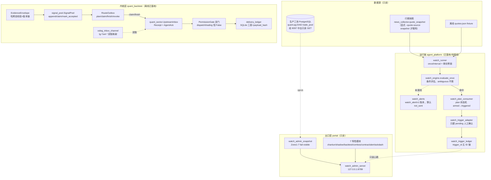

# 盯盘整合开发文档 v1.0

> **口径日期**：2026-11-04（全文所有行号、状态、计数均以该日只读盘点为准）
> **文档性质**：研发团队整合开发文档（非汇报稿）；所有论断须带「文件路径:行号」证据
> **三态标注约定**：✅ 已落地（代码已提交/入库）｜🧊 已冻结（契约/红线冻结，不擅自改）｜🔌 待接线（代码就绪但未接生产）
> **安全边界**：本文档基于 2026-11-04 只读盘点；盯盘全链路 paper-only/只读/offline，研究推演不构成投资建议

---

## 1. 文档定位与子系统边界

盯盘子系统由四层构成，任何一层都不单独构成"盯盘系统"：

| 层 | 名称 | 代码域 | 职责 | 状态 |
|---|---|---|---|---|
| 出口层 | watch-admin 只读服务 | `portal/watch_admin_server.py` + `portal/watch_admin_snapshot.py` + 7 个 `portal/watch_admin_route_*.py` | 只读管理页/快照/特性看板，独立进程绑 127.0.0.1 | ✅ 已落地 |
| 内核层 | WQ 信号上行域 | `quant_backtest/watch_dispatch/` + `quant_backtest/quant_sector/` + `quant_backtest/agent_bridge/` | 证据信封、路由 outbox、上游受理、双门、投递账本 | ✅ 已落地（离线） |
| 运行链 | agent_platform watch_* | `agent_platform/watch_engine.py`、`watch_runner.py`、`watch_alerts.py`、`watch_plan_consumer.py`、`watch_trigger_adapter.py`、`watch_trigger_ledger.py` | 条件评估引擎、quote provider、告警账本、plan 状态机、trigger 账本 | ✅ 已落地；🔌 真实行情源/调度待接线 |
| 组织契约 | org.json 席位 | `agent_platform/registry/org.json` | WA1/WA2/WA3/QS1 席位、上报路、ACK 语义 | ✅ 已落地 |

边界声明：

1. **盯盘永不直连飞书/投研/交易室**——`quant_backtest/watch_dispatch/contracts.py:171-179`（RouteIntent docstring）：watch 是量化交易子模块，异动只上报量化板块（唯一路由 `QUANT_UPSTREAM_REPORT`，`contracts.py:16`），三路分发由量化层拥有。
2. **出口层不碰生产**——`portal/watch_admin_server.py:5-14`：独立进程、仅绑 127.0.0.1、不 import/modify `portal_api.py`、不碰 8091；`portal/watch_admin_route_ackdash.py:9-13`：数据源严格本地只读文件，无飞书/交易/通知/10.205.0.118/8091。
3. **全链路恒三类权限 False**——`contracts.py:77-87`（EvidenceEnvelope）、`contracts.py:199-209`（RouteIntent）、`quant_backtest/quant_sector/dual_gate.py:243-249`（PermissionGate）：production/notification/trading 均恒 `False`。

---

## 2. 系统架构总览

分层数据流：**数据源 → 信号产生 → 内核上行链 → 双门 → 出口层只读投影**。

模块调用关系要点：

- **上游链**：`signal_pool`（营级账本）→ `RouteOutbox`（单事件上行）→ `UpstreamInbox`（司马懿侧受理出 Receipt+Ack）→ 回写 `mark_accepted`（`quant_backtest/watch_dispatch/signal_pool.py:447`）。
- **运行链**：`watch_runner → watch_engine → watch_plan_consumer.trigger_plan → watch_trigger_adapter → watch_trigger_ledger`（接线规格见 `docs/plans/2026-11-04_盯盘完整系统_引擎_v1.md:18-29`、`docs/plans/2026-11-04_F3c_trigger_ledger_v1.md:82-85`）。
- **出口层**：`watch_admin_server` 主两路由 + 动态加载 7 特性模块（`portal/watch_admin_server.py:49-57,118-166`）；`/api/d1/watch-plans` 只读消费引擎心跳（`docs/plans/2026-11-04_盯盘完整系统_API_v1.md:12-19`）。

---

## 3. 核心契约（逐项证据）

### 3.1 证据信封 EvidenceEnvelope：哈希自校验 + 版本链

| 契约点 | 证据 |
|---|---|
| 字段闭集（41 字段，含五时点） | `quant_backtest/watch_dispatch/contracts.py:39-75` |
| 三类权限恒 False | `contracts.py:77-87` |
| payload 序列化（排除 envelope_hash 自身） | `contracts.py:89-100` |
| 版本链：v1 禁 previous；v>1 须 previous_hash 逐字段咬合 + 前件哈希重算 | `contracts.py:116-126` |
| freeze_at 须严格递增（版本时间） | `contracts.py:125-126` |
| 信封时窗 `source<=visible<=detected<=freeze<until` | `contracts.py:142-147` |
| 现时性 `freeze_at<=now<valid_until` | `contracts.py:148-151` |
| 哈希自校验 `digest(payload())==envelope_hash` | `contracts.py:152-154` |
| `source_qualification` 只接受 SOURCE_UNVERIFIED | `contracts.py:140-141` |
| 唯一路由集 `_ROUTES={"QUANT_UPSTREAM_REPORT"}` | `contracts.py:16` |

### 3.2 RouteIntent：唯一路由 + observation_only

| 契约点 | 证据 |
|---|---|
| docstring：watch 只上报父层，永不直投三路 | `contracts.py:171-179` |
| 默认值 READY_OFFLINE / observation_only=True / executable=False / no_order_permission=True | `contracts.py:194-197` |
| route ∉ _ROUTES → ROUTE_INVALID | `contracts.py:213-214` |
| 执行语义禁入（EXECUTION_FORBIDDEN） | `contracts.py:222-223` |
| 信封身份一致性（event_id/version/hash 全对齐） | `contracts.py:217-218` |
| 路由时窗嵌套于信封时窗 | `contracts.py:226-227` |
| 幂等键 = 六要素 digest（非 provider 回执） | `contracts.py:233-237` |

### 3.3 RouteOutbox：三时间线 + generation + revoke

| 契约点 | 证据 |
|---|---|
| 状态机 READY_OFFLINE/CLAIMED/ACCEPTED_VERIFIED/DEFINITELY_REJECTED/UNKNOWN/CANCELLED | `quant_backtest/watch_dispatch/route_outbox.py:19-24` |
| plan（幂等建 intent） | `route_outbox.py:164` |
| claim（租约；LEASE_WINDOW/INTENT_NOT_CLAIMABLE/ATTEMPTS_EXHAUSTED） | `route_outbox.py:274` |
| finish（attempt 结算；attempt/intent/generation/revoked 六重 current 校验） | `route_outbox.py:309,400-421` |
| **ACCEPTED_VERIFIED 须 ActiveAckPort 独立权威 + R1 复查** | `route_outbox.py:424-439`（D2 裁定 2026-10-23：ACK 回调与落账之间落地撤销时，发布前对同 fingerprint 只读复查 inbox 活性，堵住"撤销后仍发 verified 收据"竞态） |
| cancel（仅未投递 intent 可取消） | `route_outbox.py:457-469` |
| revoke_envelope（epoch 只进不退；EPOCH_NOT_ADVANCED） | `route_outbox.py:471-503` |

### 3.4 inbox 幂等键与双通道

| 契约点 | 证据 |
|---|---|
| 幂等键 = digest(channel,kind,payload,source,report_id,trace_id) | `quant_backtest/agent_bridge/osleg_contract.py:167-170` |
| trace_id 缺失 = 契约违例，禁回填默认值 | `osleg_contract.py:164-166` |
| 同键重放回放同一单（duplicates+1）；被拒旧单重投须新 msg_id 不复活 | `osleg_contract.py:171-183` |
| 双账命名空间：gateway `lg-*`、契约层 `w4-*`，共享 report_id/trace_id | `quant_backtest/agent_bridge/osleg_inbox_channel.py:11-12` |
| kind 词表白名单 KIND_TO_GATEWAY；未登记失败关闭 | `osleg_inbox_channel.py:62-68`（gateway 侧 `agent_platform/gateway/inbox_gateway.py:60` INBOX_KINDS=("task_request","question","feedback")） |
| 隔离红线：store 不得指向真实 bridge_inbox | `osleg_inbox_channel.py:86-96,169-175` |
| HTTP 通道②契约：X-OSLEG-Auth + 来源白名单 ("qs1","a0")；占位 token 拒收 | `quant_backtest/agent_bridge/osleg_http_contract.py:62-70,87-91` |

### 3.5 ledger 追加式哈希链

| 账本 | 契约点 | 证据 |
|---|---|---|
| EvidenceEnvelope 版本链 | previous_version_hash 链 + 重算校验 | `contracts.py:116-126` |
| RuleEvent 链 | event_digest 规范化 sha256（previous_hash/sequence/issued_at 全入哈希） | `quant_backtest/watch_owner_rules.py:210-238,268-295` |
| delivery_ledger | SQLite 三表 delivery_events/targets/attempts + subscription_control；payload_hash 列；BEGIN IMMEDIATE 原子事务 | `quant_backtest/delivery_ledger.py:176-214,346-348` |
| SENT 语义 | CLAIMED 可能已触达 provider → 过期只产 UNKNOWN；SENT 须 provider 回执 + 独立 verifier | `delivery_ledger.py:1-8` |

### 3.6 revoke 原子性

| 契约点 | 证据 |
|---|---|
| outbox epoch 前进校验 + claimed intent 转 UNKNOWN 并清 receipt | `route_outbox.py:471-503` |
| inbox revoke：epoch 只进不退；撤销时间不得早于 ACK | `quant_backtest/quant_sector/upstream_inbox.py:257-270` |
| is_active/is_revoked 只读查询 | `upstream_inbox.py:272-278` |
| 双门 revoke：identity 入 blocked 集不可逆 | `quant_backtest/quant_sector/dual_gate.py:301-310` |
| R1 复查防撤销竞态（见 3.3） | `route_outbox.py:424-439` |

### 3.7 时间一致性

| 契约点 | 证据 |
|---|---|
| canonical.utc_text：tzinfo 缺失或非零 offset → UTC_REQUIRED | `quant_backtest/watch_dispatch/canonical.py:58-61` |
| 行情源时区 Asia/Shanghai（market A） | `quant_backtest/watch_source_authority.py:25` |
| 盘前完成凭证时区 Asia/Shanghai | `quant_backtest/premarket_run_receipt.py:20` |
| 信封五时点单调链 | `contracts.py:142-147` |
| delivery ledger 强制 aware 时间戳 | `quant_backtest/delivery_ledger.py:31-39` |

### 3.8 双门 stronggate（quant_sector）

| 契约点 | 证据 |
|---|---|
| PermissionGate：每次 consume 双门实时重验 | `quant_backtest/quant_sector/dual_gate.py:225-241` |
| **上游受理前置**：无 lookup/未知 ref/已撤销 → BLOCKED/UPSTREAM_NOT_ACCEPTED | `dual_gate.py:334-337` |
| 人工授权门：resolve_and_verify + binds + 时窗 + scope（sim_only 必 True） | `dual_gate.py:338-346` |
| RiskGuard 门：独立评估 + binds + decision==PASS + 时窗 | `dual_gate.py:347-355` |
| dispatch_permitted / trading_permitted 恒 False | `dual_gate.py:243-249` |
| 终态上限 SIM_DISPATCH_ELIGIBLE（仍不含交易许可） | `dual_gate.py:356-357` |

### 3.9 白名单/词表

| 契约点 | 证据 |
|---|---|
| HTTP 通道来源白名单 ("qs1","a0") | `quant_backtest/agent_bridge/osleg_http_contract.py:68-70` |
| gateway kind 词表（3 种） | `agent_platform/gateway/inbox_gateway.py:60` |
| W4 kind→gateway 映射；未登记失败关闭 | `quant_backtest/agent_bridge/osleg_inbox_channel.py:62-68,414-419` |
| API engine 状态白名单标量（token/凭据不透出） | `docs/plans/2026-11-04_盯盘完整系统_API_v1.md:49` |

### 3.10 来源资格四证据（WATCH1）

| 证据类 | 字段要点 | 证据 |
|---|---|---|
| StrategyMembershipProof | 权威签发的单条 A 池策略成员资格（approved/revoked/valid_from/until） | `quant_backtest/watch_source_authority.py:29-41` |
| OwnerInputProof | 服务端签发的 B 池持久化输入版本授权 | `watch_source_authority.py:44-59` |
| RawHttpResponseProof | 受信原始 HTTP 字节 + 独立留存锚（content_sha256/字段位） | `watch_source_authority.py:63-76` |
| TradingSessionProof | 独立交易所日历会话 + 策略版本 | `watch_source_authority.py:80-88` |

> 补充：`ProviderLicenseProof`（provider 授权）见 `watch_source_authority.py:92-100`；解析器协议 `WatchSourceAuthority` 为注入式只读端口，任何查找/解析/外部策略失败一律 fail-closed（`watch_source_authority.py:1-7,103-109`）。快照的 canonical digest **不构成**原始行情凭证（`watch_source_authority.py:5-6`）。

---

## 4. 数据流全链路

### 4.1 信号产生（影子触发器）

- 监控集：`portal/data/todays_picks.json`，tier∈{T1,T2} 且含买入类 tag（`quant_backtest/pool_watch.py:4-5`）。
- 触发线：`PULL_FACTOR=0.99`（回踩 -1%）/ `BREAK_FACTOR=1.03`（突破 +3%），`quant_backtest/pool_watch.py:52-53`。
- 择势门：reg=="down" 时突破降级 reg_flag_only（留痕不推）（`pool_watch.py:14-15`）。
- 落点：`signal_pool.append_event`；14 天影子期铁律，绝不调 signal_consumer/engine（`pool_watch.py:21-25`）。

### 4.2 内核上行链

`signal_pool`（append→claim→mark_accepted，`quant_backtest/watch_dispatch/signal_pool.py:370,424,447`）→ `EvidenceEnvelope` 冻结 → `RouteOutbox.plan/claim/finish` → `UpstreamInbox.accept` 出 Receipt+AgentAck（`quant_backtest/quant_sector/upstream_inbox.py:236-255`；ACK 不得早于受理 `:244-246`）→ 跨层翻译：`osleg_inbox_channel` lg-*/w4-* 双账共享 report_id/trace_id（`quant_backtest/agent_bridge/osleg_inbox_channel.py:11-12`）→ 回写 `mark_accepted`。

### 4.3 组织链落点

| 席位 | 组织事实 | 证据 |
|---|---|---|
| WA1 许褚 | watch_monitor / watch_lead；上行路 QUANT_UPSTREAM_REPORT；report_kinds ANOMALY/HEALTH；"不直连飞书/投研/交易所；三类动作权限恒 False" | `agent_platform/registry/org.json:155-208`（constraints :186-190） |
| WA2 张郃 | reports_to WA1；盘口/量能盯盘 | `org.json:485-538`（reports_to :508） |
| WA3 太史慈 | reports_to WA1；事件/情绪盯盘 | `org.json:540-593`（reports_to :563） |
| QS1 司马懿 | quant_sector_upstream_receiver；accepted_routes 仅 QUANT_UPSTREAM_REPORT；"受理回执=ACK，受理不等于授权" | `org.json:210-262`（ack_semantics :230） |
| 部门职责 | QS1 签收 WA1 上行并出具 agent 级 ACK（K-ORG-191）；盯盘组 WA1 统管 WA2/WA3 | `org.json:93`（lead_duty） |
| 门户路由 | watch_setup → 许褚营 G1 触发器 | `portal/comm_router.py:105-112` |

### 4.4 运行链（引擎/确认/人工门）

`watch_runner`（provider 三选一：quotes-json/snapshot/none，默认 none 不联网；`docs/plans/2026-11-04_盯盘完整系统_接线_v1.md:103-108`）→ `watch_engine.evaluate_once`（读 armed plan、判条件、命中调 `consumer.trigger_plan`；ambiguous/quote_unavailable/quote_stale 一律不触发，`docs/plans/2026-11-04_盯盘完整系统_引擎_v1.md:36-44`）→ `watch_plan_consumer.trigger_plan`（`agent_platform/watch_plan_consumer.py:346`；plan→triggered）→ `watch_trigger_adapter.trigger_watch_plan`（只建 pending 确认，`agent_platform/watch_trigger_adapter.py:5,212-214`）→ `watch_trigger_ledger`（trigger_id 五 ID 链，`docs/plans/2026-11-04_F3c_trigger_ledger_v1.md:33-41,61-66`）。**人工门**：approve/reject 走既有 `/api/sim/confirm`（`docs/plans/2026-11-04_盯盘完整系统_引擎_v1.md:199-200`；接口登记 `docs/standards/INTERFACE_REGISTRY_v1.yaml:587`）。

### 4.5 告警上行边界

告警事件 `watch_alert/v1` 为运行时轻量账本（闭集字段、UTC、十进制、paper_only/not_a_trade 必 true、执行字段拒收），默认 dry-run 零写、dispatch 默认 not_sent，不 import 任何网络库（`docs/plans/2026-11-04_盯盘完整系统_告警_v1.md:18-40,66-77`）。**不授予任何生产资格**（同文 :41-42,168）。与 watch 上行边界一致：告警 sink 接线前，盯盘侧无任何真实通知出口。

---

## 5. 出口层 watch-admin 服务

### 5.1 server 结构

| 项 | 事实 | 证据 |
|---|---|---|
| 进程隔离 | 独立进程，仅绑 127.0.0.1:8789，不 import/modify portal_api，不碰 8091 | `portal/watch_admin_server.py:5-14` |
| HOST | `"127.0.0.1"` | `watch_admin_server.py:43` |
| 端口 | 默认 8789（env WATCH_ADMIN_PORT 可覆盖）；2026-10-30 起 8796 让给军团指挥台后换 8789 | `watch_admin_server.py:44-45` |
| 端口史 | OSLINK 通道②契约占 8795（`quant_backtest/agent_bridge/osleg_http_contract.py:2`）；watch_admin 曾绑 8796（`outputs/盯盘子项目_单B_optin_验证报告_20261021.md:16`）→ 现 8789 | 见左列证据 |
| 鉴权 | **无 HTTP 鉴权**（仅靠 127.0.0.1 绑定 + 特性模块内部门控） | `watch_admin_server.py:89-184`（无任何 auth 分支） |
| static 穿越防护 | `/static/` resolve 后 relative_to(base)，越界 403 | `watch_admin_server.py:102-116` |
| 快照路由 | `GET /api/watch-admin/snapshot`，异常仍返 200 fail-visible 信封 | `watch_admin_server.py:118-133` |
| 特性模块动态加载 | ImportError 跳过；路由命中即 200；模块异常 feature_failed | `watch_admin_server.py:136-166` |
| 每请求新建 Aggregator | L121 `WatchAdminAggregator().build(replay_at=replay)` | `watch_admin_server.py:121` |

### 5.2 Zone3 门控（生产三池）

| 态 | 行为 | 证据 |
|---|---|---|
| 默认 opted_out | 不出网、不持 key、不发任何请求；error_code=opted_out，verified=False | `portal/watch_admin_snapshot.py:534-546` |
| opt-in | 须 `WATCH_ADMIN_ALLOW_PROD_POOL=1` + 只读 key 才 GET 8097（X-Push-Hub-Key；仅 SELECT 不写回） | `watch_admin_snapshot.py:547-574` |
| key 优先级 | env PUSH_HUB_KEY/push_hub_key/QUANT_MID_KEY/quant_mid_key → push_secrets.json（push_hub_key/quant_mid_key）→ None | `watch_admin_snapshot.py:295-319` |
| 无 key | error_code=no_key，SOURCE_UNVERIFIED，不伪造 | `watch_admin_snapshot.py:575-582` |
| fail-visible | 单源缺失只标该源 unknown，build() 整体不抛 | `watch_admin_snapshot.py:10-14` |

### 5.3 七个特性模块一览

| 模块 | API/HTML 路由 | 职责 | 缺源处理 |
|---|---|---|---|
| chanlun | `/api/watch-admin/chanlun`、`/watch-admin/chanlun` | ST1 缠论信号候选（chanlun_pool.jsonl 计数+小样本） | 缺文件 → unknown/error_code（`watch_admin_snapshot.py:511-526`） |
| shadow | `/api/watch-admin/shadow` | A/B 影子对比（runtime decisions + shadow ledger 只读） | 缺失不编造（`watch_admin_snapshot.py:826-848`） |
| backtest | `/api/watch-admin/backtest` | last_backtest.json 原样呈现（标缺 model/agent/combo 维度） | 缺文件 → unknown |
| combos | `/api/watch-admin/combos` | 组合注册表只读（combo_registry/直读 JSON 双路） | 缺失 → missing（`watch_admin_snapshot.py:586-599`） |
| contract | `/api/watch-admin/contract` | 席位/模型契约一致性看板（org.json + team_invest + model_tiers + 8098 静态） | 8098 不可达 → http_error/UNVERIFIED（`portal/watch_admin_route_contract.py:11-13`） |
| alert | `/api/watch-admin/alert` | 告警看板（只读 JSONL） | 缺源 → unknown |
| ackdash | `/api/watch-admin/ackdash` | 单A：实时 ACK/多 Agent 投票/用量三面板 | 恒 source_missing/unverified（`portal/watch_admin_route_ackdash.py:5-8,29-42`） |

### 5.4 单A / 单B / 单C 边界与状态

| 项 | 状态 | 证据 |
|---|---|---|
| 单A（实时 ACK/投票/用量看板） | ✅ 已入库 commit `d24047080`；三面板本地探针全部缺失 → 恒 source_missing，**待真源接入裁决**（无五要素批文） | `git log d24047080`；`watch_admin_route_ackdash.py:26-42`；`outputs/盯盘子项目_单B_optin_验证报告_20261021.md:71` |
| 单B（生产三池 opt-in） | ✅ opt-in 已验证 verified=True（真实 8097 响应，空池 active=0/pending=0）；回滚 = 删 env 零代码 | `outputs/盯盘子项目_单B_optin_验证报告_20261021.md:20-43,63-65` |
| 单C（飞书/通知/交易/GAP-4/051 视图） | 🧊 维持 BLOCK，不立项 | `outputs/盯盘子项目_单B_optin_验证报告_20261021.md:71`；`portal/watch_admin_route_contract.py:70-106` |

---

## 6. 测试与质量现状

### 6.1 内核层测试矩阵（quant_backtest/tests/，2026-11-04 实测 def 计数）

| 测试文件 | def test_ 数 |
|---|---|
| test_wq1_upstream_inbox.py | 9 |
| test_wq1_dispatch_ledger.py | 19 |
| test_wq3_lease_recovery.py | 16 |
| test_wq_pool_upstream_e2e.py | 18 |
| test_trusted_acceptance.py | 15 |
| test_watch_dispatch_outbox.py | 19 |
| test_watch_dispatch_signal_pool.py | 29 |
| test_osleg_http_contract.py | 26 |
| test_delivery_ledger.py | 18 |
| test_quant_sector_dual_gate.py | 18 |

### 6.2 运行链测试（agent_platform/tests/）

| 测试文件 | def test_ 数 | 备注 |
|---|---|---|
| test_watch_engine.py | 34 | 计划文档自报 43 passed；差异已核实 = parametrize 展开（`:124` 十用例，34+9=43）；`docs/plans/2026-11-04_盯盘完整系统_引擎_v1.md:157` |
| test_watch_alerts.py | 24 | 计划文档自报 29 passed；差异已核实 = parametrize 展开（`:109` 六用例，24+5=29）；`docs/plans/2026-11-04_盯盘完整系统_告警_v1.md:129` |
| test_watch_trigger_ledger.py | 22 | 与 F3c 自报 22 passed 一致 |
| test_watch_runner.py | 16 | 与接线单自报 16 passed 一致 |
| test_watch_feed_consumer.py / test_watch_trigger_adapter.py | 4 / 5 | 既有回归 |

### 6.3 可引用通过记录

- W-Q1 独立对抗验收：验收通过、产品缺陷 0；回归 watch_dispatch 78 passed + wq1 22 passed；离线实证 socket/urllib/subprocess/文件写事件 = 0（`docs/plans/2026-10-19_W-Q1独立对抗验收报告_pool-qa与wq1-qa合并归档.md`）。
- 盯盘 API：`portal/tests/test_api_watch_plans.py` 19 passed；相关回归 74 passed + 2 xfailed；route baseline 298 零 diff；全量 portal/tests 871 passed + 1 failed（唯一失败 `test_dw_catalog_alignment` 为既有 clean-worktree 环境性失败，与本单无关）（`docs/plans/2026-11-04_盯盘完整系统_API_v1.md:186-209`）。
- 引擎/告警/接线三单 ruff 0 + syntax gate PASS（同三计划文档验收证据节）。

### 6.4 出口层零 pytest 覆盖 —— 文档级缺口

watch-admin 出口层（server/snapshot/7 路由模块）**无 pytest 基线**，质量保障仅靠 verify 脚本 + 文档态 QA（`outputs/盯盘子项目_*` 系列 + 计划文档）。这是本文档列名的第一个 P0 路线图项。

---

## 7. 已知缺口与冻结项（诚实清单）

| # | 缺口 | 现状与证据 | 状态 |
|---|---|---|---|
| G1 | GAP-4 P0 与 051 时序缺口 | 仅存在于 snapshot blocks 列表（`portal/watch_admin_snapshot.py:811,1031`）与 route_contract REDLINE_ITEMS（`portal/watch_admin_route_contract.py:79-91`）；冻结未解、无修复工单、看板不解锁 | 🧊 冻结 |
| G2 | route_outbox 内存态 | 无持久化、无可查询端点；WA1 首条 inbox/acked 回执未落盘 → 上游 ACK live=contract_only（`watch_admin_snapshot.py:804-812`） | 已知缺口 |
| G3 | cross 条件缺 prev | `--quote-source snapshot` 快照无 prev → cross 条件 ambiguous（`docs/plans/2026-11-04_盯盘完整系统_接线_v1.md:107,148`） | 待 provider 补前值 |
| G4 | 真实行情源/调度/告警 sink 未接线 | 引擎默认无网络；runner 未接调度；watch_alerts 无触发源调用、无 sink（`docs/plans/2026-11-04_盯盘完整系统_引擎_v1.md:186-200`、`_告警_v1.md:134-152`、`_接线_v1.md:144-158`） | 🔌 Lead 待办 |
| G5 | snapshot 15s TTL 跨请求失效 | TTL 是 Aggregator 实例内缓存（`watch_admin_snapshot.py:69,192-193,1000-1037`），但 server 每请求新建实例（`watch_admin_server.py:121`）→ 缓存实际不复用 | 已知缺口（性能向，不影响正确性） |
| G6 | 盯盘 API 生效需重启 | `/api/d1/watch-plans` 新字段为 portal_api 进程内代码，需维护窗口重启 8091 换血（`docs/plans/2026-11-04_盯盘完整系统_API_v1.md:216-217`） | 🔌 未重启 |
| G7 | watch_engine 未写 status.json | 文件缺失时 API 诚实返回 engine_state=unavailable（`docs/plans/2026-11-04_盯盘完整系统_API_v1.md:112-123,231`） | 🔌 待引擎 owner |
| G8 | 租约过期悬挂 intent | CLAIMED 未 finish 的 intent 无自动回收路径（`docs/plans/2026-10-19_W-Q1独立对抗验收报告_pool-qa与wq1-qa合并归档.md` 观察项 1） | 观察项 |
| G9 | params.yaml 注释滞后 | L8/L14 注释记 R4 max_pos_weight=0.35（10-08 拍板），L75 实值已为 0.40（10-10 复核拍板单，L72-74）；文档级小缺口，**不影响运行**（代码只读实值），建议修订注释 | 注释修订待办 |

---

## 8. 红线与门禁

### 8.1 五项 BLOCK（看板/只读契约永不触碰）

| 红线 | 证据 |
|---|---|
| 飞书真实下发 | `portal/watch_admin_route_contract.py:71-77`；`watch_admin_snapshot.py:811` |
| GAP-4 | `watch_admin_route_contract.py:78-84` |
| 051 时序缺口 | `watch_admin_route_contract.py:85-91` |
| 真实通知 | `watch_admin_route_contract.py:92-98` |
| 交易 | `watch_admin_route_contract.py:99-105` |

### 8.2 三类权限恒 False

production / notification / trading 在 EvidenceEnvelope（`contracts.py:77-87`）、RouteIntent（`contracts.py:199-209`）、PermissionGate（`dual_gate.py:243-249`）、SignalPool（`watch_dispatch/signal_pool.py:289-297`）均为恒 False 属性；双门终态上限 SIM_DISPATCH_ELIGIBLE（`dual_gate.py:356-357`）。

### 8.3 RiskGuard 现状

| 项 | 事实 | 证据 |
|---|---|---|
| 四规则 | R1 市场质量分位闸 / R2 流动性冲击 / R3 事件风险 / R4 仓位集中度 | `zerobound-kg/kg_riskguard.py:9-22,85-86` |
| 阈值（params.yaml 单一事实源） | R1 滚动 125 日 P10；R2 vol/vol_ma20 ≥ 2.5；R3 密度 ≥ 0.5 或 n ≥ 5；R4 权重 **0.40** | `zerobound-kg/params.yaml:53-54,60,65,68,75` |
| GUARD_KEYS | 9 键全部入 calibrated_keys（enforce_allowed=True 条件②达成） | `kg_riskguard.py:94-99`；`params.yaml:18` |
| enforce 状态 | **维持 shadow**：仍需 ①显式 --enforce + ③样本外对账 \|t\|≥3 且老田批准（③当前无法机验） | `kg_riskguard.py:37-46` |
| R4 口径（0.40） | 实值以 **2026-10-10 老田复核拍板单**为准（w≥0.40 才显著危险 -8.81%, t=-3.81；0.35 拐点档 -1.84pp 不显著）；params.yaml 第 8/14 行注释中的 0.35 为 10-08 拍板历史记录，**注释滞后于实值**（L75=0.40，依据 L72-74） | `zerobound-kg/params.yaml:8,14,72-75` |
| 误杀专题 | 治误杀路径=拦截账本→后验复算→2x2 对账→达标才 enforce；R1 重设计依据 223 有效采样日、block 46 日 -3.56% vs pass 52 日 +1.05% | `kg_riskguard.py:4-8,24-29` |
| 规则级误杀证据 | 结论 no_rule_level_false_kill_evidence（源自盯盘误杀复盘：拦截样本后验 +0.65% vs 放行 -0.25%） | `kg_riskguard.py:4-6`；校准落地 WO-QT-20261020-023 见 `deliverables/2026-10-20_RiskGuard校准落地_WO-QT-20261020-023.md` |

### 8.4 人类批准门禁

写 8091 / 触 10.205.0.118 属 L2 人类五要素批准域（AGENTS.md §7 门禁体系；本文撰写会话对该文件相关行读取被敏感审批拦截，具体行文 **待核**，可引用可见行 `AGENTS.md:113`「L2 五要素」）。判例 K-STOCK-413（历史裁定口径）一并遵守。盯盘 API 生效需维护窗口重启 portal_api（当前未重启，见 G6）。

---

## 9. 下一步开发路线图

| 优先级 | 项 | 内容 | 依赖 | 门禁 |
|---|---|---|---|---|
| P0 | 出口层 pytest 基线 | 为 server/snapshot/7 路由模块建最小只读测试（路由表、static 穿越 403、fail-visible 信封、Zone3 三态、无写盘断言） | 无（可并行） | 不碰 8091/飞书/交易 |
| P0 | 真实行情源与调度接线 | 由 Lead 接 quote provider（snapshot 显式联网或替换 feed）；调度建议盯盘时段 30-60s 一轮、盘后停；先离线 quotes 灰度 | watch_runner 已落地 | L2 五要素（涉网络/调度） |
| P1 | 单A 真源接入 | ackdash 三面板接真实只读源（待老田裁决源资格） | 单A 模块已入库 d24047080 | 五要素批文；未批维持 source_missing |
| P1 | WA1 首条回执落盘验证 | route_outbox 持久化或回执落盘，使上游 ACK live 从 contract_only → verified | G2 | 不改 outbox 内存语义；先隔离验证 |
| P1 | route_outbox 持久化 | 内存态 → 显式路径账本（含查询端点），保持 epoch/撤销语义 | P1 回执项 | 独立对抗验收 |
| P2 | cross 条件 provider | snapshot provider 补 prev（缓存推导或双点抓取） | G3 | ambiguous 不猜的口径不变 |
| P2 | 监控台增强 | engine status.json 落盘 + API 展示 + ackdash 接线 | G7 | 只读；不重启即生效（有文件即读） |

每项通用纪律：只 commit 不 merge 的切片先行；隔离根/tmp 数据验证；不启停服务、不写生产；回滚 = git revert + 停调度/删 env（零代码回滚优先）。

---

## 附录 A：关键文件索引

| 域 | 文件 |
|---|---|
| 内核契约 | `quant_backtest/watch_dispatch/contracts.py`、`canonical.py`、`route_outbox.py`、`signal_pool.py`、`agent_reporting.py` |
| 内核受理/账本 | `quant_backtest/quant_sector/upstream_inbox.py`、`dual_gate.py`、`quant_backtest/delivery_ledger.py`、`quant_backtest/watch_owner_rules.py` |
| 桥接 | `quant_backtest/agent_bridge/osleg_contract.py`、`osleg_inbox_channel.py`、`osleg_http_contract.py`、`agent_platform/gateway/inbox_gateway.py` |
| 来源资格 | `quant_backtest/watch_source_authority.py`、`quant_backtest/premarket_run_receipt.py` |
| 运行链 | `agent_platform/watch_engine.py`、`watch_runner.py`、`watch_alerts.py`、`watch_plan_consumer.py`、`watch_trigger_adapter.py`、`watch_trigger_ledger.py` |
| 出口层 | `portal/watch_admin_server.py`、`portal/watch_admin_snapshot.py`、`portal/watch_admin_route_{chanlun,shadow,backtest,combos,contract,alert,ackdash}.py` |
| 组织/路由 | `agent_platform/registry/org.json`、`portal/comm_router.py` |
| 规范文档 | `docs/plans/2026-11-04_盯盘完整系统_{引擎,API,告警,接线}_v1.md`、`docs/plans/2026-11-04_F3c_trigger_ledger_v1.md`、`docs/plans/2026-10-25_OSLINK-W4_司马懿到田丰归口契约v0.1_草案.md` |

## 附录 B：盘点一致性说明（撰写时核实）

1. 测试计数口径：计划文档自报 passed 数与本文 def 计数差异已核实为 parametrize 展开（watch_engine `:124` 十用例 34+9=43；watch_alerts `:109` 六用例 24+5=29）；其余文件两口径一致。
2. 端口史：watch_admin 8796→8789 有代码注释与单B报告双向证据；8795 属 OSLINK 通道②契约端口，与 watch_admin 无绑定关系，文中已区分表述。
3. AGENTS.md 敏感行读取被审批拦截，§8.4 相关行文按可见内容最小化引用并标待核，未编造。
4. params.yaml R4 阈值口径：实值 0.40（10-10 复核拍板单，L72-75）与 L8/L14 注释 0.35（10-08 历史）存在漂移；本文档一律以实值为准并记入第 7 节 G9。
5. 引用抽验：内核盘点 worker 复核通过的抽验行号（contracts.py:40/172/16/223；route_outbox.py:25/424/471；org.json:206-207/230/508,511；osleg_contract.py:37/69/167-169；params.yaml:53-54/60/65,68,91/75）已逐条复核属实，可直接引用。

---

> **本文档基于 2026-11-04 只读盘点；盯盘全链路 paper-only/只读/offline，研究推演不构成投资建议。**
