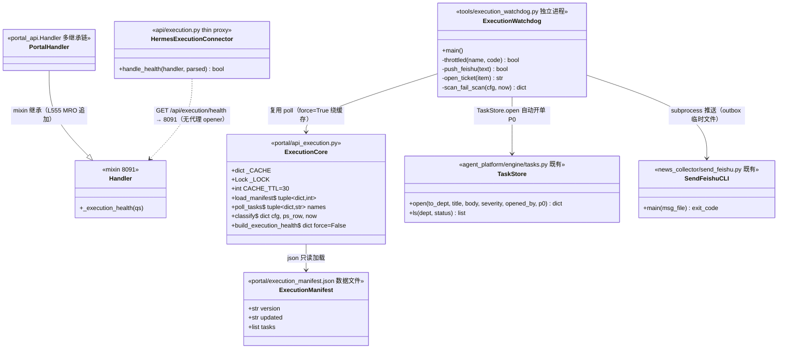
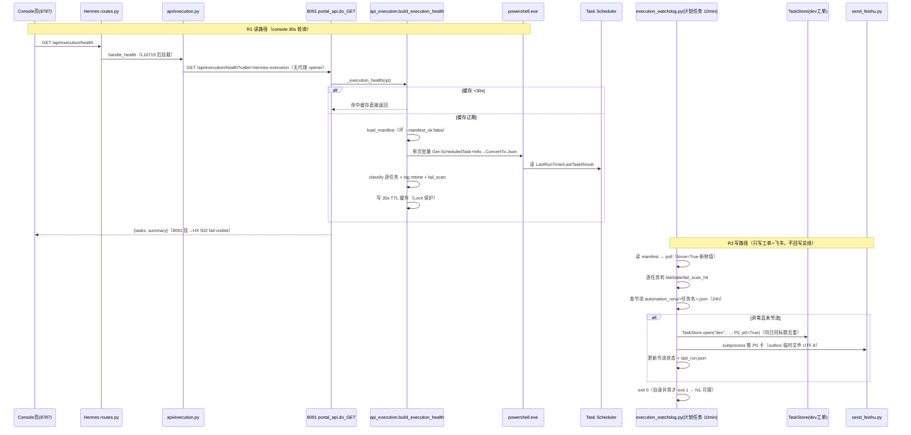
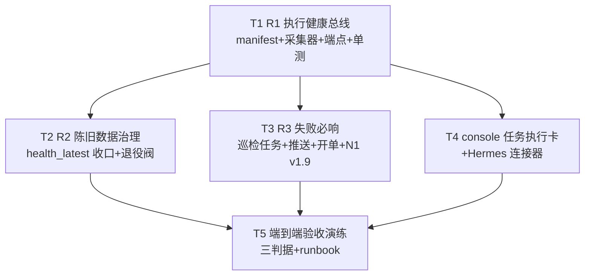

# 联动层一期施工设计（R1 执行健康总线 + R2 陈旧数据治理 + R3 失败必响）
> STATUS: unspecified（owner: TBD；2026-11-07 前补状态或标 superseded）


> 2026-10-18 · 撰写：架构师 高见远 · 上游输入：许清楚《Hermes自动执行动线联动研究报告》（R1/R2/R3 需求卡 + 验收判据为设计边界）
> 粒度目标：工程师拿去可直接施工——文件清单、接口契约、数据结构、任务分解（有序+依赖）、共享约定、风险。
> 红线（全文强制）：全部只读投影 + 白名单；零主控改动；fail-visible（总线挂 ≠ 执行面挂）；不碰影子链施工面（并行会话）；零新增依赖（纯 stdlib + OS 自带 powershell.exe）。

---

## Part A · 系统设计

### 1. 实现路线（难点分析与选型）

**核心难点四个：**

1. **Windows 计划任务状态怎么读（无新依赖约束）**——三个候选：
   - ❌ `win32com`（Schedule.Service COM）：需 pywin32，**新增依赖，违反红线**，否决。
   - ❌ `schtasks /query /fo csv /v`：verbose CSV 列头随系统区域设置本地化（中文系统列头为中文），且长输出含脏行，解析脆弱，否决。
   - ✅ **`subprocess` 调 `powershell.exe -NoProfile -Command`，一条命令批量取 manifest 全部任务的 `Get-ScheduledTask | Get-ScheduledTaskInfo | ConvertTo-Json`**：属性名固定不随区域变、一次进程调用取全量（PS 冷启 300-800ms，只付一次）、纯 stdlib。**已实测验证**：`Get-ScheduledTaskInfo` 的 `LastRunTime` / `LastTaskResult` 可用；`AgentShadowDaily` 实测 `LastRun=1999-11-30 Result=267011`（0x41303 尚未跑哨兵）——「never」态真实存在，正是 R1 要解决的「跑没跑看不见」。
2. **8091 是 ThreadingHTTPServer，schtasks/PS 子进程开销与缓存的取舍**——**结论：模块级 30s TTL 缓存 + `threading.Lock`**。理由：单次 PS 批量轮询约 1-2s；console 30s 自动刷新 + 人工连点会让无状态直查把 8091 工作线程挂在子进程等待上；任务健康是分钟级信号，30s 数据新鲜度损耗可接受（stale 判据粒度本身 ≥ 分钟）。R3 巡检是独立进程，轮询时显式绕过缓存（`force=True`）拿新鲜值。
3. **失败必响的开单机制选型**——三个候选：
   - ❌ `tools/devtask.py new`：那是**产码工单调度器**，`new` 会建 git worktree + task/ 分支——运维哑火事件不是产码任务，走它会污染 `.worktrees` 且附带了不需要的 git 面，否决。
   - ❌ 经 8093 legion HTTP 开单：多一跳网络面，8093 挂则必响失效——**必响要最短链路**，否决。
   - ✅ **复用 `run_shadow.open_failed_task`（agent_platform/run_shadow.py L216-237）同款机制**：`agent_platform/engine/tasks.py` 的 `TaskStore.open(to_dept="dev", title, body, severity="P0", opened_by="system/execution-watchdog", p0=True)`（P0 直入 doing），落 `agent_platform/data/org/tasks/tasks_YYYYMM.jsonl`，与既有 failed 自动开单同一本账（写侧单源红线）。同标题同日去重沿用其 `ts.ls(dept="dev")` 标题比对判例，叠加 24h 节流（见 §3 watchdog）。
4. **8091 侧代码放哪**——**新建 `portal/api_execution.py` 独立 mixin 模块，不并入 api_capability.py**。理由：api_capability.py 已 450+ 行且域不同（能力看板/观察季）；mixin 挂载判例成熟（api_capability.Handler 模式），独立文件可独立测试、接线只动 portal_api.py 三行；采集器核心函数设计为**纯 stdlib 无 portal 内部依赖**，R3 巡检脚本可直接 `sys.path.insert` 复用（一份轮询逻辑两个消费方，不复制粘贴）。

**架构模式**：延续 K-ORG-112 三层只读投影——`数据面(Windows Scheduler + 日志 mtime) → 只读总线(8091 /api/execution/health) → 转调消费(Hermes 8787 console 卡)`。R3 是总线上唯一的「主动消费方」（独立计划任务进程拉总线数据做必响），仍不产生写路径回总线。

### 2. 文件清单

```
新增：
  portal/execution_manifest.json          # R1 任务清单+期望节奏（数据文件，加任务=加一行）
  portal/api_execution.py                 # R1 采集器核心 + Handler mixin（纯 stdlib）
  portal/test_execution_mixin.py          # R1 mixin 单测（对齐 test_capability_mixin.py 判例）
  tools/execution_watchdog.py             # R3 失败必响巡检脚本（纯 stdlib）
  tools/register_execution_watchdog.ps1   # R3 计划任务一次性注册脚本（UTF-8 BOM）
  Hermes/hermes-webui-next/api/execution.py       # Hermes thin proxy 连接器（observe.py 同款）
  docs/runbooks/2026-10-XX_联动层一期验收演练.md   # T5 验收演练 runbook（XX=实际执行日）

修改：
  portal/portal_api.py                    # 三处接线：import(~L142) / Handler MRO(L555) / do_GET(L2909 后)
  Hermes/hermes-webui-next/api/routes.py  # 挂载段（L16719 observe 块之后插入）
  Hermes/hermes-webui-next/api/purify.py  # R2：health 段退役（L32/L37/L139-146/L182/L192）
  Hermes/hermes-webui-next/static/console.html  # R2：⑤卡改读新源（L70/L187-196）+ R1 新「任务执行」卡（L120 后 + JS L265-317 段）
  ops/health_latest.json                  # R2：重写为弃用标记 JSON
  ops/health_check.py                     # R2：退役阀（头部 banner + main() 拒绝执行）
  jev-eval/n1_check.ps1                   # R3：v1.9 新增第 (9) 项检查（必响链自身失联可探）

复用（只读引用，不改）：
  agent_platform/engine/tasks.py          # TaskStore.open / ls（开单底座）
  news_collector/send_feishu.py           # 飞书推送（subprocess 判例链）
```

### 3. 数据结构与接口



**manifest 条目 schema**（`portal/execution_manifest.json`）：

```jsonc
{
  "version": 1,
  "updated": "2026-10-18",
  "tasks": [
    {
      "name": "AgentShadowDaily",              // 计划任务名（schtasks 主键，ASCII）
      "cadence_minutes": 1440,                  // 期望节奏（分钟）
      "grace_minutes": 4320,                    // 宽限（缺省 = cadence*0.5）；周末类任务显式放宽
      "log_path": "agent_platform/data/shadow/last_run.log",  // 可选，仓库相对路径（C:\aios junction 语义）
      "fail_scan": {                            // 可选：rc=0 也要扫的「自愈失败」日志
        "log": "C:/项目/zhice-os-v2-windows-20260920/code/logs/aw-stack.log",
        "pattern": "FAILED:",
        "window_hours": 24
      },
      "enabled": true,                          // false → 显示 disabled 灰态，不入 summary 红绿
      "note": "影子链每日 17:10（工作日）"
    }
  ]
}
```

**8091 端点契约** `GET /api/execution/health`（只读，无任何写端点；caller 归因沿 K-ORG-109）：

```jsonc
{
  "read_only": true,
  "generated_at": "2026-10-18T09:30:00Z",
  "manifest_ok": true,            // false = manifest 缺失/坏 JSON（fail-visible，HTTP 仍 200）
  "manifest_path": "portal/execution_manifest.json",
  "manifest_count": 18,
  "ps_ok": true,                  // false = PowerShell 批量轮询失败（不编造数据）
  "ps_error": null,
  "ps_elapsed_ms": 1420,
  "tasks": [
    {
      "name": "AgentShadowDaily",
      "expected_cadence": "每 1440 分钟",
      "last_run": "2026-10-18 17:10:33",   // null = never；PS 原样格式化
      "last_result": 0,                     // int；267011=0x41303 尚未跑
      "result_ok": true,                    // last_result ∈ BENIGN_RC
      "log_mtime": "2026-10-18 17:35:02",   // null = log_path 缺省或文件不存在
      "stale_min": null,                    // now - last_run 分钟数；never 时 null
      "status": "ok"                        // ok | fail | stale | never | disabled
    }
  ],
  "summary": {"ok": 15, "fail": 1, "stale": 1, "never": 0, "disabled": 1,
               "worst": "fail"}            // worst ∈ null|never|stale|fail（红>黄>灰）
}
```

**status 判定**（优先级从上到下，`classify()` 实现）：
1. `enabled=false` → `disabled`；
2. `last_result ∉ BENIGN_RC = {0, 267009, 267011, 267014}` → `fail`（良性码表沿 ops/health_check.py L101 判例：0x41301 运行中 / 0x41303 尚未跑 / 0x41306 被终止；4294967295 等**不在**表内，必报 bad）；
3. `last_result == 267011 且 last_run 为 1999 哨兵` → `never`（从未跑过）；
4. `stale_min > cadence_minutes + grace_minutes` → `stale`；
5. 其余 → `ok`。`fail_scan` 命中不改变 status（rc 面归 rc），单独输出 `fail_scan_hit: true` 供 R3 消费。

**R3 巡检节流状态文件**（产物统一落 `C:\aios\automation_runs\`，对齐 2026-10-18 拍板约定）：

```jsonc
// C:\aios\automation_runs\execution_watchdog\<任务名>.json
{"last_alert_ts": "2026-10-18T09:31:00", "error_code": 1, "ticket_id": "T-20261018-012"}
// 节流键 = (任务名, error_code)，24h 内同键不重复推送/开单；error_code 变化立即再响
// C:\aios\automation_runs\execution_watchdog\last_run.json
{"ran_at": "2026-10-18T09:30:00", "exit": 0, "alerted": [], "skipped_throttle": []}
// N1 v1.9 检查此文件新鲜度（>30min FAIL）——「告警链自身失联可被 N1 探出」的落点
```

### 4. 程序调用流



### 5. Anything UNCLEAR（假设与待核对项）

1. **manifest 首批 18 任务的精确节奏是架构师抽查+清单推断，未逐条实测**（已实测 5 个：AgentWatchdog=5min、N1Check 每日 07:30、AI工作站门户API 每日 08:30、AgentShadowDaily=never 哨兵、HermesWebUI-Guard 每日 08:00）。T1 施工时用一条 PowerShell 逐条核对修正 `cadence_minutes/grace_minutes`，已列入 T1 自证步骤。
2. **HermesWebUI-Guard2 / Morning / A0Patrol 等任务名**按主理人清单采信，T1 核对时若不存在则从 manifest 删行（manifest 缺任务不报错，只是少一行——宁少勿假）。
3. **8787 提权重启未完成**（并行会话施工面）：T4 的 routes.py 挂载落盘后需重启 Hermes 才生效，时机须与 observe 连接器会话协调合并（撞车纪律红线 6），T5 验收前完成即可。
4. **N1Check v1.9 修改 jev-eval/n1_check.ps1** 属运维面文件，假设无并行会话同时改它；T3 开工前 `git diff` 确认。
5. 假设 `C:\aios` junction 持续有效（已实测：junction → C:\项目\老田的AI助手）；manifest 的 log_path 全部用仓库相对路径，fail_scan.log 允许绝对路径（aw-stack.log 在 zhice-os-v2 仓）。

---

## Part B · 任务分解

### 6. 依赖包

**零新增第三方依赖。** 全部使用：
- Python stdlib：`json / subprocess / threading / time / sqlite3(不开) / pathlib / urllib`（8091 现有 import 已含 subprocess/threading，实测 portal_api.py L150-161）；
- OS 自带：`powershell.exe`（Win PS 5.1，Get-ScheduledTask/Get-ScheduledTaskInfo/ConvertTo-Json）、`schtasks.exe`（注册计划任务）、`python.exe = C:\Program Files\Python311\python.exe`（与 n1_check.ps1 L58 同源）。

### 7. 任务清单（有序 + 依赖）

#### T1 · R1 执行健康总线（manifest + 采集器 + 端点 + 单测）
- **Source Files**：
  - 新建 `portal/execution_manifest.json`（首批 18 任务，schema 见 §3；节奏按 §5.1 逐条 PowerShell 核对后修正）
  - 新建 `portal/api_execution.py`（`load_manifest / poll_tasks / classify / build_execution_health` 纯函数 + `Handler` mixin，单文件纯 stdlib，可被 R3 脚本独立 import）
  - 修改 `portal/portal_api.py`：L142 后 `import api_execution`；L555 Handler MRO 追加 `api_execution.Handler`；L2909（observe 块）后插入 do_GET 分发 `if path == '/api/execution/health': self._execution_health(qs); return`
  - 新建 `portal/test_execution_mixin.py`（对齐 test_capability_mixin.py 判例）
- **Dependencies**：无
- **Priority**：P0
- **测试要点**：manifest 缺失/坏 JSON → `manifest_ok:false` HTTP 200 不 500；manifest 内任务在系统中不存在 → ps_ok:true 但该任务 status=never（宁报勿瞒）；`last_result=1` → fail；`last_result=267011+1999哨兵` → never；stale 边界（now-last_run == cadence+grace 恰好不判 stale，+1 判）；PS 子进程注入失败（monkeypatch subprocess）→ ps_ok:false 不编造；缓存 30s 生效（两次调用 ps 只跑一次）；并发 Lock 无竞态。
- **自证命令**：
  ```
  python -m pytest portal/test_execution_mixin.py -q
  python -X utf8 -c "import sys;sys.path.insert(0,'portal');import api_execution;import json;d=api_execution.build_execution_health();print(json.dumps(d['summary'],ensure_ascii=False),d['ps_ok'])"
  # 8091 重启后：curl http://127.0.0.1:8091/api/execution/health | jq .summary
  ```

#### T2 · R2 陈旧数据治理（health_latest.json 收口）
- **Source Files**：
  - 修改 `Hermes/hermes-webui-next/api/purify.py`：删 `HEALTH_JSON/HEALTH_STALE_MIN` 常量（L32/L37）与 `_health_state()`（L139-146）；`handle_overview` 的 `health` 键（L182/L192）改为固定值 `{"retired": true, "successor": "/api/execution/health"}`（不删键防前端 KeyError）
  - 修改 `Hermes/hermes-webui-next/static/console.html`：⑤健康快照卡 loadPurify 内 health 段（L187-195）改渲染「已退役→见任务执行卡」+ badge 灰态；L70 卡标题加「（已退役）」
  - 重写 `ops/health_latest.json`：`{"deprecated": true, "deprecated_at": "2026-10-18", "reason": "K-STOCK-349 砍健康聚合 + R2 收口到 8091 /api/execution/health", "successor": "GET http://127.0.0.1:8091/api/execution/health", "frozen_ts": <原文件 ts 字段>}`（JSON 无注释头，弃用标记进键值，grep 可见、误读方拿到 deprecated:true）
  - 修改 `ops/health_check.py`：头部 banner 注明退役 + `main()` 入口打印退役说明并 `exit 2`（`--force` 才放行）——防旧入口被手工拉起复活第二本账
- **Dependencies**：T1（新数据源可用后才断旧源）
- **Priority**：P0
- **测试要点**：console ⑤卡不再出现 health_latest 数据；purify overview 返回 health.retired=true；全仓 grep `health_latest` 仅剩 docs 归档/弃用标记自身，无活跃消费方；`python ops/health_check.py` 退出码 2。
- **自证命令**：
  ```
  python -X utf8 ops/health_check.py; echo "exit=$?"        # 期望 exit=2
  python -X utf8 -c "import json;print(json.load(open('ops/health_latest.json',encoding='utf-8'))['deprecated'])"  # True
  # 全仓 grep health_latest（排除 docs/ 与文件本身）→ 0 活跃消费方
  ```

#### T3 · R3 失败必响（巡检计划任务 + 推送 + 自动开单 + N1 v1.9）
- **Source Files**：
  - 新建 `tools/execution_watchdog.py`（纯 stdlib；`sys.path.insert(0, portal)` 复用 `api_execution.poll_tasks(force=True)`；逐任务判 fail/stale/fail_scan_hit → 节流检查（§3 状态文件，24h 同任务同错误码）→ ① `subprocess.run([py, news_collector/send_feishu.py, tmp_msg])` 推 P0 措辞卡（api_misc.py L790 判例：消息写 outbox UTF-8 临时文件）② `TaskStore.open("dev", "计划任务失败必响：<任务名>", body, "P0", opened_by="system/execution-watchdog", p0=True)`（run_shadow.open_failed_task 判例 + 同日同标题去重）→ 写 last_run.json；自身异常 exit 1）
  - 新建 `tools/register_execution_watchdog.ps1`（**UTF-8 with BOM**，start_agent_platform.ps1 判例：脚本不自注册，头部注释含注册命令；一次性管理员执行：`schtasks /Create /TN "AI工作站执行失败巡检" /TR "C:\Program Files\Python311\python.exe -X utf8 C:\aios\tools\execution_watchdog.py" /SC MINUTE /MO 10 /F`；动作支持 `--dry-run` 参数）
  - 修改 `jev-eval/n1_check.ps1`：v1.9 新增第 (9) 项——读 `C:\aios\automation_runs\execution_watchdog\last_run.json`，mtime 超 30min 或 exit≠0 → `Fail`（必响链自身失联可探，验收判据②）；顺带 `Get-ScheduledTaskInfo` 查「AI工作站执行失败巡检」任务 rc
  - （只读复用，不改：`portal/api_execution.py`、`agent_platform/engine/tasks.py`、`news_collector/send_feishu.py`）
- **Dependencies**：T1
- **Priority**：P0
- **P0 推送措辞模板**：
  ```
  🚨 [P0] 执行失败必响：<任务名>
  - 异常类型：<LastTaskResult=<rc> 非0 | 超期未跑 stale_min=<n> | 自愈日志命中 FAILED:>
  - 最近运行：<last_run>  · 节奏：每 <cadence> 分钟
  - 证据：<fail_scan 日志行 / last_run.log 尾行>
  - 已自动开单：<task_id>（dev 部门 P0 直入 doing）
  - 同任务同错误码 24h 内不重复推送（节流）
  ```
- **测试要点**：单测（monkeypatch poll_tasks 返回构造数据）：fail+未节流 → 推送+开单各一次；同任务同码 24h 内第二次 → 跳过（skipped_throttle）；error_code 变化 → 立即再响；TaskStore 异常不中断推送（开单 fail-open 判例）；send_feishu 失败 → watchdog exit 1（fail-visible）；`--dry-run` 只打印不写状态不推送；manifest 解析容错（坏 JSON → exit 1 带 manifest_ok:false 日志）。
- **自证命令**：
  ```
  python -m pytest tools/test_execution_watchdog.py -q   # （随脚本一并新建，临时库注入同 run_shadow 测试法）
  python -X utf8 tools/execution_watchdog.py --dry-run   # 期望打印：无异常 / 将推送清单
  schtasks /Query /TN "AI工作站执行失败巡检" /V /FO LIST  # 注册成功 + Last Result=0
  ```

#### T4 · console「任务执行」卡 + Hermes execution 连接器
- **Source Files**：
  - 新建 `Hermes/hermes-webui-next/api/execution.py`（observe.py L1-87 同款 thin proxy：`_VIA="hermes-execution"`、空代理 opener、8091 不可达 → 502 `{"ok":false,"error":"portal 8091 不可达…"}` fail-visible、`?caller=hermes-execution` 归因）
  - 修改 `Hermes/hermes-webui-next/api/routes.py`：**L16719（`/api/observe/state` 块结束行）之后、L16721（`/api/alerts/queue` 块）之前**插入：
    ```python
    if parsed.path == "/api/execution/health":
        from api.execution import handle_health
        return handle_health(handler, parsed)
    ```
  - 修改 `Hermes/hermes-webui-next/static/console.html`：
    - L120（观察季卡 grid 结束）后新增全宽卡 `<div class="card" style="grid-column:1/-1">`，标题「任务执行（8091 转调 · 执行健康总线投影）」，id 前缀一律 `ex-`（`exb` badge / `ex-at` / `ex-body`），与 ob- 前缀不冲突
    - L265 段（观察季 JS 后）新增 `loadExecution()`：`api("/api/execution/health")` → badge 取 `summary.worst`（无异常=绿 `全绿 N/M`；fail=红；stale/never=黄；8091 不可达=红 badge「8091 不可达」+ 红条，**总线挂≠执行面挂**文案）→ 表格列：任务 / 节奏 / 最近运行 / 结果码 / 陈旧分钟 / 状态；四态配色沿 CSS 变量：ok=`var(--green)`、fail=`var(--red)`、stale=`var(--yellow)`、never=灰 `var(--muted)`（disabled 同灰）
    - L315-317 刷新段追加 `loadExecution();` 与 `setInterval(loadExecution,30000);`
- **Dependencies**：T1（端点就绪）；与并行 observe 会话的 Hermes 重启动作在 T5 协调，不阻塞本任务落盘
- **Priority**：P0
- **测试要点**：8787 `/api/execution/health` 透传 8091 数据并带 via/latency_ms；杀 8091 → 连接器 502 且卡显红条（fail-visible，不静默空白）；四态渲染目检（可临时改 manifest 一行构造 stale）；`ex-` id 无重复（console.html 全文 grep）。
- **自证命令**：
  ```
  curl http://127.0.0.1:8787/api/execution/health | python -c "import sys,json;d=json.load(sys.stdin);print(d.get('via'),d['summary'])"
  # 8787 重启后浏览器 console 页目检新卡
  ```

#### T5 · 端到端验收演练（三判据）+ runbook
- **Source Files**：
  - 新建 `docs/runbooks/2026-10-XX_联动层一期验收演练.md`（演练记录 + 回滚说明）
  - 修订 `portal/execution_manifest.json`（演练中发现的节奏误差回填）
  - `tools/execution_watchdog.py` 按需补 `--inject <任务名> <rc>` 演练注入模式（写一次性假状态，不碰真任务）
- **Dependencies**：T1 T2 T3 T4
- **Priority**：P0（验收判据逐条对账产品报告）
- **演练脚本（对齐 R1/R2/R3 验收判据）**：
  1. **R1 验收①**：手动禁用一个低危白名单任务（如 A0Patrol）→ console 卡 ≤10 分钟内该任务变红（30s 刷新 + 30s 缓存，实际 <2min）；**验收②**：卡片直接回答「今天 17:10 AgentShadowDaily 跑没跑」；**验收③**：端点代码 grep 确认只有 GET 分发、无写路径。
  2. **R3 验收①（三哑火注入，全部用假任务/假日志，不碰真影子链——演示不落真仓红线）**：注册假任务 `TestFailProbe`（每 10min，动作 `cmd /c exit 1`）入 manifest → ≤10min 收飞书 P0 卡 + dev 部门 OPEN 单；向 aw-stack.log 追加一条 `[ts] FAILED: drill` 行验证 fail_scan 通路；`--inject` 构造 stale 场景。每场景验证节流（同码二次静默）与解除（改 rc 后不再报）。
  3. **R3 验收②（fail-visible）**：禁用「AI工作站执行失败巡检」任务 30min+ → N1 晨检 v1.9 第 (9) 项 FAIL → 告警转发链推飞书；恢复后 N1 转绿。
  4. **R2 验收**：console 无卡引用 health_latest.json；全仓 grep 无活跃消费方；`ops/health_check.py` exit 2。
  5. 演练毕：删除 TestFailProbe 任务与 manifest 行、清 automation_runs 演练状态、恢复 A0Patrol。
- **自证命令**：runbook 内逐条留痕（schtasks 查询输出、飞书截图、工单号、N1 报告段）。

### 8. 共享约定（工程师必读）

1. **API 无统一包装**：8091 各端点直接返回业务 JSON（无 {code,data,message} 包装）；失败走 fail-visible 字段（`ps_ok/manifest_ok`）而非 HTTP 错误码，HTTP 500 只留给未捕获异常。
2. **caller 归因**：Hermes→8091 GET 一律追加 `?caller=hermes-*`（K-ORG-109）；本期 `hermes-execution`。
3. **良性返回码表**：`BENIGN_RC = {0, 267009, 267011, 267014}`——新任务接入时不要把 267011（尚未跑）当失败；`4294967295`（0xFFFFFFFF）必报 bad。
4. **Windows 编码判例**：① Python subprocess 捕获 PS 输出：bytes 先 `utf-8` 后 `gbk` 回退解码（中文 Win PS5.1 管道默认 GBK；任务名保持 ASCII 使风险仅限错误文本）；② 新建 .ps1 必须 **UTF-8 with BOM**（PS5.1 无 BOM 中文注释会炸，start_agent_platform.ps1 L1 有 BOM 判例）；③ 飞书消息走 UTF-8 临时文件而非命令行参数（send_feishu.py `sniff_read_text` BOM 嗅探已兜底）；④ manifest/状态文件 `json.dumps(ensure_ascii=False)` + UTF-8 落盘；⑤ 读既有日志用 `errors="replace"`（api_capability `_read_jsonl` 判例），fail_scan 匹配同样逐行 replace 后再 regex。
5. **状态文件落点**：R3 全部落 `C:\aios\automation_runs\execution_watchdog\`（junction 即仓内 automation_runs，2026-10-18 拍板约定），不另立目录。
6. **写侧单源**：R3 开单只写 agent_platform org 工单账本（data/org/tasks/），**不**另写 8091 v2_alert 队列（避免第二本账；console 告警指挥台仍只显 alert 链事件）。
7. **manifest 即白名单**：R1 只投影 manifest 内任务；系统里其余 ~80 个任务不在投影面（宁少勿假），新任务接入 = manifest 加一行 JSON，零代码。
8. **测试判例**：8091 mixin 测试对齐 `portal/test_capability_mixin.py`；watchdog 测试对齐 run_shadow 的 TaskStore 临时库注入法；PS 轮询在测试中一律 monkeypatch，**测试绝不真调 Get-ScheduledTask**（CI 无 Windows 计划任务上下文）。

### 9. 任务依赖图



---

## 10. 风险与红线对账

| 风险/红线 | 处置落点 |
|---|---|
| 总线自身成新单点（8091 挂→全盲） | 连接器 502 fail-visible → console 红条「总线不可达（总线挂≠执行面挂）」；8091 本身有 HermesWebUI-Guard 同级守护任务在 manifest 内自observ |
| R3 误报刷屏 → 人麻木 | (任务名，错误码) 24h 节流 + 同日同标题开单去重双保险；日常心跳不推送，只推异常 |
| 开单写侧第二本账 | 只走 TaskStore（org 工单），不写 alert 队列不写 devtask worktree |
| 演练污染真仓/影子链 | 演练一律假任务 TestFailProbe + 假日志行 + --inject；影子链施工面零触碰（并行会话纪律） |
| PS 轮询开销拖垮 8091 | 单次批量 + 30s TTL 缓存 + Lock；R3 独立进程绕缓存不叠加 |
| 中文/编码炸点 | §8.4 五条判例逐条落实现与测试 |
| manifest 节奏填错→大面积误报 stale | T1 逐条实测核对；grace_minutes 显式宽松（周末类 ×3）；stale 只黄不红，fail 才红 |
| 8787 未提权重启，T4 不生效 | 文件层先落盘，重启时机并入并行会话协调（T5 前完成），runbook 记录 |

## 自检

- 每个 Ti 均有 ≥3 文件、精确行号/挂载点、测试要点与可执行自证命令——工程师可拿单直接开工。
- 验收判据全部映射到 T5 可测演练步骤（停任务变红 / 三哑火注入 ≤10min 响 / N1 探出必响链失联）。
- 关键选型均有实测或既有代码证据（schtasks 方案实测 5 任务；开单机制实读 run_shadow L216-237 + engine/tasks.py L78；benign RC 表实读 health_check 判例档；aw-stack.log 路径实读 start_agent_platform.ps1 L23-52）。
