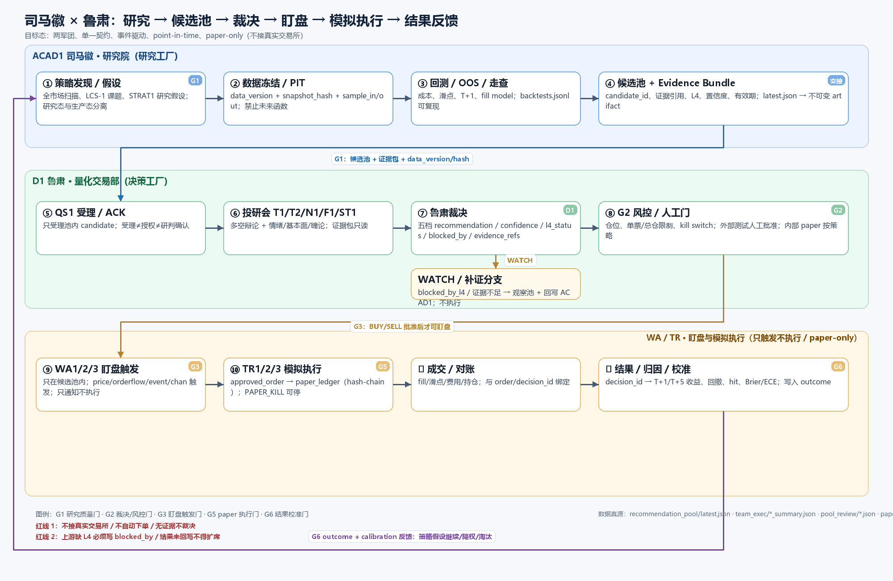
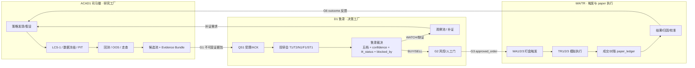

# 司马徽 × 鲁肃军团业务串联与开源最佳实践 v1

- 日期：2026-10-30 23:35
- 范围：ACAD1 研究院 → 候选池 → D1 投研/裁决 → 盯盘 → 模拟执行 → 结果反馈
- 性质：方案设计，不改运行时
- 目标：在**单机、paper-only、不接真实交易所**的约束下，把两个军团接成一条可验收的闭环。

## 一、一句话结论

**最优解不是把两个军团合并，也不是上一个完整交易引擎；而是把交接口从“文件/任务”升级为“不可变证据包 + 统一 decision_id + 结果回写”，用事件驱动串起来。**

```text
ACAD1 负责“找到值得看的机会 + 给证据”
D1   负责“独立核验 + 裁决 + 触发 + 复盘”
WA/TR 负责“触发 + paper 执行 + 对账”
结果 负责“校准 ACAD1 + 校准 D1”
```

## 二、现状证据

### 2.1 业务链路已经写在注册表里

`agent_platform/registry/trading_bot.json` 的六段：

```text
select      ACAD1 选股入池       → recommendation_pool/latest.json
research    D1 投研分析研判      → team_exec/<run_id>_summary.json + pool_review/<date>.json
plan        D1 建仓计划
watch       WA1 盯盘发现异动     → QUANT_UPSTREAM_REPORT
human_confirm 人工确认（外部测试）
execute     TR1 模拟执行         → paper_ledger.jsonl
review      D1 复盘              → feedback + T+5 归因
```

约束：

```text
status = paper_only
trading_permitted = false
real_exchange_adapter = disabled
内部 auto 路径跳过人工门；外部测试必须人工确认
```

### 2.2 交接物是文件，不是契约

ACAD1 候选池：

```text
pool_id = ACAD1-REC-20261030
counts.total = 19（T2=19，T1=0）
source: portal/data/todays_picks.json + strategy_portfolio.json
data_date = 2026-10-29，freshness_days=1
```

D1 复核：

```text
pool_review/2026-10-30.json
reviewed = 5 / 19
buy = 0, watch = 5, pending_analysis = 14
team summary: WATCH 0.5，degraded=true，L4 定性未提供
```

结论：**池子给了“选什么”，但没有给“为什么值得相信”的完整证据包。**

### 2.3 D1 的裁决与结果仍偏弱

`shadow_ledger.jsonl` 109 条：

```text
WATCH 75 / HOLD 20 / BUY 9 / None 5
degraded 10 / failed 3
```

`decision_outcomes.jsonl` 60 条：

```text
BUY 9 条，hit 4 条（约 44%）
其余 51 条 hit=null（WATCH/HOLD 正常无方向）
model 基本为 null
最近 outcome 只到 2026-10-28
```

D1 派出的 6 张 10-29 周单：

```text
T2 / N1 / F1 / ST1 / WA1 / QS1 全部 still doing
```

结论：**D1 会拆单，但收口不足；结果闭环也没真正跑起来。**

### 2.4 盯盘与执行仍是“契约态”

`watch_runtime`：

```text
WA1 = contract_only_upstream_report
WATCH_TOWER = contract_only_no_market_feed
watchbot = registered_no_runtime
```

`open_items`：

```text
人工确认卡片的 portal/飞书入口与超时策略落地
盯盘触发 → 人工确认 → TR1 执行的端到端联调
legacy /paper 与 quant paper 的职责边界待确认
```

结论：**主链路的前半段（选股/研判）有数据，后半段（盯盘/执行）尚未真实闭环。**

## 三、开源社区学到的四个原则

### 1. Research-to-production parity（研究/生产同一套语义）

NautilusTrader 的核心不是“又一个回测器”，而是：

```text
同一个 kernel、同一个事件模型、同一套订单/风控/组合状态，
只在 data/execution client 边界替换回测与实盘。
```

它给我们的启发不是“换成 Nautilus”，而是：

```text
ACAD1 的回测、D1 的裁决、TR 的 paper 执行，
应该共享同一套 candidate/decision/order/outcome 标识与事件语义。
```

来源：[Why NautilusTrader Exists](https://nautilustrader.io/blog/why-nautilustrader-exists/)

### 2. Point-in-time / 数据版本是研究可信度的底座

Qlib 的 PIT 设计与数据管理强调“当时可得的数据”，而不是回填后的全量数据。

落到我们的系统：

```text
候选池每个 item 必须带 data_version + snapshot_hash
D1 的 evidence_refs 必须能回到当时快照
禁止用未来数据修正历史决策
```

来源：[Qlib PIT 文档](https://github.com/microsoft/qlib)、[Qlib 架构概述](https://github.com/shizhengLi/qlib-learning/blob/main/tech-blog/01-qlib-architecture-overview.md)

### 3. Event-driven + deterministic replay

QuantConnect LEAN 的 Algorithm Engine 把数据、算法、组合、执行拆成事件驱动组件；回测/实盘共用算法接口。

我们不需要搬 LEAN，但应该采用：

```text
candidate.created → decision.made → trigger.fired → order.filled → outcome.recorded
```

每个事件带 `event_id / ts / source / run_id / decision_id`，可回放。

来源：[QuantConnect Algorithm Engine](https://www.quantconnect.com/docs/v2/writing-algorithms/key-concepts/algorithm-engine)

### 4. Paper/dry-run 必须有风控与停机开关

Freqtrade 的 dry-run/paper 模式把“策略、stake、风控、停机”作为一等配置，而不是散落在脚本里。

落到我们：

```text
PAPER_KILL 必须被 WA/TR/D1 共同尊重
单票/总仓/最大回撤/触发频率做硬限制
人工门只对外部测试/真实交易开启
```

来源：[Freqtrade 文档](https://www.freqtrade.io/en/stable/)

## 四、目标流程图



Mermaid 版本：



## 五、目标契约

### 5.1 Candidate（ACAD1 → D1）

```json
{
  "candidate_id": "cand-...",
  "pool_id": "ACAD1-REC-20261030",
  "strategy_id": "chanlun",
  "code": "002531",
  "tier": "T2",
  "thesis": "缠论+九维共振",
  "evidence_refs": [
    {"type": "kline", "snapshot_id": "snap-...", "sha256": "..."},
    {"type": "event", "ids": ["evt-..."]},
    {"type": "l4", "status": "定性成立|存疑观察|缺失", "source": "..."}
  ],
  "data_version": "tdx-parquet@2026-10-28",
  "snapshot_hash": "sha256:...",
  "expected_horizon": "T+5",
  "confidence": 0.62,
  "expires_at": "2026-11-01"
}
```

### 5.2 Decision（D1）

```json
{
  "decision_id": "dec-...",
  "candidate_id": "cand-...",
  "recommendation": "WATCH|HOLD|BUY|SELL|STRONG_BUY",
  "confidence": 0.5,
  "l4_status": "missing|uncertain|confirmed",
  "blocked_by": ["l4_missing", "evidence_truncated"],
  "evidence_refs": ["..."],
  "rationale": "...",
  "l1_basis": "...",
  "model": "glm/glm-5.3",
  "fallback": false,
  "run_id": "..."
}
```

### 5.3 Outcome（TR/复盘 → ACAD1/D1）

```json
{
  "decision_id": "dec-...",
  "horizon": "T+1|T+5",
  "return": 0.021,
  "max_drawdown": -0.008,
  "hit": true,
  "slippage_bps": 3,
  "brier": 0.12,
  "model": "glm/glm-5.3",
  "reviewed_at": "..."
}
```

## 六、六道门

```text
G1 研究质量门（ACAD1）
  数据已冻结、PIT 快照可回查、OOS/成本/滑点齐全
  → 否则不进候选池

G2 裁决/风控门（D1）
  evidence_refs 可定位、L4 明确、仓位限制、置信度
  → 缺证据必须写 blocked_by，不得静默 WATCH

G3 盯盘触发门（WA）
  只在池内、只在有效期内、只按 decision 触发
  → 发现异动只通知，不执行

G4 人工/外部门（HUMAN）
  仅外部测试/真实交易；超时 expire_to_watch
  → 内部 paper auto 可按策略跳过，但留痕

G5 paper 执行门（TR）
  PAPER_KILL、单票/总仓、滑点/费用、幂等
  → 不接真实交易所

G6 结果校准门（D1/ACAD1）
  T+1/T+5 outcome、Brier/ECE、归因
  → 未回写不得扩席/加仓
```

## 七、落地路线

### P0（1–2 天，先把接口变成契约）

```text
1. ACAD1 candidate 输出 Evidence Bundle（含 data_version/snapshot_hash/L4）
2. D1 decision 输出 decision_id + l4_status + blocked_by + evidence_refs
3. D1 工具调用真正接入（make_context / quote_snapshot / events）
4. 补 decision_id → outcome 回写；补 10-29/30 outcome
5. 周单收口：6 张 doing 全部签收
```

### P1（1 周，打通盯盘/paper 闭环）

```text
6. WA 触发 dry-run：只吃候选池 + decision 条件
7. TR paper 执行 + 对账：paper_ledger 绑定 decision_id
8. 统一事件日志：candidate/decision/trigger/order/outcome
9. 人工门入口（portal/飞书）与超时策略
10. 看板：候选池 → 决策 → 触发 → 成交 → outcome
```

### P2（按需，做深）

```text
11. Brier/ECE 校准、分桶命中率、策略淘汰
12. deterministic replay（同一输入可复现事件序列）
13. 模型/策略/数据版本 registry
14. 外部测试与真实交易的隔离环境
```

## 八、验收标准

```text
1. 任一 decision 都能从 candidate_id 追到 evidence_refs 和 snapshot_hash
2. 任一 outcome 都能回指 decision_id、model、run_id
3. WATCH 必须有 blocked_by；不允许“无证据的 WATCH”
4. 候选池 → D1 → WA → TR → outcome 全链路事件可回放
5. PAPER_KILL 在 WA/TR/D1 三层都可验证生效
6. D1 的 6 张周单收口；outcome 账本更新到最近交易日
7. 同一候选重复进入 D1 不会产生重复决策/重复下单
```

## 九、不要做什么

```text
不要把 ACAD1 和 D1 合并成一个 agent
不要让 D1 直接执行/下单
不要为了“全”直接搬 QuantConnect/Nautilus
不要把“摘要 + WATCH”当成完整裁决
不要让 outcome 账本继续缺 model/decision_id
不要在没有 L4/证据时用 WATCH 掩盖缺口
```

## 十、结论

**最优解是“两个工厂 + 一个契约 + 一条事件链”，不是“一个更大的军团”。**

```text
ACAD1：把机会变成可核验的候选
D1：把候选变成可追溯的裁决
WA/TR：把裁决变成可复现的 paper 执行
Outcome：把执行变成下一轮研究的证据
```
