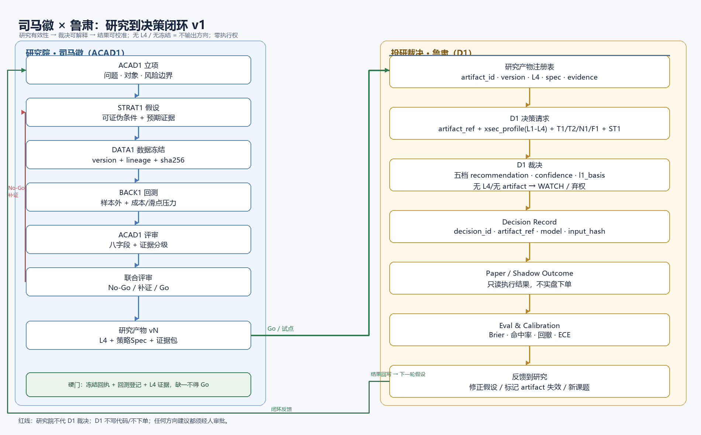

# 司马徽 × 鲁肃：研究到决策闭环 v1

- 日期：2026-10-30
- 工单：`WO-LEGION-ACAD-D1-FLOW-20261030`
- 性质：架构方案；不修改现有生产代码
- 图：`2026-10-30_司马徽鲁肃研究到决策闭环_flow.png`（同目录）



---

## 一、结论

司马徽和鲁肃现在不是“两个部门没协同”，而是**两条流水线没有同一个交接物**：

```text
研究院：课题 → 冻结 → 回测 → 评审 → No-Go/Go
投研：T1/T2/N1/F1 → D1 → WATCH/BUY/...
```

两条线之间缺三样东西：

1. **研究产物契约**（L4、策略 Spec、冻结回执、回测证据）；
2. **D1 的硬前置**（没有产物/L4，只能 WATCH，不能装作能裁决）；
3. **结果回写**（D1 的决策结果要回到研究院，形成下一轮假设）。

一句话：

> **最优解不是再建一个平台，而是让“研究产物”成为唯一交接物，让“决策记录”成为唯一回写凭证。**

---

## 二、现场事实（截至 2026-10-30 23:23）

### 2.1 研究院（司马徽）

当前课题账本：

```text
AC-20261017-LCS1             status=review  decision=No-Go
AC-20261030-LCS1-REDEFINE    status=evidence
```

- LCS-1 原课题：数据冻结回执已存在，但回测已 cancelled，理由=数据未冻结 + 由 REDEFINE 承接；
- 新课题：`LCS-1 信号重定义（D3/D4 冻结先行）`，在 evidence 阶段；
- 说明研究院已经在做“重新定义 + 冻结先行”，方向是对的。

### 2.2 投研裁决（鲁肃）

D1 的 prompt 明确要求：

```text
输入：T1/T2 假设攻防结论 + N1/F1 佐证 + xsec_profile L4 定性
L4=存疑观察 → 禁止 BUY/SELL，只能 WATCH
```

但生产 `run_shadow` 的 `make_context()` 只给 D1：

```text
基本面快照 + 技术面 + 情绪代理
```

**没有 xsec_profile L4。**

而真正有 L4 的是另一条链：

```text
tools/xsec_profile.py（L1-L4 漏斗）
  → tools/legion_debate.py（T1/T2/N1/F1/D1/R1/R2/R3）
```

`legion_debate` 是独立 CLI 演示链；`run_shadow` 没有消费它。

这解释了一个现象：D1 经常输出 `WATCH`，不是它保守，是它拿不到 `L4 定性成立` 这个前置。

### 2.3 D1 历史结果

`shadow_ledger.jsonl` 109 条：

```text
WATCH 75 / HOLD 20 / BUY 9 / 其他 5
parse_ok=true 85
degraded=true 10
```

D1 不是不会给方向，但方向能力被 L4 缺位和上游摘要质量锁住。

---

## 三、开源社区学什么

| 开源方案 | 可借鉴的机制 | 本平台怎么用 |
|---|---|---|
| [LangGraph](https://docs.langchain.com/oss/python/langgraph/persistence) | 显式状态图、checkpoint、human-in-the-loop interrupt | 借鉴到现有 academy 阶段机；不新增常驻服务 |
| [MLflow Model Registry](https://mlflow.org/docs/latest/model-registry/) | 版本、stage、lineage、artifact 注册 | 做 `research_artifact` 注册表：artifact_id/version/stage |
| [DVC](https://dvc.org/doc) | 数据版本 + 内容哈希 + 可复现 | 已有 freeze receipt 的 sha256/lineage，继续沿用 |
| [Great Expectations](https://greatexpectations.io/) | 数据质量断言 | 把“冻结四字段/样本窗口/成本模型”做成硬断言 |
| [OpenLineage](https://openlineage.io/) | 输入/输出/版本血缘 facet | 现有 freeze receipt 的 lineage 结构可对齐 |
| [Evidently](https://www.evidentlyai.com/) | 生产监控、漂移、质量报表 | 做决策结果监控：Brier/命中/回撤/ECE |
| [Metaflow](https://metaflow.org/) / [Kedro](https://kedro.org/) | DAG、artifact、可复现 pipeline | 只借鉴 DAG 编排；当前不引入 |
| [Temporal](https://temporal.io/) | 长事务、重试、持久状态 | 未来多日/多阶段研究编排可考虑；当前不引入 |
| [Inspect](https://inspect.aisi.org.uk/) / [DSPy](https://dspy.ai/) | 评测/优化 | 用于 D1 决策质量与 prompt 评测，不替代业务状态机 |

**选型判断：不装框架。**  
当前是单人、单机、文件账本；引入 LangGraph/MLflow/Temporal 的运维成本大于收益。  
先借“状态机 + artifact registry + lineage + eval”的**模式**，用现有 Python/JSON 实现。

---

## 四、目标架构：一个交接物，两条闭环

```text
┌──────────────── 研究院（司马徽/ACAD1） ────────────────┐
│ 立项 → 假设 → 数据冻结 → 回测 → 评审 → No-Go/Go        │
│                              │ Go/试点                  │
│                              ▼                          │
│                    Research Artifact vN                 │
│        （L4 + 策略Spec + 冻结回执 + 回测证据）           │
└──────────────────────────────┬──────────────────────────┘
                               │ artifact_ref
┌──────────────────────────────▼──────────────────────────┐
│ 投研裁决（鲁肃/D1）                                      │
│ 决策请求 = artifact + xsec_profile L1-L4 + T1/T2/N1/F1  │
│          + ST1 旁路                                     │
│ D1 裁决 = 五档 + confidence + l1_basis                  │
│ 无 artifact / 无 L4 → WATCH/弃权，禁止 BUY/SELL          │
└──────────────────────────────┬──────────────────────────┘
                               │ decision_id
┌──────────────────────────────▼──────────────────────────┐
│ 结果与评估（Paper/Shadow，不实盘）                        │
│ outcome → Brier/命中/回撤/ECE → 回写研究院               │
└──────────────────────────────┬──────────────────────────┘
                               │ 下一轮假设/失效标记
                               └──────────────→ 研究院
```

### 4.1 四个契约

**Research Artifact**

```json
{
  "artifact_id": "RA-20261030-LCS1-v1",
  "topic_id": "AC-20261030-LCS1-REDEFINE",
  "version": 1,
  "stage": "validated",
  "l4": {"verdict": "定性成立|存疑观察|散手票", "evidence_refs": []},
  "data": {"freeze_receipt": "...", "sha256": "...", "sample_in": "...", "sample_out": "..."},
  "strategy_spec": {"path": "...", "sha256": "..."},
  "validation": {"backtest_status": "done", "metrics": {}, "reproducible": true},
  "decision": {"academy": "Go|试点|产品化", "approved_by": "laotian"}
}
```

**Decision Request**

```json
{
  "request_id": "DRQ-...",
  "symbol": "600337",
  "asof": "2026-10-30",
  "artifact_ref": "RA-20261030-LCS1-v1",
  "xsec_profile": {"l1": {}, "l2": {}, "l3": {}, "l4": "定性成立"},
  "evidence": {"t1": "...", "t2": "...", "n1": "...", "f1": "...", "st1": "..."}
}
```

**Decision Record**

```json
{
  "decision_id": "DR-20261030-01",
  "request_id": "DRQ-...",
  "artifact_ref": "RA-...",
  "recommendation": "WATCH|BUY|HOLD|SELL|...",
  "confidence": 0.62,
  "l1_basis": "...",
  "model": "glm/glm-5.3",
  "input_hash": "...",
  "read_only": true
}
```

**Outcome**

```json
{
  "decision_id": "DR-20261030-01",
  "horizon_days": 5,
  "return_pct": 1.2,
  "max_drawdown_pct": -0.8,
  "hit": true,
  "brier": 0.18
}
```

### 4.2 三个硬门

1. **研究院 Go 门**：冻结回执 + 回测登记 + L4 证据，缺一不得 Go；
2. **D1 方向门**：无 `artifact_ref` 或 L4 不是“定性成立” → 只能 WATCH/弃权；
3. **结果门**：每次 D1 裁决必须有 `decision_id`；到期必须有 outcome 或显式“未取得”。

---

## 五、怎么接现有代码（最小改动）

| 现有件 | 改动 |
|---|---|
| `tools/academy_research.py` | 增加 `build_research_artifact()`，在 Go/试点时落 `artifacts/` |
| `agent_platform/domains/academy_wiring.py` | 阶段推进时校验 artifact 完整性 |
| `agent_platform/engine/tools.py::make_context` | 给 `final_decision` 注入 `xsec_profile` + `artifact_ref` |
| `agent_platform/run_shadow.py` | 生成 `decision_id`；把 artifact/decision 写进 ledger |
| `tools/xsec_profile.py` | 作为 L4 唯一生产者；冻结/缓存版本 |
| `shadow_ledger.jsonl` | 增加 `decision_id/artifact_ref/outcome`（向后兼容） |
| `/legion` 页面 | 课题 + artifact + decision + outcome 四列展示 |

**不新增常驻服务、不新建数据库、不引入框架。**

---

## 六、分阶段路线

### W1：契约与证据链（1–2 天）

- 定义 `research_artifact` schema；
- ACAD1 Go 时生成 artifact；
- `make_context` 注入 xsec_profile/artifact；
- D1 无 L4 → WATCH；单元测试。

**验收**：任意一次 D1 运行都能追到 artifact_ref 或显式 `no_artifact`。

### W2：决策记录与结果（2–3 天）

- `decision_id`、input_hash；
- Paper/Shadow outcome 采集；
- Brier/命中/回撤/ECE；
- 结果回写 academy topic。

**验收**：109 条历史 decision 可回填 decision_id；新决策 100% 有 outcome 或“未取得”。

### W3：闭环自动化（2–3 天）

- 新课题/重定义由失败决策或 No-Go 触发；
- artifact 失效标记；
- `/legion` 看板显示研究→决策→结果。

### W4：评测与校准（按需）

- Inspect/DSPy 评测 D1 prompt/模型；
- 校准曲线，淘汰不可靠证据；
- 仍然不实盘执行。

---

## 七、指标

| 指标 | 目标 |
|---|---|
| D1 决策带 artifact_ref | 100%（无则显式 no_artifact） |
| D1 无 L4 时输出 BUY/SELL | 0 |
| 决策有 decision_id | 100% |
| 决策有 outcome/未取得 | 100% |
| Brier/ECE | 建立基线并持续跟踪 |
| 研究课题有 Go/No-Go 结论 | 100% 不悬空 |
| 人工审批 | 所有方向建议必经 |

---

## 八、明确不做

- 不把研究院做成 D1 的“数据供应商”却不给反馈；
- 不让 D1 在没有 L4/artifact 时硬给方向；
- 不引入第二套任务状态机；
- 不把 MLflow/LangGraph/Temporal 一次性全装；
- 不做实盘自动执行。

---

## 九、一句话

> **司马徽负责“证据是否成立”，鲁肃负责“在不确定性下如何裁决”；两者之间用 `Research Artifact` 交接，用 `Decision Record/Outcome` 回写。**  
> 这比再建一个“研究平台”或“决策平台”都更小、更可审计，也更接近开源社区验证过的闭环模式。
