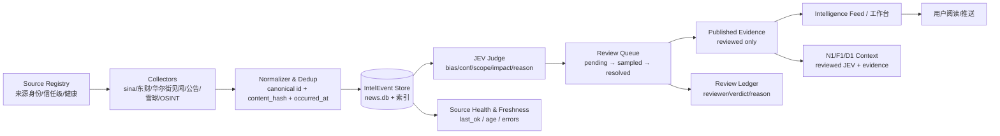

# 情报板块研发方案 v1（2026-10-31）

> STATUS: proposed（待老田批准；批准后改 active）
> OWNER: N1（许劭/情报内容） · DSH-Lead（研发治理） · ARCH1（架构）
> SCOPE: 情报采集 → JEV 判读 → 证据 → 复核 → 情报流 → N1/D1 裁决
> 依据：`docs/plans/2026-10-31_零界研发计划_v2_收口与闭环.md`、`docs/audit/2026-10-30_JEV全线资产与项目总结.md`、2026-10-31 情报现状复审

---

## 一、结论

情报板块的问题不是“没有数据”：

```text
news.db   107,979 条，最新采集 2026-10-31 10:21，24h 5,774 条
JEV        近 24h 5,625 条判断，最新 2026-10-31 10:15
来源       9 个来源 status=ok
```

问题是“数据在，但链断了”：

```text
采集在跑
  → 总线读错排序（旧闻顶到第一屏）
  → /intel/stream 502（route_table 把字符串当函数）
  → JEV 10,525 条 pending、0 resolved（模型判断无人复核）
  → N1 的 news_event 仍是价格代理（JEV 没进裁决）
```

**方案目标：把情报从“展示层”改成“可复核的证据供给链”。**

---

## 二、目标架构



### 2.1 唯一事实源

- `news.db` 继续做采集与 JEV 的**唯一事实源**，不新建第二套数据库；
- `news` 表补 `canonical_id`、`content_hash`、`review_status` 索引；
- JEV 结果只存 `news.jev` + 审计账本，不复制第二份“结论表”。

### 2.2 唯一交接物：IntelEvent

```json
{
  "event_id": "IE-20261031-000001",
  "canonical_id": "src:hash",
  "source": "sina|eastmoney|wallstreetcn|announcement|xueq|osint",
  "source_ref": "原文 ID/URL",
  "content_hash": "sha256",
  "occurred_at": "2026-10-31 10:15",
  "ingested_at": "2026-10-31 10:20",
  "title": "...",
  "content": "...",
  "stocks": ["600000.SH"],
  "trust": "A|B|C",
  "dedup_of": null
}
```

### 2.3 JEV 记录

```json
{
  "event_id": "IE-...",
  "bias": "bull|bear|neutral",
  "conf": 0.85,
  "scope": "A股|港股|美股|宏观",
  "event_type": "demand|supply|policy|tech|price|...",
  "impact": "high|medium|low",
  "reason": "50字内依据",
  "model": "provider/model",
  "prompt_version": "jev-vX",
  "created_at": "..."
}
```

### 2.4 复核记录

```json
{
  "review_id": "RV-...",
  "event_id": "IE-...",
  "status": "pending|resolved|rejected",
  "reviewer": "N1",
  "verdict": "accept|reject|needs_evidence",
  "reason": "...",
  "reviewed_at": "..."
}
```

### 2.5 发布证据包

```json
{
  "bundle_id": "EV-...",
  "event_refs": ["IE-..."],
  "jev_refs": ["RV-..."],
  "l4": {"verdict": "定性成立|存疑观察", "artifact_ref": "..."},
  "published_at": "...",
  "reviewed_by": "N1"
}
```

---

## 三、路由与认证（P0）

### 3.1 路由修复

现状：

```python
# portal/route_table.py
_GET_EXACT_6 = {"/intel/stream": "_intel_page", ...}
# portal/portal_api.py:1836
route_table._GET_EXACT_1[path]()   # 'str' object is not callable
```

方案：二选一，优先 A。

```text
A. 表里存 callable（构建时绑定方法）
B. dispatch 统一 getattr(self, name)()
```

验收：`/intel/stream`、`/bt-jev`、`/gzh`、`/fin`、`/kg/flow`、`/kg/battle` 全部 200/302，不再 502；16 组 `GET_EXACT` 做参数化 smoke。

### 3.2 认证矩阵

| 面 | 未登录 | 登录 | 写/复核 |
|---|---|---|---|
| `/intel`、`/intel/stream` | 302 `/login` | 200 | — |
| `/xq_intel.html`、`/news_intel.html` | 302 | 200 | — |
| `/api/news/intel`、`/api/xq/intel`、`/api/jev/query` | 401 | 200 | — |
| `/api/intel/bus`、`/api/intel/evidence-targets` | 401 | 200 | — |
| `POST /api/jev/review/resolve` | 401/403 | 200 | 需 N1/ADMIN 角色 + 审计 |

保留公开分享链接的白名单，但默认不公开原始 JEV、复核队列和证据原文。

---

## 四、数据正确性与新鲜度

### 4.1 排序

现状 `api_intel_bus._domain_news`：

```sql
ORDER BY id DESC
```

改为：

```sql
ORDER BY ts DESC, created_at DESC, id DESC
```

响应增加：

```json
{"as_of": "...", "latest_ts": "...", "age_s": 0, "source_health": {}}
```

### 4.2 去重

- `content_hash = sha256(normalize(title+content+stocks+source))`；
- 同源重复保留 `dedup_of`，跨源同一事件标记 `cluster_id`；
- 禁止用标题相似度直接删原文，只做“展示去重/聚类”，保留证据。

### 4.3 新鲜度

- 每个来源 `last_ok / last_error / age_s / count_24h`；
- 页面显示 `数据截至`，超阈值显示黄色 stale，不隐藏；
- `news.db`、JEV、xq coverage 各自明确阈值：
  - 情报总线 ≤ 15 分钟；
  - JEV 判读 ≤ 30 分钟；
  - xq coverage 快照 ≤ 24h。

---

## 五、复核运营（P1，最高优先）

### 5.1 不追求一次清 10,525 条

采用**抽样复核**：

```text
每批 200 条，优先 high impact + low conf + 新来源
→ N1 人工/半自动裁决
→ accept/reject/needs_evidence
→ 只将 reviewed 记录进入 Published Evidence
→ 其余保留 pending，不当作“已判读”推送
```

### 5.2 状态机

```text
pending → sampled → resolved(accept/reject/needs_evidence)
                 ↘ rejected(不再进入发布)
```

### 5.3 硬规则

- 未复核 `high impact` 事件不得进入 N1/D1 的“已核验证据”；
- 复核写接口必须登录 + 角色 + 审计；
- 每条复核记录不可改，只能追加新版本；
- 复核队列与发布队列分离，避免“pending 数量=已判读”。

---

## 六、接通 N1/D1

现状：

```text
agent_platform/engine/tools.py
情绪面 v1 用 K 线派生代理指标；jev 事件库接入留 v2
news_event = sentiment
```

方案：

1. 新增 `INTEL_TO_N1` feature flag，默认关；
2. 开启后，`make_context` 的 `news_event` 优先从 **reviewed JEV/EvidenceBundle** 生成；
3. 不可用时明确：

```json
{"source": "price_proxy", "reason": "no_reviewed_jev"}
```

4. D1 的 `l1_basis` 必须带证据来源：

```text
l1_basis: "reviewed JEV: IE-...; L4: artifact...; 备位=price_proxy"
```

5. 先做 A/B：同一批标的，reviewed JEV vs price_proxy，比较裁决质量与延迟；
6. 通过 `change_gate` 后才改生产 prompt 默认路径。

---

## 七、来源与工作台

### 7.1 统一主页

`/intel` 只保留：

```text
今日情报流 / 证据-标的关系 / JEV 复核入口 / 来源健康 / 09 个下游入口
```

`/xq_intel.html`、`/news_intel.html`、`/bt-jev` 作为下钻，不再重复做首页。

### 7.2 来源分级

```text
A 法定/交易所公告
B 主财经媒体
C 聚合/自媒体/OSINT
```

每条 IntelEvent 带 `trust`；C 级来源不得单独作为高影响判读证据。

### 7.3 暂不接入

- 股吧、视频 OSINT、TDX 行情：Phase 2 再按“来源身份+采集时间+原文位置+运行责任”接入；
- 不在 Phase 1 新建独立来源服务。

---

## 八、可观测与验收

### 8.1 指标

| 指标 | 目标 |
|---|---|
| 情报页面/接口 5xx | 0 |
| 路由 smoke | 16/16 通过 |
| 未登录情报读接口 | 401/403 |
| 总线首条与 DB max(ts) 偏差 | ≤15 分钟 |
| stale 页面 | 有明确“数据截至”标识 |
| JEV high-impact pending | ≤100（滚动） |
| 抽样复核量 | ≥200/日，resolve 可追溯 |
| xq coverage 快照年龄 | ≤24h |
| N1 证据来源 | 开启后 reviewed JEV 占比 ≥80%，其余显式 price_proxy |
| 未核验高影响推送 | 0 |

### 8.2 验收

```text
1) 未登录：/intel、/xq_intel.html、/news_intel.html、/intel/stream、/bt-jev → 302
2) 未登录：/api/news/intel、/api/jev/query → 401
3) 登录：以上页面 200；/intel/stream 不再 502
4) 总线 items[0].ts >= items[1].ts；latest_ts 接近 DB max(ts)
5) JEV review resolve 未授权 → 401/403；授权 → 审计落账
6) 雪球 coverage 快照 age <= 24h；无 2020 异常日期
7) 开 INTEL_TO_N1 的 A/B 中，N1 可见 reviewed JEV；关闭时显式 price_proxy
8) 一条真实事件：采集→JEV→复核→N1→D1，可回放
```

---

## 九、非目标

- 不新建第二套情报数据库；
- 不恢复 8788 staging；
- 不在 Phase 1 做 OSINT/股吧/视频完整接入；
- 不把“pending 数量”当“已判读”；
- 不在未复核情况下让高影响事件进入 N1/D1 的方向建议；
- 不自动实盘执行。

---

## 十、待老田拍板

1. **情报可见性**：默认全私有，还是保留公开只读页？（默认建议：全私有）
2. **复核产能**：N1 每日最多多少条人工复核？（建议 200 条/日）
3. **N1 接入**：是否批准 `INTEL_TO_N1` 的 A/B，而不是直接切生产？
4. **OSINT/股吧**：Phase 1 不做，Phase 2 是否列 P1？
5. **JEV 历史积压**：10,525 pending 中，是否只抽样 high impact，其余归档为“未复核历史”？
