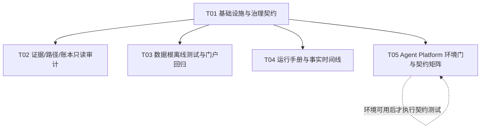

# 治理增量架构与工程任务分解（2026-10-17）

> 适用范围：`next-minimal-workorders-2026-10-17.md`、`GOV-FIX-ROADMAP-2026-10-17.md`、`shared-resource-register.md`、`governance-control-ledger-2026-10-17.md`、`manual-approval-decision-register-2026-10-17.md`。
>
> 本设计是只读审计/离线测试/文档增量方案，不授予任何生产写权限；不修改业务代码、端口、nginx、账本、数据根或服务状态。

## 一、执行结论

### 可由工程师立即实施

| 工单 | 判定 | 原因 | 预期交付 |
|---|---|---|---|
| GOV-MIN-001 | `ready` | 仅扫描治理目录并新建索引 | `docs/governance/evidence-index-2026-10-17.md` |
| GOV-MIN-002 | `ready` | 临时目录 fixture + 静态/离线测试，不运行生产启动器 | 测试脚本、覆盖矩阵、风险说明 |
| GOV-MIN-003 | `ready` | 只读搜索和人工分类，不移动/替换路径 | `docs/governance/path-migration-matrix-2026-10-17.md` |
| GOV-MIN-004 | `ready` | 路由、导航导出、mixin 的静态/只读 smoke | 差异表、命令和批准缺口 |
| GOV-MIN-005 | `ready` | 只读快照内存解析，输出外部投影 | Markdown/JSON 投影，原账本 hash 不变 |
| GOV-MIN-006 | `ready` | 只基于已验证事实撰写 runbook | 四份 runbook 或草稿索引 |

### 必须保持 `blocked`

| 项目 | 判定 | 解锁条件 |
|---|---|---|
| GOV-MIN-007 | `blocked`（环境门） | 独立 `zhice-os-v2` 树具备可用 Python、pytest、依赖和权限；在此之前只能出环境报告/测试设计，不得称测试通过 |
| GOV-FIX-001 | `blocked` | DEC-20261017-01 管理员+项目负责人批准、共享窗口、portproxy 前后证据和回滚演练 |
| GOV-FIX-002 | `blocked`（写入部分） | 逐文件读写矩阵、领域批准、离线回归、生产 smoke、回滚验证 |
| GOV-FIX-003 | `blocked`（切根/启动部分） | `kg_sync_task.log` 登记、唯一 live 根确认、逐表证据、数据负责人批准 |
| GOV-FIX-004 | `blocked`（原地处置部分） | 仅允许继续外部投影；原 JSON/JSONL/SQLite 的修正、删除、补字段必须逐条批准 |
| GOV-FIX-005 | `blocked`（生产/基线部分） | 只读门禁报告可做；生产页面、nginx、route/mixin 基线变更须批准 |
| GOV-FIX-006 | `blocked` | PID/归属/用途证据、8787/8788 隔离证明和管理员批准；不得重启 8787 处理 8788 |
| GOV-FIX-007 | `blocked`（跨域部分） | 可运行测试环境、owner/role 和 Artifact/approval/replay 契约边界、跨域批准 |

## Part A：System Design

## 1. Implementation Approach

### 1.1 核心技术挑战

1. **事实源与文档声明可能漂移**：运行态显示 8080 可用、8734 无 portproxy；任何索引或 runbook 必须带时间戳、来源路径和 `UNVERIFIED` 标识。
2. **共享资源并发保护**：`quant_backtest/data`、两个账本、portal、8093、Hermes state 等默认只读；read-only 可并行但报告不能假设数据静止。
3. **账本不可变性**：legacy `tasks.json` 与 Agent Platform JSONL 属于不同域；只能做 raw/history/current 统计和外部投影，不得合并、覆盖或删除原始行。
4. **路径迁移不可批量化**：E 盘硬编码必须逐文件确认读/写语义、调用方和替代根；不允许全局盘符替换。
5. **环境不可用时的诚实性**：Agent Platform 当前缺可用 Python/pytest 时，必须输出 blocked 环境报告，不能把设计或静态检查写成通过。

### 1.2 技术选择与理由

- **Python 3 标准库**（`pathlib`、`hashlib`、`json`、`csv`、`datetime`、`subprocess`）：用于只读扫描、hash、fixture、报告生成，减少引入依赖和环境漂移。
- **pytest（可选、仅在环境可用时）**：用于 GOV-MIN-002 的离线矩阵测试与 GOV-MIN-007 的契约测试；pytest 缺失时保留设计/报告状态，不安装到生产环境。
- **PowerShell 只读命令**：用于 Windows 现场探测（端口、进程、文件属性）；所有命令必须写入证据文件，不执行 `netsh` 写入、服务重启或数据同步。
- **Markdown/JSON 外部报告**：作为审计结果载体；不新增数据库、不改事实源。
- **架构模式**：只读审计流水线（Scanner → Classifier/Projector → EvidenceRecord → AuditReport），工单以状态机管理（`ready → running → completed` 或 `blocked`），审批作为独立 release gate。

### 1.3 边界策略

- 允许：docs 新文件、临时目录、离线 mock/shadow、只读代码搜索、HTTP GET smoke。
- 禁止：生产写面、服务重启、端口映射/白名单、路径移动删除、数据根切换、账本原地更新、跨域接口语义改变。
- 每个工单必须定义 `allowed_paths`、`forbidden_paths`、`shared_resources`、`test_commands`、`evidence_path` 和 `rollback`。

## 2. File List

### 2.1 既有输入/事实源（只读）

- `docs/governance/next-minimal-workorders-2026-10-17.md`
- `docs/governance/GOV-FIX-ROADMAP-2026-10-17.md`
- `docs/governance/shared-resource-register.md`
- `docs/governance/governance-control-ledger-2026-10-17.md`
- `docs/governance/parallel-governance-board-2026-10-17.md`
- `docs/governance/manual-approval-decision-register-2026-10-17.md`
- `docs/governance/GOV-FIX-003-data-root-readonly-2026-10-17.txt`
- `docs/governance/GOV-FIX-006-port-readonly-2026-10-17.txt`
- `docs/governance/portal-qa-2026-10-17.txt`
- `quant_backtest/start_kg_sync.ps1`
- `quant_backtest/data/catalog.json`
- `portal/api_common.py`
- `portal/portal_api.py`
- `portal/api_portfolio.py`
- `portal/agent_auto_commit.py`
- `portal/static/nav.js`
- `portal/nginx.conf`
- `tools/export_nav.py`
- `tools/unify_nav.py`
- `tools/_mixin_integrity.py`
- `tools/check_ports.py`
- `.worktrees/tasks.json`
- `agent_platform/data/org/tasks/tasks_202610.jsonl`
- `agent_platform/engine/tasks.py`
- `C:/项目/zhice-os-v2-windows-20260920/code`（独立树，若存在）

### 2.2 本次允许新增/修改的交付文件

- `docs/system_design.md`（本设计）
- `docs/class-diagram.mermaid`
- `docs/sequence-diagram.mermaid`
- `docs/governance/evidence-index-2026-10-17.md`
- `docs/governance/path-migration-matrix-2026-10-17.md`
- `docs/governance/ledger-candidate-projection-2026-10-17.md`
- `docs/governance/runbook-drafts-2026-10-17.md`（或拆为四份草稿）
- `docs/governance/portal-regression-2026-10-17.md`
- `docs/governance/platform-test-environment-2026-10-17.md`
- `docs/governance/platform-contract-test-matrix-2026-10-17.md`
- `tools/test_kg_root_selector_offline.py`（仅 fixture/离线测试）
- `tools/test_portal_governance_readonly.py`（静态/只读断言，可选）
- `agent_platform/tests/test_governance_contracts.py`（仅独立树环境可用后创建）
- 临时 fixture 目录：系统 `%TEMP%` 下的唯一工作目录，任务完成后删除

> 不允许修改上述既有业务代码、账本、运行配置；若发现必须修改才能完成，应新开审批工单并保持当前工单 blocked。

## 3. Data Structures and Interfaces

完整 Mermaid class diagram 已保存于 `docs/class-diagram.mermaid`，核心对象如下：

```mermaid
classDiagram
    class WorkOrder { +string id; +string status; +list allowed_paths; +list forbidden_paths; +validate_scope() bool }
    class EvidenceRecord { +string source_path; +string generated_at_utc; +string sha256; +string status; +verify() bool }
    class ResourceWindow { +string resource; +string mode; +string scope; +allows(path, operation) bool }
    class ApprovalDecision { +string decision_id; +string choice; +string approver; +is_released() bool }
    class AuditReport { +string report_path; +list evidence; +list findings; +list blocked_items; +render_markdown() string }
    class RollbackPlan { +string trigger; +list steps; +string verification; +execute_dry_run() bool }
    class EvidenceIndexer { +scan_governance_dir(); +index_missing_items() }
    class PathAuditor { +scan_hardcoded_paths(); +classify_read_write(path) }
    class LedgerProjector { +read_snapshot(path); +project_candidates(); +verify_hash(path, expected) }
    class RootSelectorTester { +build_fixture(name); +run_matrix() }
    class PortalRegressionRunner { +compare_routes(); +check_nav_export(); +run_readonly_smoke() }
    class RunbookBuilder { +build_for_port(port); +mark_unverified(fact) }
    class PlatformGate { +probe_environment(); +build_contract_matrix(); +is_testable() }
    WorkOrder --> EvidenceRecord : produces
    WorkOrder --> ResourceWindow : registers
    WorkOrder --> ApprovalDecision : may require
    WorkOrder --> RollbackPlan : owns
    AuditReport o-- EvidenceRecord : cites
```

接口约定：

- `EvidenceRecord` 必须包含绝对路径、存在性、mtime/生成时间、SHA-256（适用时）、命令和限制。
- `AuditReport` 必须区分 `FACT`、`MISSING`、`UNVERIFIED`、`BLOCKED`，不得把候选意见写成事实。
- `ResourceWindow.allows()` 对任何写、迁移、重启调用返回 false，除非存在已签批 `ApprovalDecision`；当前批次没有此类放行。
- 账本投影接口只读 bytes/snapshot，输出到新 Markdown/JSON；禁止 `save()` 回写原始账本。

## 4. Program Call Flow

完整 Mermaid sequence diagram 已保存于 `docs/sequence-diagram.mermaid`。关键流程：

1. Team Lead 创建 GOV-MIN-001～007 工单并设定允许/禁止路径。
2. 工单先检查共享资源登记；当前登记仅允许 read-only。
3. 001/002/003/004/005/006/007 各自通过独立 Scanner 读取事实源，结果写外部报告或临时目录。
4. 汇总器校验：交付文件落盘、命令可复现、运行态变更为“无”、未写共享资源、回滚可执行。
5. 若请求生产写入，转入 ApprovalDecision；缺审批、快照、窗口或回滚证据则保持 `blocked`。
6. 只有只读交付满足全部验收条件时才可关闭工单。

关键 CRUD/初始化语义：

- `WorkOrder.__init__`：从工单卡片加载状态和 scope；不自动授权。
- `EvidenceRecord.__init__`：读取文件元信息并记录生成时刻；源不存在时状态为 `MISSING`。
- `ResourceWindow.__init__`：读取登记表；过期窗口自动拒绝。
- `AuditReport`：创建/追加 findings 仅发生于新报告；事实源永不更新。
- `ApprovalDecision`：只能由人工填充批准人/窗口；未签批不可转换为 released。

## 5. Anything UNCLEAR

1. `portal-qa-2026-10-17.txt` 在部分总控核查中被记为“未找到”，但目录当前存在同名文件；工程师应以执行时实际路径、mtime、SHA-256 为准，报告差异，不覆盖旧结论。
2. `C:/项目/zhice-os-v2-windows-20260920/code` 的解释器和依赖状态尚未确认，因此 GOV-MIN-007 只能先做环境探测。
3. 8788 的进程、state/data 根隔离证据仍不完整；不能据 HTTP 200 推断生产就绪。
4. `catalog.json` 可解析且 tables 非空不等于启动器已运行或数据根已获批准；不得由静态推导升级为运行事实。
5. E 盘每个硬编码项的真实 owner/读写语义需由路径矩阵逐条确认，无法判断项必须保持 `blocked`。
6. 日期来自治理文档（2026-10-17）；运行现场报告必须使用实际采集时间（ISO 8601，含时区）。

## Part B：Task Decomposition

## 6. Required Packages

- Python 3.11+（标准库：`pathlib`、`hashlib`、`json`、`datetime`、`subprocess`）— 只读审计与报告生成
- `pytest>=7.4,<9` — 仅在隔离测试环境可用时执行离线/契约测试；不得为本批次改动生产环境
- PowerShell 5.1+ — Windows 现场只读探测命令
- 无新增数据库、Web 框架或运行时服务依赖

## 7. Task List（按依赖排序，最多 5 个）

### T01：项目基础设施与治理契约

- **Source Files**：`docs/system_design.md`、`docs/class-diagram.mermaid`、`docs/sequence-diagram.mermaid`、`docs/governance/next-minimal-workorders-2026-10-17.md`、`docs/governance/shared-resource-register.md`、`docs/governance/manual-approval-decision-register-2026-10-17.md`
- **Dependencies**：无
- **Priority**：P0
- **范围**：固化只读边界、状态枚举、证据字段、审批 gate、禁止动作；不改既有治理事实。

### T02：证据索引、路径审计与账本外部投影

- **Source Files**：`docs/governance/evidence-index-2026-10-17.md`、`docs/governance/path-migration-matrix-2026-10-17.md`、`docs/governance/ledger-candidate-projection-2026-10-17.md`、`.worktrees/tasks.json`、`agent_platform/data/org/tasks/tasks_202610.jsonl`、`portal/portal_api.py`、`portal/api_portfolio.py`、`portal/agent_auto_commit.py`
- **Dependencies**：T01
- **Priority**：P0
- **范围**：GOV-MIN-001/003/005；读取、hash、分类、外部输出。不得修改路径或账本。

### T03：数据根离线选择器与门户只读回归

- **Source Files**：`tools/test_kg_root_selector_offline.py`、`tools/test_portal_governance_readonly.py`、`quant_backtest/start_kg_sync.ps1`、`quant_backtest/data/catalog.json`、`tools/export_nav.py`、`tools/unify_nav.py`、`tools/_mixin_integrity.py`、`portal/static/nav.js`、`docs/governance/portal-regression-2026-10-17.md`
- **Dependencies**：T01
- **Priority**：P0
- **范围**：GOV-MIN-002/004；使用临时 fixture 和 HTTP GET/static checks；禁止运行生产启动器、重建基线或重启服务。

### T04：运行手册与事实时间线

- **Source Files**：`docs/governance/runbook-drafts-2026-10-17.md`、`docs/governance/GOV-FIX-006-port-readonly-2026-10-17.txt`、`docs/governance/GOV-FIX-003-data-root-readonly-2026-10-17.txt`、`docs/governance/governance-control-ledger-2026-10-17.md`、`tools/check_ports.py`
- **Dependencies**：T01
- **Priority**：P1
- **范围**：GOV-MIN-006；只引用已验证端口/健康检查/隔离事实，未知启动命令写 `UNVERIFIED`；不启停服务。

### T05：Agent Platform 环境门与契约测试准备

- **Source Files**：`docs/governance/platform-test-environment-2026-10-17.md`、`docs/governance/platform-contract-test-matrix-2026-10-17.md`、`agent_platform/tests/test_governance_contracts.py`（仅独立树可用后）、`agent_platform/registry/org_baseline.json`、`agent_platform/engine/tasks.py`
- **Dependencies**：T01
- **Priority**：P1
- **范围**：GOV-MIN-007；先探测 Python/pytest/依赖/权限，再准备 owner/role、heartbeat、Artifact、replay 矩阵。环境不可用时任务产出为 BLOCKED 报告，绝不宣称通过。

> T02/T03/T04 可在 T01 完成后并行；T05 也可并行做环境探测，但契约测试执行必须等待环境可用。任何 GOV-FIX-001/002/003/006/007 的生产或跨域实施不属于本任务集。

## 8. Shared Knowledge

- 所有报告状态使用：`FACT`、`MISSING`、`UNVERIFIED`、`BLOCKED`、`PASS`；`PASS` 仅表示本地验收通过，不表示生产批准。
- 所有时间戳使用 ISO 8601，优先 UTC；Windows 现场同时记录本地时区。
- 原始账本、JSONL、SQLite、数据根、服务配置均 append-only/只读；外部投影不得改变事实源。
- 所有证据必须包含绝对路径、采集时间、命令、适用范围、限制和（适用时）SHA-256。
- HTTP 200 仅表示端点响应，不等于 ready、生产归属或隔离合规。
- 当前事实入口是 8080；8734 不得写成已生效；7897 不能凭历史记录自动登记或加白名单。
- `quant_backtest/data` 与 `C:/项目/KGDataRoot` 的选择只能通过离线选择器报告讨论，禁止本批次切根。
- 任何变更必须先有人工批准、共享资源窗口、变更前快照/哈希、针对性测试、回滚步骤和变更后复核。

## 9. Task Dependency Graph

## 10. Evidence Chain and Rollback

### 证据链

`工单卡片 → 共享资源登记 → 变更前现场/快照 → 只读扫描或临时 fixture → 输出报告/测试日志 → hash/时间戳复核 → 验收结论 → 总控台账引用`。

每条结论都必须可从报告回到原始路径和可复现命令；缺失证据不得用历史计划、HTTP 200 或静态推测替代。

### 回滚策略

- **文档/报告**：删除本批新增文件即可；不删除既有证据，不覆盖旧报告。
- **离线测试**：删除系统临时 fixture、测试日志和新增测试文件；不得触碰 live data 根。
- **账本投影**：删除外部 Markdown/JSON 投影；原始账本 hash 应与执行前一致。
- **路径矩阵**：删除矩阵文件即可；不得执行移动、删除、重命名或文本替换。
- **门户回归**：删除新增断言/报告；不修改 nginx、nav.js、route/mixin 基线。
- **runbook**：删除草稿或标记 superseded；不执行其中未验证启停命令。
- **Agent Platform**：删除独立测试文件/报告；不修改生产数据库、服务、账本或共享状态。

任何发现未登记写入、越权路径、生产进程受影响或 hash 变化时，立即停止任务，保留现场证据，状态改为 `BLOCKED`，并升级到人工批准清单。
