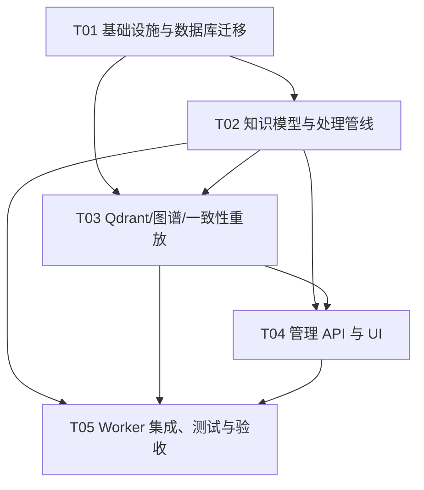

# osint_video 知识化增量系统设计

> 面向现有 `C:/项目/老田的AI助手/osint_video` PoC（链接队列 + ASR/OCR）的增量架构。目标是把“链接驱动的博主兴趣发现”沉淀为可检索、可追溯、可审计的知识资源；媒体文件只是短期处理输入，不作为核心资产。

## 1. 实施方案

### 1.1 核心技术挑战

1. **链接到兴趣信号的闭环**：链接解析后自动发现博主，维护博主画像和兴趣信号；同一链接/视频重复提交必须幂等。
2. **历史数据渐进整理**：旧 `StructuredDoc`、孤立视频、已有 `osint_target` 均需可增量导入，不能阻塞在线采集。抽取、规范化、实体链接、向量化、知识图谱写入必须可断点重试。
3. **知识单元而非媒体资产**：知识单元包含事实、观点、事件、引用片段及来源；视频只保留 hash、时长、短期路径和生命周期元数据，过期后不影响文本知识检索。
4. **多索引一致性**：PostgreSQL 保存权威元数据和证据链；Qdrant 做语义召回；图谱做实体关系和时间线扩展。必须通过 outbox/重放机制处理部分写入失败。
5. **证据可审计**：策略结论必须能回溯到知识单元、原始链接、时间戳/文本片段、抽取版本和人工修订记录，禁止只保存无来源的摘要。
6. **采集与抽取状态机**：复用现有 `LinkStatus`，增加 collection/extraction/knowledge 三层作业状态，区分可重试失败、人工介入和永久归档。

### 1.2 框架与架构选择

- **后端**：Python 3.11 + FastAPI + Pydantic v2；沿用现有 `queue_link/api.py`、`repository.py`，API 响应统一 `{code, data, message}`。
- **持久化**：PostgreSQL 15 + SQLAlchemy Core/psycopg3。关系表是事实来源，JSONB 仅用于可演进的抽取原文和模型指标。
- **向量检索**：Qdrant（dense 向量，预留 sparse/BM25）；collection `osint_knowledge_units_v1`，payload 仅放过滤字段和摘要，不放秘密或完整媒体。
- **知识图谱**：首期采用 PostgreSQL `kg_node/kg_edge` 表（可迁移 Neo4j）；边必须带 `evidence_id`、置信度和有效时间。
- **管理平台**：React 18 + Vite + MUI + TanStack Query；页面包括链接投递、博主/兴趣、知识单元、时间线、策略证据链、任务监控。
- **任务执行**：先用 PostgreSQL `FOR UPDATE SKIP LOCKED` 的轻量 worker；任务量增长后可切换 Celery/RQ，不改变领域接口。
- **架构模式**：分层架构（API → Service → Repository/Index Adapter），领域对象与外部采集器解耦；Outbox + 幂等 upsert 保证最终一致。

### 1.3 处理状态机

- **链接采集**：沿用 `pending → parsed → downloaded → decrypted → extracted → done`；异常进入 `failed → pending`，超限 `dead`；Cookie 失效进入 `waiting_cookie`。
- **知识资源**：`candidate → reviewed → published → deprecated/quarantined`；知识单元采用 `unit_version`，重抽取只生成新版本，不覆盖历史。
- **知识处理**：`raw → normalized → classified → entity_linked → indexed → published`；质量不足为 `quarantine`，永久错误为 `rejected`。每次重跑产生新的 `processing_run`，不覆盖历史版本。
- **媒体生命周期**：`acquired → processing → extraction_succeeded/extraction_failed → purged`；默认保留不超过 24 小时（可配置），purge 必须记录 retention_deadline/deleted_at/reason，且不得级联删除知识文本和 Evidence。

## 2. 文件清单

### 2.1 现有文件（保留/修改）

- `queue_link/models.py`：补充采集任务阶段、知识处理状态常量。
- `queue_link/repository.py`：安全认领（`FOR UPDATE SKIP LOCKED`）、状态转移、outbox 写入。
- `queue_link/api.py`：保留现有链接/凭证/统计接口，挂载管理平台 API。
- `extraction/pipeline.py`：StructuredDoc 增加 `creator_ref`、`source_locator`、`processing_run_id`。
- `store/schema.sql`：保留已有表，追加知识、兴趣、证据、图谱和生命周期表。
- `common/paths.py`：统一媒体临时目录、归档目录和知识导出目录。
- `config/settings.py`、`.env.example`：增加 Qdrant collection、媒体保留小时数（默认24h）、worker 并发和脱敏开关。
- `requirements.txt`：增加 qdrant-client、SQLAlchemy、FastAPI 相关 API/UI 开发依赖（前端单独 package.json）。

### 2.2 新增后端文件

- `knowledge/__init__.py`
- `knowledge/models.py`：KnowledgeUnit、Topic、Entity、TimelineEvent、Evidence、InterestSignal。
- `knowledge/service.py`：知识单元规范化、版本、实体/主题抽取、证据链服务。
- `knowledge/repository.py`：知识表、博主兴趣、策略证据 CRUD。
- `knowledge/indexer.py`：Qdrant upsert/search 和失败重放。
- `knowledge/graph.py`：`kg_node/kg_edge` upsert、邻居/时间线查询。
- `knowledge/importer.py`：历史 `StructuredDoc` 与旧 `osint_video/osint_target` 渐进导入。
- `knowledge/retention.py`：媒体过期、归档、删除前完整性检查。
- `knowledge/api.py`：知识、博主、时间线、策略、任务监控 API。
- `workers/collection_worker.py`、`workers/extraction_worker.py`、`workers/knowledge_worker.py`：分阶段 worker。
- `workers/outbox_replayer.py`：PG outbox 到 Qdrant/图谱的重放。
- `scripts/migrate_knowledge.py`：幂等迁移与历史数据导入 CLI。
- `scripts/rebuild_indexes.py`：从 PG 重建 Qdrant/图谱。

### 2.3 新增前端文件

- `admin_ui/package.json`、`admin_ui/vite.config.ts`、`admin_ui/tsconfig.json`、`admin_ui/index.html`。
- `admin_ui/src/main.tsx`、`admin_ui/src/App.tsx`、`admin_ui/src/api/client.ts`、`admin_ui/src/types.ts`。
- `admin_ui/src/pages/LinkInbox.tsx`、`Creators.tsx`、`KnowledgeUnits.tsx`、`Timeline.tsx`、`Strategies.tsx`、`Jobs.tsx`。
- `admin_ui/src/components/EvidenceChain.tsx`、`KnowledgeEditor.tsx`、`CreatorInterestPanel.tsx`、`StatusBadge.tsx`。
- `admin_ui/src/styles/theme.ts`、`admin_ui/src/styles/global.css`。

### 2.4 文档与测试

- `docs/system_design.md`、`docs/class-diagram.mermaid`、`docs/sequence-diagram.mermaid`。
- `tests/test_knowledge_service.py`、`tests/test_knowledge_repository.py`、`tests/test_state_machine.py`、`tests/test_retention.py`、`tests/test_api_knowledge.py`。
- `admin_ui/src/**/*.test.tsx`：关键页面和证据链交互测试。

## 3. 数据结构与接口

### 3.1 核心表结构

在现有 `store/schema.sql` 后追加以下表（所有时间字段 `TIMESTAMPTZ`，所有外部 ID 使用文本并建立唯一索引）：

```sql
CREATE TABLE osint_creator_profile (
  creator_id BIGSERIAL PRIMARY KEY,
  platform TEXT NOT NULL DEFAULT 'wx_channels',
  finder_id TEXT,
  nickname TEXT NOT NULL,
  source_type TEXT NOT NULL DEFAULT 'link',
  first_source_url TEXT,
  profile_json JSONB NOT NULL DEFAULT '{}',
  enabled BOOLEAN NOT NULL DEFAULT TRUE,
  created_at TIMESTAMPTZ NOT NULL DEFAULT now(),
  updated_at TIMESTAMPTZ NOT NULL DEFAULT now(),
  UNIQUE(platform, finder_id)
);

CREATE TABLE osint_interest_signal (
  signal_id BIGSERIAL PRIMARY KEY,
  creator_id BIGINT REFERENCES osint_creator_profile(creator_id),
  target_id BIGINT REFERENCES osint_target(target_id),
  signal_type TEXT NOT NULL, -- topic/entity/stance/behavior
  subject_key TEXT NOT NULL,
  score DOUBLE PRECISION NOT NULL DEFAULT 0,
  evidence_unit_id TEXT,
  observed_at TIMESTAMPTZ NOT NULL,
  model_version TEXT,
  UNIQUE(target_id, signal_type, subject_key, observed_at)
);

CREATE TABLE osint_knowledge_resource (
  resource_id TEXT PRIMARY KEY,
  video_id TEXT REFERENCES osint_video(video_id),
  target_id BIGINT REFERENCES osint_target(target_id),
  source_url TEXT NOT NULL,
  resource_type TEXT NOT NULL DEFAULT 'video',
  lifecycle_status TEXT NOT NULL DEFAULT 'candidate',
  resource_version INT NOT NULL DEFAULT 1,
  duration_sec DOUBLE PRECISION,
  publish_time TIMESTAMPTZ,
  collected_at TIMESTAMPTZ NOT NULL DEFAULT now(),
  quality_json JSONB NOT NULL DEFAULT '{}',
  index_status TEXT NOT NULL DEFAULT 'pending',
  index_error TEXT,
  created_at TIMESTAMPTZ NOT NULL DEFAULT now(),
  updated_at TIMESTAMPTZ NOT NULL DEFAULT now(),
  UNIQUE(video_id, resource_version)
);

CREATE TABLE osint_media_asset (
  media_id TEXT PRIMARY KEY,
  resource_id TEXT NOT NULL REFERENCES osint_knowledge_resource(resource_id),
  video_id TEXT REFERENCES osint_video(video_id),
  storage_uri TEXT,
  sha256 TEXT UNIQUE,
  bytes BIGINT,
  lifecycle_status TEXT NOT NULL DEFAULT 'acquired',
  retention_deadline TIMESTAMPTZ,
  verified_at TIMESTAMPTZ,
  deleted_at TIMESTAMPTZ,
  deletion_reason TEXT,
  created_at TIMESTAMPTZ NOT NULL DEFAULT now()
);

CREATE TABLE osint_knowledge_unit (
  unit_id TEXT PRIMARY KEY,
  resource_id TEXT NOT NULL REFERENCES osint_knowledge_resource(resource_id),
  target_id BIGINT REFERENCES osint_target(target_id),
  unit_type TEXT NOT NULL, -- claim/viewpoint/method/case/definition/metric/entity
  title TEXT,
  text TEXT NOT NULL,
  normalized_text TEXT,
  entities JSONB NOT NULL DEFAULT '[]',
  topics JSONB NOT NULL DEFAULT '[]',
  time_range JSONB,
  confidence DOUBLE PRECISION NOT NULL DEFAULT 0,
  unit_version INT NOT NULL DEFAULT 1,
  status TEXT NOT NULL DEFAULT 'candidate',
  content_hash TEXT NOT NULL,
  extractor TEXT,
  model_version TEXT,
  source_url TEXT NOT NULL,
  source_video_id TEXT,
  source_locator JSONB, -- {start_sec,end_sec,frame_ts}
  occurred_at TIMESTAMPTZ,
  quality_status TEXT NOT NULL DEFAULT 'draft',
  pii_masked BOOLEAN NOT NULL DEFAULT FALSE,
  processing_run_id TEXT,
  supersedes_unit_id TEXT REFERENCES osint_knowledge_unit(unit_id),
  index_status TEXT NOT NULL DEFAULT 'pending',
  index_error TEXT,
  created_at TIMESTAMPTZ NOT NULL DEFAULT now(),
  updated_at TIMESTAMPTZ NOT NULL DEFAULT now(),
  UNIQUE(resource_id, content_hash, unit_version)
);

CREATE TABLE osint_topic (
  topic_id BIGSERIAL PRIMARY KEY,
  slug TEXT UNIQUE NOT NULL,
  name TEXT NOT NULL,
  taxonomy_version TEXT NOT NULL
);
CREATE TABLE osint_knowledge_topic (
  unit_id TEXT REFERENCES osint_knowledge_unit(unit_id),
  topic_id BIGINT REFERENCES osint_topic(topic_id),
  score DOUBLE PRECISION NOT NULL DEFAULT 0,
  PRIMARY KEY(unit_id, topic_id)
);

CREATE TABLE osint_entity (
  entity_id BIGSERIAL PRIMARY KEY,
  entity_type TEXT NOT NULL,
  canonical_name TEXT NOT NULL,
  aliases_json JSONB NOT NULL DEFAULT '[]',
  UNIQUE(entity_type, canonical_name)
);
CREATE TABLE osint_knowledge_entity (
  unit_id TEXT REFERENCES osint_knowledge_unit(unit_id),
  entity_id BIGINT REFERENCES osint_entity(entity_id),
  mention TEXT,
  confidence DOUBLE PRECISION NOT NULL DEFAULT 0,
  PRIMARY KEY(unit_id, entity_id, mention)
);

CREATE TABLE osint_timeline_event (
  event_id TEXT PRIMARY KEY,
  unit_id TEXT NOT NULL REFERENCES osint_knowledge_unit(unit_id),
  event_time TIMESTAMPTZ,
  event_type TEXT,
  summary TEXT NOT NULL,
  confidence DOUBLE PRECISION NOT NULL DEFAULT 0
);

CREATE TABLE osint_evidence (
  evidence_id TEXT PRIMARY KEY,
  unit_id TEXT NOT NULL REFERENCES osint_knowledge_unit(unit_id),
  resource_id TEXT NOT NULL REFERENCES osint_knowledge_resource(resource_id),
  link_task_id BIGINT REFERENCES osint_link_task(id),
  video_id TEXT REFERENCES osint_video(video_id),
  target_id BIGINT REFERENCES osint_target(target_id),
  source_channel TEXT NOT NULL, -- asr/ocr/subtitle/manual
  start_sec DOUBLE PRECISION NOT NULL,
  end_sec DOUBLE PRECISION NOT NULL,
  quote TEXT NOT NULL,
  quote_hash TEXT NOT NULL,
  channel_confidence DOUBLE PRECISION,
  source_url TEXT NOT NULL,
  collected_at TIMESTAMPTZ NOT NULL,
  extract_run_id TEXT,
  model_version TEXT,
  validity TEXT NOT NULL DEFAULT 'valid',
  frame_ref TEXT,
  source_type TEXT NOT NULL DEFAULT 'video',
  source_ref TEXT NOT NULL,
  locator JSONB,
  reliability DOUBLE PRECISION NOT NULL DEFAULT 0.5,
  content_hash TEXT,
  captured_at TIMESTAMPTZ NOT NULL DEFAULT now(),
  CHECK (start_sec >= 0 AND end_sec > start_sec),
  CHECK (end_sec <= 86400)
);

CREATE TABLE osint_strategy (
  strategy_id BIGSERIAL PRIMARY KEY,
  name TEXT NOT NULL,
  objective TEXT,
  status TEXT NOT NULL DEFAULT 'draft',
  version INT NOT NULL DEFAULT 1,
  created_by TEXT,
  created_at TIMESTAMPTZ NOT NULL DEFAULT now()
);
CREATE TABLE osint_strategy_evidence (
  strategy_id BIGINT REFERENCES osint_strategy(strategy_id),
  evidence_id TEXT REFERENCES osint_evidence(evidence_id),
  relation TEXT NOT NULL, -- supports/contradicts/context
  rationale TEXT,
  weight DOUBLE PRECISION NOT NULL DEFAULT 1,
  PRIMARY KEY(strategy_id, evidence_id)
);

CREATE TABLE osint_processing_run (
  run_id TEXT PRIMARY KEY,
  object_type TEXT NOT NULL,
  object_id TEXT NOT NULL,
  stage TEXT NOT NULL,
  state TEXT NOT NULL,
  attempt INT NOT NULL DEFAULT 0,
  error_code TEXT,
  error_msg TEXT,
  model_version TEXT,
  started_at TIMESTAMPTZ,
  finished_at TIMESTAMPTZ
);
CREATE TABLE osint_outbox (
  event_id BIGSERIAL PRIMARY KEY,
  aggregate_type TEXT NOT NULL,
  aggregate_id TEXT NOT NULL,
  event_type TEXT NOT NULL,
  payload JSONB NOT NULL,
  published_at TIMESTAMPTZ,
  created_at TIMESTAMPTZ NOT NULL DEFAULT now()
);
CREATE TABLE kg_node (
  node_id TEXT PRIMARY KEY,
  node_type TEXT NOT NULL,
  ref_id TEXT NOT NULL,
  props JSONB NOT NULL DEFAULT '{}'
);
CREATE TABLE kg_edge (
  edge_id TEXT PRIMARY KEY,
  src_node_id TEXT NOT NULL REFERENCES kg_node(node_id),
  predicate TEXT NOT NULL,
  dst_node_id TEXT NOT NULL REFERENCES kg_node(node_id),
  evidence_id TEXT REFERENCES osint_evidence(evidence_id),
  confidence DOUBLE PRECISION NOT NULL DEFAULT 0,
  valid_from TIMESTAMPTZ,
  valid_to TIMESTAMPTZ
);
```

### 3.2 外部 API

统一响应：`{code: 0, data: ..., message: "ok"}`；错误使用非零 code，敏感字段永不回显。

- `POST /api/v1/links`：投递一个或多个分享链接；字段 `urls[]`、`created_by`、`priority`、`route`；返回 accepted/duplicated/task_ids。
- `GET /api/v1/creators`：按 nickname、topic、entity、enabled、monitor_level 分页。
- `GET /api/v1/creators/{creator_id}/interests`：返回兴趣信号、分数、证据单元、时间范围。
- `PATCH /api/v1/creators/{creator_id}`：编辑昵称、监控级别、启停和备注。
- `GET /api/v1/knowledge/units`：按 `q/topic/entity/target_id/publish_from/collected_from/unit_type/status` 过滤，支持 cursor 分页。
- `POST /api/v1/knowledge/units`：人工创建/修订知识单元，必须提交至少一个有效 Evidence；published 只能由 reviewed 进入。
- `PATCH /api/v1/knowledge/units/{unit_id}`：创建新版本（不原地覆盖）；记录 supersedes 和审计信息。
- `GET /api/v1/knowledge/search?q=...`：Qdrant 召回 + PG 证据回填，可选 `expand_graph=true`。
- `GET /api/v1/timeline`：按 target、主题、实体、发布时间/采集时间和时间窗查询事件。
- `POST /api/v1/strategies`、`PATCH /api/v1/strategies/{id}`：策略 CRUD。
- `POST /api/v1/strategies/{id}/evidence`：绑定/解除证据，支持 supports/contradicts/context、weight、rationale。
- `GET /api/v1/strategies/{id}/evidence-chain`：返回版本化证据链、冲突项、来源链接和质量警告。
- `GET /api/v1/jobs`、`POST /api/v1/jobs/{id}/retry`、`POST /api/v1/jobs/{id}/quarantine`：任务监控与人工处置。
- `GET /api/v1/stats`：采集、知识处理、索引延迟、媒体保留、抽取覆盖率、证据完整率和告警统计。

### 3.3 Mermaid 类图与时序图

详见同目录 `class-diagram.mermaid`、`sequence-diagram.mermaid`；二者与本节的数据模型/API 名称保持一致。

## 4. 程序调用流程

1. 管理员在 LinkInbox 粘贴链接，`AdminAPI → LinkQueueRepository` 规范化 URL、hash 去重并写 `osint_link_task`。
2. CollectionWorker 以 `SKIP LOCKED` 认领 pending，调用 D/B 采集器；解析作者后 upsert `osint_target`（finder_id 优先，首链 source_type=link/source_link 留痕），创建 KnowledgeResource/MediaAsset 元数据，更新链接状态。
3. ExtractionWorker 调用现有 `extraction.pipeline.run`，ASR/OCR/字幕作为独立 source_channel 保留分段文本、时间戳和通道置信度；为每次处理创建 `processing_run`，并将资源置为 extraction_succeeded/failed。
4. KnowledgeWorker 将 StructuredDoc 切分为知识单元，执行 PII 脱敏、主题分类、实体链接、时间线事件抽取；写 PG 知识表和 Evidence，再写 outbox。
5. OutboxReplayer 消费 outbox，幂等写入 Qdrant 和 KG；失败按指数退避，超过阈值进入人工队列，不影响 PG 知识单元可见性（状态保持 indexed_pending）。
6. 搜索时先 Qdrant 向量召回并按 creator/topic/time 过滤，再从 PG 回填证据和时间戳，必要时从 KG 扩展邻居；结果必须携带 source_url、evidence_id、quality_status。
7. 策略编辑只引用 Evidence，不直接引用无来源文本；修改生成新策略版本并保留历史绑定。

## 5. 不明确事项与假设

- PRD 尚未明确最终部署规模，首期假设单机 PostgreSQL + Qdrant、日处理不超过万级知识单元；通过 worker 接口预留横向扩展。
- 未明确是否允许保存视频原文件。默认仅短期保留用于抽取/复核，媒体不进入向量库；如合规要求禁止落盘，MediaAsset 可改为远程临时 URI。
- 未明确博主唯一 ID 的稳定性。优先使用平台 finder_id，缺失时以 `(platform, normalized_nickname)` 临时归并并标记低置信度，支持人工合并。
- 未明确图数据库选型。首期 PostgreSQL 图表以降低运维成本；节点/边接口可替换 Neo4j。
- “兴趣”定义默认由主题/实体提及频率、时间衰减和人工确认综合计算；不将单个视频直接视为兴趣结论。

## 6. 必需依赖包

- `fastapi>=0.110,<1`: 管理 API
- `uvicorn[standard]>=0.29`: ASGI 服务
- `pydantic>=2.6`、`pydantic-settings>=2.2`: DTO 与配置
- `sqlalchemy>=2.0`、`psycopg[binary]>=3.1`: PostgreSQL 访问
- `qdrant-client>=1.9`: 向量库客户端
- `orjson>=3.10`: JSON 序列化
- `python-multipart>=0.0.9`: 管理端上传/表单兼容
- `pytest>=8`、`pytest-asyncio>=0.23`、`httpx>=0.27`: 测试
- `react@^18.2.0`: 管理端 UI
- `vite@^5.2.0`、`typescript@^5.4.0`: 前端构建与类型
- `@mui/material@^5.15.0`、`@emotion/react@^11.11.0`、`@emotion/styled@^11.11.0`: UI 组件
- `@tanstack/react-query@^5.0.0`: API 缓存与异步状态
- `react-router-dom@^6.22.0`: 页面路由
- `vitest@^1.5.0`、`@testing-library/react@^14.2.0`: 前端测试

## 7. 任务分解（按依赖排序）

> 严格不超过 5 个任务；每个任务至少包含 3 个相关文件。T01 集中放置全部基础设施配置与入口。

### T01 项目基础设施与数据库迁移（P0）
- **源文件**：`requirements.txt`、`.env.example`、`config/settings.py`、`store/schema.sql`、`admin_ui/package.json`、`admin_ui/vite.config.ts`、`admin_ui/tsconfig.json`、`admin_ui/index.html`、`admin_ui/src/main.tsx`、`admin_ui/src/App.tsx`、`scripts/migrate_knowledge.py`
- **依赖**：无
- **交付**：新增表、索引、outbox、配置项、前后端启动入口；迁移幂等可回滚。

### T02 知识领域模型与处理管线（P0）
- **源文件**：`knowledge/models.py`、`knowledge/service.py`、`knowledge/repository.py`、`knowledge/importer.py`、`knowledge/retention.py`、`workers/knowledge_worker.py`、`extraction/pipeline.py`、`queue_link/models.py`
- **依赖**：T01
- **交付**：历史 StructuredDoc 渐进导入、KnowledgeResource/知识单元版本、主题/实体/时间线/Evidence、脱敏、媒体保留策略和知识状态机。

### T03 Qdrant、知识图谱与一致性重放（P0）
- **源文件**：`knowledge/indexer.py`、`knowledge/graph.py`、`workers/outbox_replayer.py`、`scripts/rebuild_indexes.py`、`store/schema.sql`、`config/settings.py`
- **依赖**：T01、T02
- **交付**：Qdrant collection、PG 图谱 CRUD、outbox 幂等消费、失败重试、全量重建命令和索引延迟指标。

### T04 管理 API 与管理平台 UI（P1）
- **源文件**：`knowledge/api.py`、`queue_link/api.py`、`admin_ui/src/api/client.ts`、`admin_ui/src/types.ts`、`admin_ui/src/pages/LinkInbox.tsx`、`Creators.tsx`、`KnowledgeUnits.tsx`、`Timeline.tsx`、`Strategies.tsx`、`Jobs.tsx`、`admin_ui/src/components/EvidenceChain.tsx`、`KnowledgeEditor.tsx`、`CreatorInterestPanel.tsx`
- **依赖**：T02、T03
- **交付**：链接投递、博主兴趣、知识搜索/编辑、时间线、策略证据链、任务运维页面；所有页面展示来源和质量状态。

### T05 Worker 集成、测试与上线验收（P0）
- **源文件**：`workers/collection_worker.py`、`workers/extraction_worker.py`、`queue_link/repository.py`、`tests/test_knowledge_service.py`、`tests/test_knowledge_repository.py`、`tests/test_state_machine.py`、`tests/test_retention.py`、`tests/test_api_knowledge.py`、`admin_ui/src/**/*.test.tsx`、`README.md`
- **依赖**：T02、T03、T04
- **交付**：端到端状态流转、并发认领、故障重放、媒体过期演练、权限/审计、历史样本回填和 Go/No-Go 报告。

## 8. 共享知识（跨切面约束）

- 所有 API 响应使用 `{code, data, message}`；分页优先 cursor，禁止无上限列表。
- `KnowledgeResource` 生命周期严格为 `candidate → reviewed → published → deprecated/quarantined`；published resource/unit 必须具备可定位的有效 Evidence。
- StructuredDoc 中 ASR、OCR、subtitle 必须按独立 `source_channel` 保存，禁止将 ASR 误标为字幕；Evidence 的 `0 ≤ start_sec < end_sec ≤ duration` 必须在资源级校验。
- `LinkTask.done` 仅在 KnowledgeResource、Evidence 已写入 PG 且索引任务已登记后才能设置，不代表仅下载或抽取完成。
- 所有日期存储为 ISO 8601 UTC；前端按用户时区展示，原始时间不改写。
- `unit_id`、`evidence_id`、`run_id`、`event_id` 全局唯一；所有写入必须幂等，重试不能制造重复知识。
- PostgreSQL 是权威事实源；Qdrant/KG 是可重建派生索引，任何查询结果必须回 PG 校验 `quality_status` 和证据权限。
- 知识单元禁止无来源发布；至少一个 Evidence，包含 source_url/source_ref 和可选时间定位。
- PII 在入库前脱敏，原始 Cookie、Token、完整账号标识不得进入日志、Qdrant payload 或图谱属性。
- 兴趣分数采用 `频次 × 时间衰减 × 证据可靠性`，单条内容仅形成候选信号；人工确认后才可标记为高置信度。
- 采集遵循现有 ≥30 秒硬限速、夜间静默和白名单；dead/waiting_cookie 任务必须可人工恢复并留审计。
- 媒体默认短期保留（建议 30 天，可按项目配置），文本、hash、来源和证据永久/长期保留；删除媒体前执行知识完整性检查。
- 策略证据链不可静默覆盖：修改创建新版本，保留 supports/contradicts/context 关系、理由、权重和操作者。
- 模型、分类法和抽取器升级必须写 `model_version/taxonomy_version`，允许按版本重跑和比较。

## 9. 任务依赖图



## 10. 保留、归档与风险

### 10.1 保留策略

- **原始链接与审计**：链接、url_hash、状态、错误和操作者至少 180 天；审计日志按现有约定保留 ≥180 天。
- **媒体**：默认 `retention_deadline = acquired_at + 24 小时`（可配置）；过期即 purge，必须记录 deleted_at/reason。只保留 sha256、时长、抽取质量和来源定位，不因 MP4 purge 删除知识文本/Evidence。
- **知识与证据**：知识单元及版本、Evidence、实体/主题/时间线、策略绑定长期保留；低质量记录进入 quarantine，不删除，便于复盘。
- **索引**：Qdrant/KG 均可由 PG 重建；删除或修订知识时写 tombstone/outbox，避免陈旧向量继续召回。

### 10.2 主要风险与缓解

- **平台接口/链接失效**：保留 source_url、采集时间和错误码；采集失败进入 waiting_cookie/dead，不伪造内容。
- **博主身份合并错误**：finder_id 优先；昵称归并标低置信度，UI 提供合并/拆分并记录审计。
- **ASR/OCR 幻觉或错字**：保留原始片段和置信度，低质量进入 quarantine；人工编辑生成新版本。
- **实体/主题漂移**：taxonomy/model version 化，支持批量重跑和新旧结果对比。
- **PG 与向量/图谱不一致**：outbox + 幂等 upsert + 定时 rebuild；查询回源 PG，不把派生索引当事实源。
- **媒体泄露与隐私**：媒体短期生命周期、路径不暴露给前端、访问需权限；Cookie/Token 使用现有 Fernet 加密并禁止进入任何知识字段。
- **任务堆积或并发重复**：`SKIP LOCKED`、租约/心跳、attempt 上限、死信告警；监控 queue lag 和 index lag。
